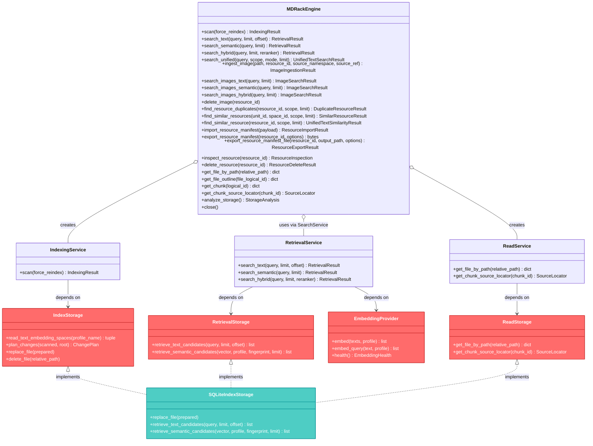

# Public interfaces

MDRack has two public entry points: the Click CLI and the embedded
`MDRackEngine`. Both compose the same canonical indexing and retrieval services,
but their total capability sets are not identical.

## Native temporal/media API (1.4.0rc3 candidate)

`await MDRackEngine.ingest_native_media(...)` / `search_native_media(...)` share
bounded actual CPU decoding and separate frames/image, audio and direct visual
video capabilities. Pure native builders keep canonical vector-only units with
nullable text and explicit temporal locators; app orchestration uses existing
source/CAS/read-session mechanisms. Registered `native ingest/search/query/capabilities` expose the same
family. Existing `read unit` handles its frame/segment IDs. Exact scope, precision,
policy budgets, public45/former40 prefix and explicit synthetic-only provider limits:
[native temporal v1](../contracts/native-temporal-v1.md),
[ADR-0017](../decisions/0017-native-temporal-preparation.md).
This is not live native inference, real-corpus/quality-cost or whole W5/W6 acceptance.

## Prepared/native image API (accepted 1.4.0rc2 slice)

`MDRackEngine.ingest_native_image` and `search_media(MediaSearchRequest)` are
versioned app routes with typed inputs, independent candidate scope, requested/
effective modes, nullable evidence and explicit score_kind. CLI adapters are
`image native-ingest` and `image native-search`. See the exact
[native image contract](../contracts/native-image-v1.md) and
[ADR-0013](../decisions/0013-native-image-contract.md).
The default LM Studio HTTP adapter still refuses pixels; explicit synthetic selection
tests orchestration only. Explicit trusted outer `CUDAEncoderProvider` injection and
`image native-* --provider external --host-config CONFIG` now have a bounded real
source/installed product qualification. The original v1 protocol supports image documents
and text-query-for-image; explicit `mdrack-cuda-retrieval-v2` additionally supports short
UTF-8 text DOCUMENT and one text QUERY capability over image/text candidates. Normal
catalog/import/search/public read/reopen and zero-encode same-image lexical enrichment
are exercised, with a fresh D hybrid query returning both image/text evidence.
See [ADR-0018](../decisions/0018-caller-owned-native-encoder.md), the
[original image result](../evaluation/native-image-product-2026-10-23.md) and
[latest text/image result](../evaluation/native-text-image-product-2026-10-24.md).
The additive ordinary-document surface is `MDRackEngine.ingest_native_text(...)`
plus new `native text-ingest` / `native text-search` CLI commands. It reuses the
canonical Markdown parser/chunker/provenance and the existing conditional
publication/Core graph owners; the user does not supply a prepared manifest,
vector, resource ID or private factory. Explicit prepared-manifest/import methods
remain available but are no longer described as the only text-document route.
Original opening joins read identity/whole_image with PUBLIC search locator/revision
and caller allowlist; read-unit coordinates remain redacted. Image-query/similarity,
document-vector reuse, legacy-space compatibility, audio/video model quality, default
or legacy method changes do not follow; corpus fitness remains separate.

The ordinary JPEG/PNG/WEBP image-document path now has bounded Windows WIC preparation:
EXIF orientation, white alpha and RGB PNG transport. With the explicit qualified
`mdrack-native-image-variable-v1` retrieval-v2 profile, oriented source dimensions reach
native `dyn_size` unchanged; legacy profiles keep fixed224 caller policy. Image-only
recipe/policy readiness is separate from shared/text-space identity. Reopen can avoid
another derivative/model call, but ready-CAS publication is not promised write-free.
See [geometry, limits and P04 qualification](../contracts/native-image-v1.md#ordinary-images-and-selected-native-geometry).
That new source-CLI/one-IMAGE result does not extend the older installed/text/QUERY
qualification to the changed producer/space or establish corpus/whole-release fitness.

## Prepared OCR enrichment

This first family is independently accepted on Windows/CPython 3.14.2 at source/
local-component and non-editable installed-package boundaries, not whole W4 or release.

The additive `ready_ocr_binding`, `prepare_ready_ocr`, `publish_ready_ocr` and
`enrich_ready_ocr` methods share `ReadyOCRService` with registered CLI
`resource ocr-binding` / `resource enrich-ocr`. The service checks a retained
caller-owned ready file, captures authority before I/O, and delegates dependency-
aware merging and bounded CAS to pure app logic over the existing neutral port.
It performs no extraction, embeddings or SQL. Lexical-only OCR enters real FTS;
read-only retention does not. Selected-source validation is explicit, and missing
legacy generations or unavailable host durability refuse. Native/independent graph
data survive normal source-validated ready image rescans. Exact new operation/error
exports, file grammar, result keys and remaining limitations are in
[ready OCR v1](../contracts/ready-ocr-v1.md) and
[ADR-0015](../decisions/0015-ready-ocr-publication.md).

## Prepared enrichment and preserving reindex

The broader [prepared enrichment v1](../contracts/prepared-enrichment-v1.md) adds
`prepare_enrichment` / `publish_enrichment` / `enrich_prepared`, real host archive
reads, and explicitly bound conditional reindex/withdraw operations. It consumes
ready OCR/text, transcript, frame captions and supplied vectors across all four intents;
it does not invoke extraction or inference. `DurableArtifactStore`,
`PreparedEnrichmentOperation` and `PreparedReindex` are additive exports after the
37 previously accepted names. See [ADR-0016](../decisions/0016-prepared-enrichment-and-artifact-custody.md).
This prepared component is independently accepted on Windows/CPython 3.14.2 at
actual Root/local-component and non-editable installed-package boundaries; W4-R2
is closed. Native inference, real-corpus quality/cost and release remain unqualified.

## Explicit catalog maintenance

Fresh `MDRackEngine.upgrade_catalog(backup_path, maintenance=True)` and CLI
`rebuild upgrade --backup <absent-outside-store> --maintenance` share one boundary.
All consumers must stop/close; only exact completed old-v2/0004 may upgrade to 0005.
Normal open never upgrades; target returns false, unsupported/damaged input refuses.
See [ADR-0014](../decisions/0014-conditional-publication-and-v2-upgrade.md).
Resource deletion boolean now also reports true when ending a withdrawn live lifecycle;
never-created/already-deleted remains false. Existing JSON keys do not change.

## Service and port relationships

`MDRackEngine` currently holds a compatibility `SearchService`, which delegates
directly to `RetrievalService`; the diagram names the canonical runtime service.

## CLI capability matrix

Live command registration exposes:

| Command | Current role |
|---|---|
| `init` | Create or verify the only application store, `<store>/catalog.sqlite3`, as clean schema `mdrack_sqlite_catalog_v2`. |
| `scan` | Change-detect and index Markdown with LM Studio or test-only fake composition where exposed. |
| `search` | Text, semantic, or hybrid retrieval. |
| `search --scope all\|notes\|audio\|video\|frames\|images` | Unified resource-level text retrieval from the fixed catalog. |
| `find-similar RESOURCE_ID` | Provider-free 1.2 textual whole-resource similarity by logical resource ID. |
| `read chunk` | Read a public logical chunk, optionally with neighbors. |
| `read file` | Read file metadata by public logical file ID. |
| `read outline` | Read deterministic heading records by public file logical ID; no raw section IDs are exposed. |
| `resource import`, `resource export`, `resource inspect`, `resource delete` | Prepared-resource lifecycle through the configured fixed catalog; no alternate `--catalog` path is registered. |
| `resource enrichment-binding`, `enrich-prepared`, `read-artifact` | Explicit ready-artifact binding, four lexical/dense intents and historical host-archive reads without inference or hidden catalog creation. |
| `resource publication-binding`, `reindex`, `withdraw` | Explicit conditional preserving reindex and projection withdrawal, distinct from unconditional whole-graph import. |
| `eval retrieval` | Privacy-safe ordinal retrieval-quality metrics against the configured fixed catalog. |
| `files list`, `files info` | List and inspect documents by public logical identity. |
| `status` | Counts, active profile details, and schema version. |
| `doctor` | Store, FTS, embedding, migration, and configuration diagnostics. |
| `rebuild fts` | Rebuild the manually maintained FTS projection. |
| `rebuild embeddings` | Recreate vectors for the active profile. |
| `image ingest`, `search`, `delete` | Explicit direct-image lifecycle against the fixed catalog; never triggered by Markdown scan. |
| `ingest raw-video SOURCE_PATH` | CLI-only ISO-BMFF raw-video adapter using an authorized stdin extractor; prepared `ingest video` and `MDRackEngine` remain unchanged. |
| `resources duplicates`, `similar` | Provider-free exact hash and existing-vector discovery with typed/facet scope filters. |
| `resources search` | Provider-free lexical search against the fixed catalog; target and scope filters are applied before limiting. |
| `resources facets`, `facets` | Deterministic facet listing, optionally narrowed by namespace. |
| `benchmark` | Provider-free local catalog verification timing and aggregate counts; this is not retrieval-quality evidence. |
| `storage-analyze` | Read-only allowlisted size/count analysis of the fixed catalog. |
| `model list`, `loaded`, `download`, `download-status`, `load`, `unload`, `switch` | LM Studio model discovery and lifecycle operations. |

CLI responses use the JSON envelope documented in
[CLI contracts](../cli-contracts.md). The CLI presentation layer also maps some
application degradation states to command errors; see [retrieval](retrieval.md).

## Explicit local-file adapters

`scan` is the Markdown-root path. The other local-file commands are explicit,
separate app adapters: `ingest text` prepares one strict UTF-8 text or Markdown
resource outside the scan root; `image ingest` prepares one direct image graph;
`ingest audio` accepts only authorized RIFF/WAVE input; and `ingest raw-video`
accepts only authorized ISO-BMFF `ftyp` input. Raw audio and video remain CLI-only;
the embedded engine exposes direct-image ingestion but no raw text, WAVE, or raw
video entry method.

These commands own local capture and, for WAVE/video, the explicitly supplied
shell-free stdin process. They must finish source validation and graph preparation
before calling `CoreIndexingService` through the logical-ID `ResourceWritePort`.
`mdrack_media` builds and validates prepared timed-media graphs without file,
provider, database, or network access. `mdrack_core` then validates the prepared
resource graph without performing file or subprocess work; `mdrack_sqlite` owns
the resulting generic catalog/search persistence. This boundary does not provide
built-in STT, a general media decoder, FFmpeg, or VLM capability.

## Embedded engine

`MDRackEngine` supports:

- scan with optional force reindex;
- text, semantic, and hybrid search;
- unified text search over notes, audio/video transcripts, frame captions, and image text;
- file lookup by relative path and canonical heading outlines by file logical ID;
- chunk lookup by logical ID;
- source-locator lookup;
- explicit direct-image ingest/search/delete;
- exact duplicate and whole-resource vector similarity discovery;
- provider-free unified textual whole-resource similarity by logical resource ID;
- active-catalog manifest-v1 import, atomic export to a caller-supplied destination, redacted inspection, and logical-resource deletion;
- prepared-artifact enrichment, explicit conditional preserving reindex/withdrawal, and historical host-owned artifact reads;
- read-only aggregate analysis of the fixed catalog;
- explicit or context-managed close.

It does not expose CLI `status`/`doctor`, model lifecycle, rebuild, or benchmark
methods. `analyze_storage()` is the separate read-only aggregate diagnostic API.

The separate Click-free `PreparedResourceCatalog` public facade opens one explicit
clean standalone catalog path and provides manifest import/export, redacted inspect/delete,
provider-free lexical/vector search with `unit|resource` targets, and deterministic
facet listing. It does not use `MDRackEngine`, the configured application store, providers,
source files, or the network.

The engine imports no Click modules. By default it composes
`CoreCompatibilityStorage` over the verified fixed clean-v2 catalog, while callers
may inject compatible storage/read/search ports and an embedding provider. The
retained direct `SQLiteIndexStorage` adapter is not a normal store-selection fallback.

### Injected indexing storage

[`IndexStorage`](../../src/mdrack/ports/storage.py) explicitly requires
`read_text_embedding_spaces(profile_name)`; `KnowledgeStorage`, the engine's
replacement-storage contract, inherits it. The read returns a tuple of existing
canonical `EmbeddingSpaceRecord` values or retained `LegacyTextEmbeddingBinding`
records. An empty tuple means authoritatively unbound, not unreadable/unknown.
It must retain unknown relevant app TEXT bindings and document projections that
scan can replace, while excluding unused/unrelated typed spaces; it never creates
or rewrites a store. The caller must supply this capability even for an empty or
providerless injected scan. An unsupported replacement fails closed; the application
never silently substitutes an on-disk catalog.

`CoreCompatibilityStorage` supplies the active canonical records.
`SQLiteIndexStorage.read_text_embedding_spaces` reads actual active legacy rows.
Its small immutable `LegacyTextEmbeddingBinding` carries `profile_name`,
`profile_fingerprint`, `vector_fingerprint` and `dimensions`; null/legacy markers
remain unknown, not manufactured canonical-space/codec metadata. The shared checker
requires exact recorded full fingerprints and dimensions. This is an application
port transport, not a new core DTO, persistence schema or migration.

`IndexingService.scan`, the embedded facade and the legacy wrapper use the same
[TEXT admission rule](indexing-and-chunking.md#text-profile-admission) before run,
traversal or writes. The optional search read-session factory is a separate
consistency capability; providing it alone does not satisfy this mandatory read.

The additive 1.2 unified search contract is documented in
[v1.2 unified text search](../contracts/v1.2-unified-search.md). It uses typed
resource scopes and portable evidence only; `frames` is query-search-only and is
not a resource-level similarity scope.

## Identity and DTO boundary

Public retrieval and read-chunk results prefer logical IDs. `chunk_id` and read
`id` remain compatibility aliases equal to the logical ID. `SourceLocator`
contains no absolute path. `heading_path` is serialized as a JSON array.

The normal `files` and `read` groups use logical resource/unit identities. Raw
SQLite row IDs are not a public application contract.

New image/resource results contain only logical resource/unit/representation IDs,
stable ranks/scores/degradation categories, and portable source references. They
never expose SQLite row IDs, local paths, caption/OCR text, vectors, facet values,
provider bodies, or raw exception strings. `mdrack.public_api` re-exports the
engine, compatibility retrieval DTOs, image result/config protocols, and resource
discovery scope/results. The explicit prepared-resource catalog facade and its safe
result/error records are published from `mdrack.application.resource_catalog` without
widening the frozen compatibility `mdrack.public_api.__all__`; pure generic core DTOs
remain under `mdrack_core`.

## Primary source anchors

- CLI registration: `src/mdrack/cli/__init__.py`
- CLI command implementations: `src/mdrack/cli/commands/`
- Engine: `src/mdrack/public_api/engine.py`
- Services: `src/mdrack/application/indexing.py`,
  `src/mdrack/application/retrieval.py`, `src/mdrack/application/query.py`
- Ports: `src/mdrack/ports/storage.py`, `src/mdrack/ports/embeddings.py`
- Shared DTO: `src/mdrack/domain/retrieval.py`
- Image API DTOs: `src/mdrack/ingestion/images.py`
- Resource discovery DTOs: `src/mdrack/application/resources.py`
- Pure core exports: `packages/mdrack-core/src/mdrack_core/__init__.py`

The machine-readable owner/version/deprecation/removal/install inventory for the
v0.4 development surface is
[`docs/compatibility/v0.4-public-surface-ledger.json`](../compatibility/v0.4-public-surface-ledger.json).

The CLI additionally exposes `ingest text` for one explicit raw local source.
This is intentionally not an `MDRackEngine` method in R1; retrieval uses the
existing unified text CLI/engine surface and reports `raw_text` resources with
portable raw-source span locators.

The CLI also exposes `ingest audio SOURCE_PATH --source-ref REF
--allow-external-stt --stt-command EXECUTABLE` for bounded RIFF/WAVE input.
This is intentionally not an `MDRackEngine` method. The executable receives
the private source snapshot on stdin and must return strict timed-transcript
JSON; the command persists no raw audio and reports no path, command, source
reference, transcript, or exception details.
