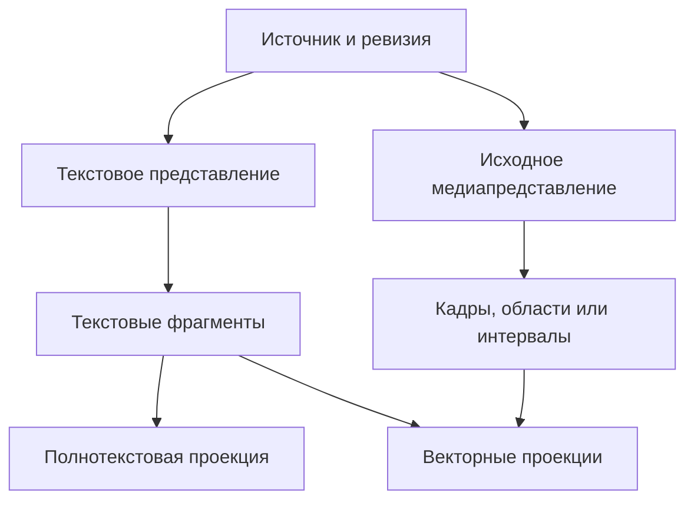
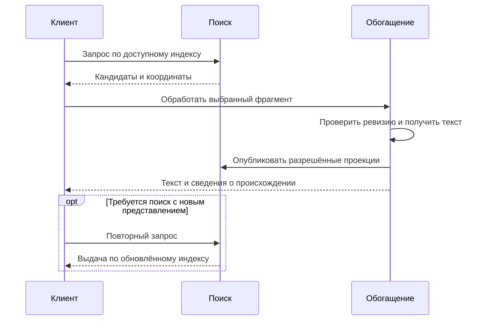
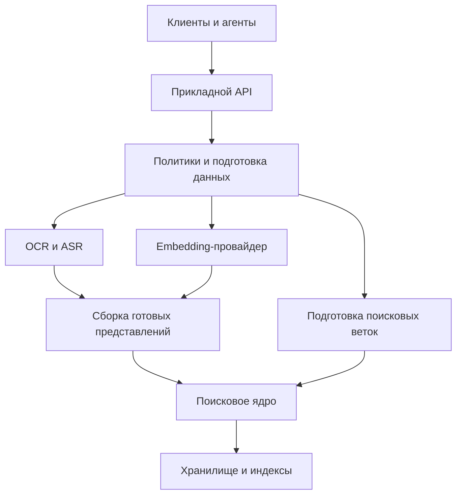
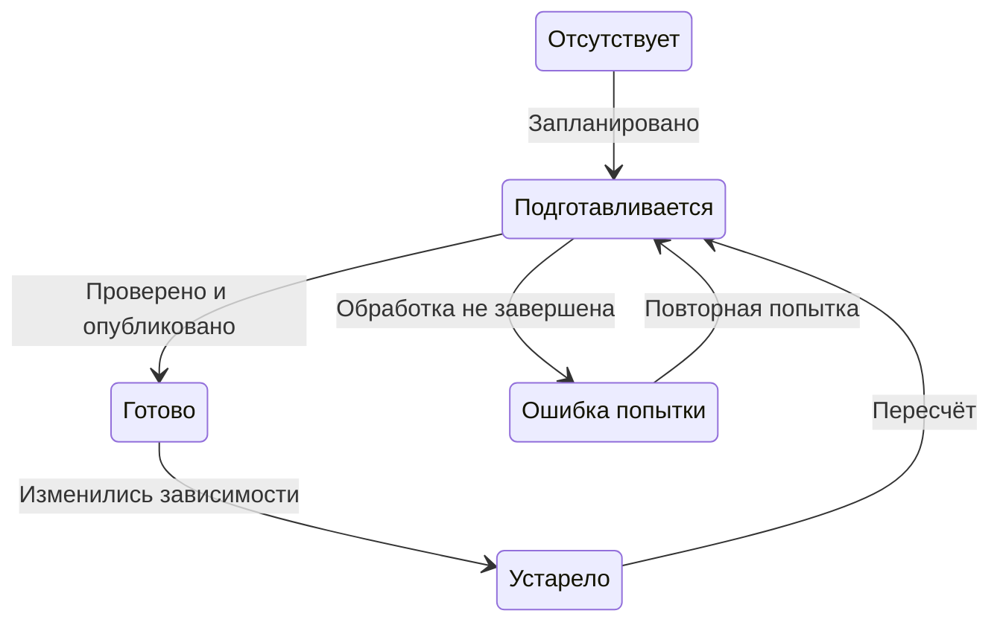

# Поиск с поздним обогащением

## Граница применения в MDRack

Это полный перенос технической концепции редакции 1.0 от 20 октября 2026 года.
Её переносимые примеры нескольких индексов и необязательного reranker не меняют
локальную политику MDRack: SQLite-only, LM Studio HTTP, без production reranker,
без прямой загрузки моделей и без пустого `PreparedResourceBatch`.
Конкретизация: [архитектура №02](02-mdrack-architecture-and-contracts.md),
[приёмка №04](04-mdrack-acceptance-quality-and-observability.md),
[программа №03](03-mdrack-implementation-and-migration-plan.md).

## Основная идея 💡

**Материал может стать доступным для поиска раньше, чем для него будут подготовлены все представления выбранного плана обработки.** Изображение получает прямой вектор без обязательного OCR. Аудиофрагмент индексируется без обязательной расшифровки. Позднее к тому же источнику добавляются текст, подписи, дополнительные векторы и более точные координаты.

Такой подход разделяет две характеристики: **доступность материала для определённого поиска** и **полноту его обработки**. Первая не обязана ждать второй. При этом сама готовность всегда относится к конкретной возможности: материал может находиться по смыслу, но пока не поддерживать поиск точной фразы или выдачу читаемой цитаты.

Текст сохраняет большую ценность. Он удобен для полнотекстового поиска, чтения, редактирования, экспорта и работы с системами, принимающими только текстовый вход. Однако текст становится одним из представлений источника, а его обязательность определяется выбранным сценарием.

> [!abstract] Центральный принцип
> Источник существует независимо от расшифровки. Поиск использует доступные и разрешённые представления. Обогащение создаёт новые представления и расширяет возможности, сохраняя идентичность источника и связь с оригиналом.

В статье предлагается переносимая архитектурная модель для библиотек документов, медиакаталогов, систем знаний и поиска, доступного программным агентам. Выбор базы данных, модели, языка реализации и транспорта остаётся за конкретной системой. Примеры контрактов иллюстрируют смысл границ; они не являются спецификацией готового SDK.

Здесь **позднее обогащение** означает получение дополнительных представлений после первоначального приёма материала. Этот термин не обозначает позднее объединение результатов, позднее взаимодействие токеновых векторов или специальную технику разбиения текста. Эти методы относятся к другим решениям и могут использоваться независимо.

## Что именно ищет система 🔎

### Поиск через текстовое представление 📝

В текстовом маршруте исходные заметки и документы поступают в embedding-модель непосредственно. Изображения сначала превращаются в OCR, подписи или описания, а речь — в расшифровки. Затем все эти тексты участвуют в смысловом поиске.

Это полноценный семантический поиск по содержанию материалов, представленному словами. Его предел определяется качеством и полнотой полученного текста. Если в описании картинки отсутствует важная деталь, улучшение текстовой embedding-модели само по себе её не восстановит.

Текстовые производные также различаются. OCR пытается сохранить символы, ASR — произнесённые слова, описание изображения — пересказать визуальное содержание. Краткое резюме сжимает смысл ещё сильнее. Эти представления полезны для разных задач и не должны подменять друг друга.

### Прямое мультимодальное встраивание 🖼️

При прямом, или нативном, встраивании модель получает поддерживаемое медиа и строит его вектор без обязательного внешнего этапа перевода содержания в текст. Согласованные текстовые и медиапредставления позволяют выполнять перекрёстный поиск. Работы по совместному обучению изображений с текстом и аудио с текстом демонстрируют сам принцип таких пространств; они не гарантируют одинаковое качество всех направлений поиска для произвольной модели. [1], [2]

**«Без распознавания» не означает «без подготовки входа».** Остаются чтение файла, декодирование, изменение разрешения, подготовка аудиосигнала, выбор кадров и деление длинного материала на фрагменты. Отсутствует отдельная обязательная стадия, создающая читаемый OCR, транскрипт или описание.

Также не следует обещать, что внутри провайдера вообще нет операций, похожих на распознавание. Для архитектуры существенен внешний контракт: какие данные передаются, какие артефакты возвращаются и требуется ли системе отдельный текст для индексирования.

### Полнотекстовый, векторный и гибридный поиск 🔎

Текстовый и мультимодальный маршруты описывают **способ подготовки смысловых представлений**. Полнотекстовый и векторный поиск описывают **поисковые каналы**. Поэтому «текстовый», «мультимодальный» и «гибридный» не являются тремя взаимоисключающими режимами.

Полнотекстовый поиск использует слова и другие единицы, выделенные токенизатором. Он может поддерживать фразы, префиксы и логические условия. Но поиск по словам не равен точному сравнению исходных байтов: поведение для регистра, морфологии, дефисов и символов кода зависит от настроек. Для строгого поиска идентификатора или последовательности символов может потребоваться отдельный буквальный канал. Эти различия хорошо видны в документации полнотекстовых индексов. [3]

Векторный поиск использует близость представлений. Его входом может быть текст, изображение или аудио — если выбранная модель и адаптер поддерживают соответствующий сценарий.

Гибридный поиск объединяет доступные каналы. Например, изображение может иметь прямой медиавектор, а его OCR — участвовать только в полнотекстовом индексе. Это уже гибридная конфигурация, хотя отдельный вектор OCR не построен.

> [!note] Извлечение текста и его встраивание независимы
> Получить расшифровку, сохранить её, включить в полнотекстовый поиск, построить по ней вектор и использовать этот вектор в конкретном запросе — разные решения.

## Модель данных: источник, представления и фрагменты 🧱

Гибкость начинается с различения исходного материала и способов доступа к его содержанию. Если каждый результат OCR, кадр и вектор превращаются в несвязанные самостоятельные документы, позднее обогащение быстро приводит к дубликатам и потере происхождения.

| Понятие | Смысл |
| --- | --- |
| **Источник** | Логический объект: заметка, изображение, аудиозапись, видео или документ |
| **Ревизия источника** | Конкретное состояние содержимого; изменение пути само по себе не обязательно означает изменение содержимого |
| **Представление** | Исходный текст, медиаданные, OCR, транскрипт, описание или другая производная форма |
| **Поисковый фрагмент** | Ограниченная единица поиска: абзац, страница, изображение, область, кадр или временной интервал |
| **Происхождение** | Связь представления с источником, его ревизией и процессом получения |
| **Пространство векторов** | Контракт совместимых embeddings и правил подготовки входов |
| **Поисковая проекция** | Запись представления в конкретном индексе: полнотекстовом, векторном или ином |
| **Основание совпадения** | Найденный фрагмент, участвовавшее представление и ссылка на проверяемое содержимое |



На схеме показаны возможные связи. Их наличие определяется профилем: аудиозапись без ASR может иметь только медиаветку, а обычная заметка — только текстовую. Векторные проекции разных фрагментов могут принадлежать одному согласованному пространству.

Поле текста у медиапредставления допускает отсутствие значения. Оно не заполняется именем файла, искусственной заглушкой или автоматически выдуманной подписью ради совместимости с текстовым интерфейсом. Имя файла и пользовательская подпись могут индексироваться отдельно, с собственным происхождением.

Для поискового канала существуют простые условия готовности. Полнотекстовой проекции нужен пригодный текст. Векторной проекции нужен совместимый вектор. Открытию результата нужна действительная ссылка на источник и координаты. Зарегистрированный источник без готовых проекций может присутствовать в каталоге, но его поисковое покрытие должно описываться честно.

### Один источник может иметь много представлений 🧩

У одного изображения могут появиться прямой вектор, OCR и пользовательская подпись. У аудиозаписи — временные интервалы, транскрипт, исправленный транскрипт и краткое содержание. Всё это связано с одним источником, но не обязано объединяться в единственную текстовую строку.

Само представление и его поисковые фрагменты тоже не совпадают автоматически. Расшифровка часовой записи может быть одним артефактом, а для поиска использоваться десятками интервалов. Текстовые и акустические границы могут различаться; их связывают координаты в исходной записи.

Для такого связывания необязательно немедленно строить сложную онтологию. Достаточно явных идентификаторов, ревизий, вида производного содержимого и ссылок на исходник. Общая идея отделять сущность, процесс получения и происхождение согласуется с моделями provenance. [4]

### Оригинал остаётся необходимым активом 📦

Вектор не заменяет исходный материал. Из него нельзя надёжно восстановить точную расшифровку, изображение или произвольную деталь, которая понадобится позднее.

Следовательно, система позднего обогащения сохраняет оригинал либо обеспечивает устойчивый доступ к нему. Если оригинал недоступен, уже готовые проекции могут оставаться полезными, но создание новых представлений и проверка результата становятся ограниченными возможностями.

## Три профиля без размножения конвейеров 🎛️

Профиль объединяет решения в понятное поведение. Он не требует отдельного поискового движка и отдельной реализации всех операций.

| Профиль | Основной смысловой маршрут | Роль производного текста |
| --- | --- | --- |
| **Через текст** | Исходный текст и текстовые производные встраиваются текстовой моделью либо текстовым путём мультимодальной модели | Для смыслового поиска по содержимому медиа текст нужен; он также может использоваться в FTS |
| **Прямой мультимодальный** | Обычные тексты и поддерживаемые медиа встраиваются непосредственно | По умолчанию новый OCR/ASR не создаётся; использование уже готовых текстов определяется отдельно |
| **Мультимодальный с текстовым обогащением** | Медиа получает прямые векторы; обычные тексты встраиваются как текст | OCR/ASR добавляет чтение и FTS; дополнительные векторы производного текста включаются по необходимости |

В первом профиле изображение без текста может оставаться доступным по имени или тегам, но не получает полноценный смысловой поиск по своему содержимому только от факта регистрации. Во втором и третьем профиле отсутствие расшифровки не мешает готовому прямому медиавектору участвовать в поиске.

Это готовые наборы настроек с разными значениями по умолчанию. Второй профиль начинает с прямого встраивания, третий дополнительно предусматривает получение текста по запросу или автоматически. Они используют одну структуру данных и могут давать одинаковое поведение, если их конкретные настройки совпадают. Переход между ними означает изменение политики, а не замену движка.

**Обычные текстовые материалы остаются текстом во всех профилях.** Выключение распознавания медиа не выключает embeddings заметок и не лишает их полнотекстового индекса.

### Политика создания текста ⏱️

Распознавание может быть выключено, запускаться по запросу или выполняться автоматически для выбранных материалов. Эти варианты относятся к планированию обработки, а не создают новые виды поискового ядра.

Политика по запросу полезна, когда требуется расшифровать найденный отрывок или прочитать надпись на выбранной картинке. Автоматическая политика подходит корпусам, где текст регулярно нужен для дальнейшей работы. Приоритет и бюджет позволяют сначала обрабатывать новые, часто используемые или ещё недостаточно покрытые материалы.

Для изображений, речи и описаний могут действовать разные рецепты. Например, автоматический ASR не обязан включать генерацию описаний всех изображений. Распознавание символов и генерация пересказа визуальной сцены также являются разными обработчиками.

### Создание нового текста и использование готового 📄

Фраза «без распознавания» неоднозначна без уточнения. Она может означать запрет новых вычислений или исключение всех результатов прежнего распознавания из поиска.

| Решение | На что влияет |
| --- | --- |
| Не создавать новый OCR/ASR | На будущие вызовы обработчиков |
| Использовать уже готовую расшифровку | На выбор доступных представлений |
| Хранить текст только для чтения | На доступ к артефакту после нахождения |
| Включить текст в FTS | На получение лексических кандидатов |
| Получить вектор текста | На наличие дополнительной смысловой проекции |
| Исключить производный текст из запроса | На конкретный план поиска, без обязательного удаления артефактов |

Эти решения существуют внутри профиля. Интерфейс может показывать три готовых режима и небольшое число понятных действий, сохраняя подробные параметры для программного API и воспроизводимых экспериментов.

> [!important] Строгий режим для сравнения
> При проверке поиска без производного текста должны быть исключены и ранее построенные OCR/ASR-проекции. Выключение новых вызовов распознавания само по себе не делает эксперимент независимым от старых расшифровок.

### Когда нужен дополнительный вектор расшифровки 🧮

Вектор OCR или транскрипта полезен, если он приносит релевантные кандидаты, которые теряет прямой медиаканал. Это отдельная гипотеза качества, а не техническая обязанность.

Минимальный мультимодальный профиль может включать прямые векторы медиа и FTS по производному тексту. Расширенный профиль добавляет смысловые векторы производного текста той же модели. Исходные текстовые заметки при этом продолжают индексироваться независимо от данного расширения.

Внутреннее имя настройки должно отражать именно производный текст, например `derived_text_dense`. Общее имя вроде `text_embeddings` легко создаёт ошибочное впечатление, что отключаются также векторы обычных документов.

### Пример согласованного профиля ⚙️

Ниже показан один условный профиль. Он использует прямые медиавекторы, не запускает распознавание автоматически и допускает уже существующий производный текст только в лексическом канале.

```yaml
profile_id: native_with_optional_text
embedding_profile: multimodal_v1
media_route: native

text_extraction:
  corpus: on_demand
  query: "off"

derived_text:
  use_existing: true
  lexical: true
  dense: false

retrieval:
  source_text_dense: true
  native_media_dense: true
  available_text_lexical: true
```

Параметры `corpus` и `query` различают обработку индексируемого материала и самого поискового запроса. Значение `on_demand` разрешает отдельную операцию обогащения, но обычный поиск не запускает её скрытно.

Профиль компилируется в небольшой проверяемый план: допустимые входы, нужные представления и активные каналы. Несовместимая комбинация, например прямой аудиомаршрут с провайдером только для текста, отклоняется до начала обработки. В расширяемой системе это проверка возможностей, а не длинная цепочка специальных условий внутри поискового ядра.

## Текстовые представления: полезность и цена ⚖️

Наличие текста расширяет способы работы с материалом, но не делает каждый поиск автоматически лучше. Его ценность зависит от задачи, качества извлечения и последующей политики использования.

| Аспект | Без обязательного текста | С текстовым представлением |
| --- | --- | --- |
| Начальная обработка | Не требуется отдельный обязательный проход OCR/ASR | Добавляется работа по получению текста |
| Смысловой поиск | Использует поддерживаемые признаки исходного медиа | Может дополнительно использовать выраженное словами содержание |
| Поиск слов и фраз | Доступен по существующим текстам и метаданным; не по нераспознанному содержимому | Доступен по OCR/ASR в пределах качества распознавания и индекса |
| Чтение и цитирование | Обычно требуется открыть или воспроизвести оригинал | Есть читаемый артефакт; дословность всё равно требует проверки |
| Работа текстового агента | Может потребоваться дополнительное преобразование выбранного материала | Текст можно передать непосредственно |
| Ошибки обработки | Нет ошибок отдельного текстового распознавателя, но остаются ошибки медиапредставления | Добавляются возможные пропуски, неверные слова и ошибки описания |
| Повторное использование | Часто нужен исходник и совместимый медиапровайдер | Текст можно использовать в других задачах и индексах |
| Сопровождение | Меньше производных артефактов | Нужны версии, актуальность и сохранение пользовательских исправлений |

### Что теряется при переводе всего в текст 🖼️

Подпись может опустить пространственное отношение, цвет, внешний вид интерфейса или второстепенный объект. Расшифровка речи обычно не предназначена для подробного сохранения музыки, шумов и характера звучания. Пересказ слайда может потерять точные подписи и связи.

Поиск через текст ограничивается сохранённым содержанием. Однако этот недостаток не делает текстовый маршрут ошибочным: для запросов по словам, объяснениям и цитатам он может быть самым прямым и удобным представлением.

### Что теряется без текста 🎧

Прямой вектор не предоставляет читаемую расшифровку. Совпадение изображения по смыслу не гарантирует точного распознавания мелкого идентификатора. Близость аудиофрагментов не гарантирует совпадения диктора, мелодии или интонации.

Для программного агента также различаются «найти источник» и «получить содержимое, пригодное для ответа». Возможность первой операции не означает автоматической готовности второй.

### Текстовые производные имеют разный уровень точности 🧾

OCR, ASR, нормализованная расшифровка, пользовательская правка и сгенерированное описание должны сохранять различимое происхождение. Исправленный текст может быть удобнее исходного распознавания, но результат, претендующий на дословную цитату, должен опираться на соответствующий артефакт и оригинал.

Генерируемое описание особенно важно не выдавать за буквальное содержимое. Оно может быть полезной поисковой подсказкой, сохраняя статус интерпретации.

> [!tip] Практический критерий выбора
> Текст оправдан там, где регулярно нужны слова, цитаты, чтение, экспорт или совместимость с текстовыми инструментами. Прямое встраивание оправдано там, где полезная информация остаётся в медиа либо обязательное распознавание мешает доступности поиска. Эти основания могут одновременно действовать для одного источника.

## Позднее обогащение как жизненный цикл 🌱

Позднее обогащение позволяет разделить первоначальное покрытие корпуса и последующее повышение его полезности. Система сначала публикует допустимые готовые представления, затем добавляет другие по мере необходимости.

Порядок не фиксирован: сначала может работать полнотекстовый поиск по готовому документу, а позднее появиться его векторная проекция. Обогащение также не ограничивается текстом. Дополнительные области изображения, кадры видео или более узкие аудиоинтервалы могут повысить подробность поиска без получения расшифровки.

У этого подхода несколько форм. Их различие важно, поскольку они влияют на поиск в разные моменты.

### Обогащение корпуса после первичной индексации 🗂️

Источник получает базовые проекции. Позднее фоновое задание создаёт OCR, расшифровку или дополнительное представление. После публикации новая проекция участвует в следующих запросах.

Такой порядок позволяет планировать работу по приоритетам и бюджету. Например, сначала получить прямые векторы изображений, затем обработать текстонасыщенные материалы, а большие аудиозаписи распознавать в отдельной очереди. Это пример политики, а не требование обрабатывать каждую коллекцию именно так.

Если прямой вектор построен независимо от текста, появление OCR само по себе не требует пересчитывать этот вектор. Добавляется новая ветка данных. Если же embedding получен из совместного входа «изображение плюс подпись», изменение подписи делает устаревшим именно это совместное представление.

### Обогащение выбранного источника по запросу 👆

Пользователь или агент выбирает материал и запрашивает конкретное действие: распознать страницу, расшифровать интервал, получить описание. Область обработки ограничена источником или его фрагментом.

Операция сначала проверяет наличие актуального результата. При совпадающих ревизии исходника и рецепте обработки повторный запрос может использовать готовый артефакт. Принудительная повторная обработка, например другой моделью, оформляется как отдельное намерение.

Для системы это обычное расширение набора представлений. Материал не нужно повторно импортировать под новой идентичностью.

### Обогащение уже найденных результатов 🔍

Первый поиск возвращает кандидатов по доступным проекциям. Затем выбранные кандидаты получают более подробное представление для чтения, объяснения или дальнейшей проверки.

Например, прямой аудиопоиск возвращает нужный минутный интервал. После этого ASR создаёт его расшифровку. Такая схема может сократить объём распознавания для задачи, где нужен небольшой отрывок из большой коллекции.



> [!warning] Ограничение первого набора кандидатов
> Распознавание найденных материалов помогает их прочитать и проверить. Оно не возвращает автоматически источники, которые первый поиск пропустил. Чтобы новый текст стал поисковым представлением самого источника, его включают в соответствующий индекс и выполняют поиск повторно. Использование полученного текста для уточнения следующего запроса — отдельный сценарий, не требующий индексирования этого артефакта.

Из этого следует ограничение стратегии «обогащать только популярные найденные материалы». Она может всё лучше обслуживать уже заметную часть корпуса и почти не улучшать доступность остальных источников. Полезно отдельно планировать обработку ещё не покрытых или редко обнаруживаемых материалов и измерять их долю.

### Обогащение запроса 🎙️

Изображение или аудио могут быть не только документом корпуса, но и поисковым запросом. OCR картинки-запроса или ASR голосового запроса создают текст для лексического канала, не меняя при этом сам корпус.

Полученный текст можно также встроить выбранной моделью и использовать как смысловой запрос к совместимому индексу. Прямой медиазапрос, текстовый вектор и лексический запрос являются отдельными поисковыми ветками; их включение определяется политикой.

Поэтому допустима конфигурация «корпус индексируется без распознавания, голосовой запрос дополнительно распознаётся». Она отличается от полностью прямого мультимодального маршрута и должна быть явно отражена в политике.

Обогащение запроса влияет на задержку каждого обращения. Оно может вносить ошибки, повторно использовать кэш и существовать вместе с прямым вектором запроса. Его выбор нельзя автоматически выводить из того, как обрабатывались документы.

### Что означает «поиск уже доступен» 🟢

Готовность базового индекса означает, что определённые запросы могут выполняться по определённым представлениям. Она не обещает полного покрытия исходного файла.

Результат может сообщать: прямые медиавекторы доступны, текст не получен, временные координаты известны с точностью до выбранных интервалов. Это содержательное описание возможностей. Общий процент обработки полезен для прогресса, но не заменяет такую информацию.

## Одна модель, совместимые пространства и много векторов 🧭

### Единая embedding-модель не требует второго текстового энкодера 🔗

Мультимодальная модель с согласованными выходами может обслуживать исходные заметки, тексты OCR/ASR, изображения и аудио. На уровне приложения это один выбранный embedding-профиль. Внутри модели при этом могут существовать разные модальные компоненты и разные процессы подготовки входов.

Текстовый путь модели не начнёт понимать аудио от передачи имени файла вместо содержимого. А наличие способности в модели ещё не гарантирует её доступность через конкретный endpoint, библиотеку или адаптер.

В контракте провайдера поэтому различаются принимаемые входы, доступные режимы получения вектора, ограничения и проверенные поисковые сценарии.

### Совместимость определяется контрактом 📐

У векторного пространства должны быть устойчивый идентификатор и описание совместимости. Обычно учитываются модель и её ревизия, размерность, способ нормализации, проекция, правила подготовки входа и роли запроса и документа.

Одинаковое количество координат не делает векторы разных моделей совместимыми. Изменение размерности, инструкции или обработки входа также может требовать нового пространства либо явно проверенного преобразования.

Совместимость не означает одинаковое буквальное форматирование запросов и документов. Для асимметричного retrieval модель может требовать одну инструкцию для запроса и другую для документа. Для симметричной похожести может использоваться другой согласованный режим. Такие различия явно описываются в документации embedding-моделей. [5]

**Один профиль по умолчанию — разумная отправная точка.** Поддержка нескольких пространств полезна для миграции и специальных задач, но не должна превращать две одновременно работающие модели в обязательное условие мультимодальности.

### Отдельные и совместные представления 🧩

Отдельные векторы изображения, OCR и подписи сохраняют независимость этих представлений. Можно добавить текст позднее, отключить его канал или заменить распознаватель, не меняя независимо вычисленный визуальный вектор.

Совместный embedding получает сочетание входов как единое содержимое. Он может быть полезен, когда смысл определяется комбинацией, например изображением вместе с поясняющим абзацем. При изменении любого входящего компонента такая проекция требует проверки актуальности.

Механическое среднее векторов не эквивалентно совместному кодированию содержимого моделью. Ни один из этих способов сам по себе не заменяет явных связей между источниками.

| Представление | Что сохраняет | Цена изменения |
| --- | --- | --- |
| Отдельный вектор медиа | Самостоятельный поисковый сигнал исходного медиа | Пересчитывается при изменении соответствующего входа или embedding-рецепта |
| Отдельный вектор текста | Самостоятельный смысловой сигнал текстового артефакта | Пересчитывается при изменении текста или его embedding-рецепта |
| Совместный вектор медиа и текста | Смысл выбранной комбинации | Зависит от актуальности обоих входов |
| Агрегат нескольких векторов | Приближённую характеристику набора по явному правилу | Зависит от состава набора и рецепта агрегации |

### Гранулярность определяет обнаружимость и координаты ⏱️

Вектор всего длинного материала может быть полезен для общей тематической близости. Для поиска конкретной детали обычно нужны более узкие единицы.

У изображения это могут быть целая картинка и выбранные области. У видео — кадры или короткие клипы. У аудио — временные интервалы. У документа — страницы и смысловые фрагменты. Перекрытие интервалов может уменьшать потери на границах, но увеличивает число проекций и близких дубликатов.

Границы и преобразования сохраняются относительно исходника: временная шкала, номер страницы, область изображения, поворот и масштаб при необходимости. Поиск не должен возвращать точность координат, которой фактически не было при подготовке материала.

## Перекрёстные запросы и поиск похожего 🔀

Тип запроса и тип искомого объекта независимы. Текст может искать изображения; изображение — заметки; аудиофрагмент — другие записи. Для этого нужны совместимый путь кодирования и область кандидатов, соответствующая намерению запроса.

| Сценарий | Что требуется от системы | Что не следует обещать автоматически |
| --- | --- | --- |
| Текст → текст | Подходящее текстовое представление и retrieval-профиль | Сохранение точных символов в смысловом векторе |
| Текст → изображение | Согласованный текстовый запрос и визуальный индекс | Надёжное нахождение любой мелкой надписи |
| Изображение → текст | Визуальный вход запроса и совместимый текстовый корпус | Одинаковое качество с обратным направлением |
| Изображение → изображение | Подходящий визуальный режим сравнения | Точную проверку дубликатов или авторства |
| Текст → аудио | Совместимый аудиоиндекс и нужная гранулярность | Одновременно высокое качество для смысла речи, музыки, событий и голоса |
| Аудио → текст или аудио | Поддерживаемое кодирование запроса и ясная цель сравнения | Распознавание личности диктора по универсальной смысловой близости |
| Изображение ↔ аудио | Реально согласованный и проверенный межмодальный маршрут | Качество, выведенное только из успешных текстовых тестов |

Модель может принимать оба типа входа, но это ещё не делает любой запрос между ними полезным. Поддержка формата, математическая совместимость векторов и подтверждённое качество поиска являются разными характеристиками.

### Два семейства операций 🧰

Для внешнего API достаточно разделить поиск по предоставленному запросу и поиск похожего по существующему источнику или фрагменту.

В первом случае система получает содержимое запроса: текст, изображение или аудиоинтервал. Во втором — ссылку на уже зарегистрированный материал и основание сравнения. Это позволяет выразить нужные направления без отдельных независимых подсистем для каждой пары модальностей.

При поиске похожего сохранённый вектор источника переиспользуется, если это соответствует выбранному профилю. В противном случае его содержимое кодируется в предусмотренной роли запроса. Решение об отдельном индексе для специальной симметричной похожести принимается по задаче и замерам, а не автоматически для любого вызова «найти похожее».

### Сходство целого и сходство фрагмента 🎯

«Найти материалы на ту же тему» и «найти место, похожее на этот отрывок» требуют разной гранулярности. Общий вектор длинной записи может сгладить небольшой, но важный эпизод. Набор векторов всех её интервалов, напротив, способен породить слишком много конкурирующих результатов.

Поэтому запрос явно определяет, сравнивается ли материал целиком, выбранный фрагмент или ограниченный набор фрагментов по заданной политике. Сам исходный объект исключается из выдачи похожего, если задача не предполагает его повторного показа.

### Связанные материалы сохраняют собственную идентичность 📎

Заметка и вложенное изображение — разные источники со связью между ними. Одно изображение может использоваться в нескольких заметках, а одна заметка — ссылаться на множество вложений.

Найденное вложение может показываться самостоятельно или в контексте связанных документов. В последнем случае результат должен различать «совпало содержимое документа» и «совпало изображение, на которое документ ссылается».

Связь хранится явно. Усреднение вектора заметки со всеми вложениями не требуется для того, чтобы знать, где используется картинка. Подпись и соседний абзац могут стать контекстным представлением вложения, сохраняя происхождение от соответствующей заметки и её ревизии.

## Объединение результатов без обязательного переранжировщика ⚖️

Гибридный поиск начинается с получения кандидатов по активным каналам. Затем применяются согласованная политика объединения и группировка результатов. Отдельная модель переранжирования может быть добавлена для конкретной задачи, но не является условием работы описанной архитектуры.

Численные оценки каналов нельзя считать одной шкалой только потому, что они представлены числами. Оценка полнотекстового поиска, cosine similarity и результат другой embedding-модели имеют разный смысл. Даже в общем пространстве распределения близости для разных модальностей могут требовать раздельной проверки.

Один из способов объединения — Reciprocal Rank Fusion, использующий позиции кандидатов. Для архитектуры удобно записать его взвешенный вариант:

$$
S(d) = \sum_{c \in C_d} \frac{w_c}{k + r_c(d)}
$$

Здесь `d` — кандидат, `C_d` — каналы, в которых он присутствует, `r_c(d)` — его позиция начиная с единицы, `w_c` — вес канала, а `k` — положительная константа сглаживания. Отсутствие кандидата в списке не даёт вклада. Базовая идея RRF и её экспериментальная проверка изложены в оригинальной работе; веса и выбор каналов относятся к политике конкретной системы. [6]

### Больше представлений не означает больше независимых голосов 🗳️

OCR, описание и прямой вектор одной картинки могут находить один и тот же объект. Несколько почти одинаковых кадров могут описывать один слайд. Без группировки они вытеснят другие полезные результаты.

Система определяет единицу объединения: фрагмент, источник или связанный родительский материал. Внутри канала ограничиваются повторы, между каналами сохраняются разные основания совпадения. При разделении одного сигнала на несколько веток учитывается общий бюджет их влияния.

Это особенно важно для позднего обогащения. Если каждая новая проекция автоматически получает полный дополнительный голос, обогащённые источники начинают выигрывать только из-за количества обработки.

### Фильтры и бюджет кандидатов 🚪

Область поиска задаёт коллекции, типы источников, теги и другие ограничения. Они должны учитываться при получении кандидатов и расчёте доступного top-k. Схема, которая сначала выбирает несколько лучших результатов по всему корпусу, а затем отбрасывает неподходящие, может потерять нужные материалы.

Если кандидаты берутся по фрагментам, а показываются по источникам, их число подбирается с учётом последующей группировки. Иначе множество фрагментов одной записи займёт бюджет, рассчитанный как будто на разные записи.

При отказе одного канала остальные могут продолжить поиск в рамках заранее определённой политики. Отсутствующий канал отражается в результате. Его нельзя молча заменять запрещённым распознаванием или несовместимым провайдером.

> [!note] Объединение требует проверки
> Добавление OCR, новых векторов или новой ветки может улучшить полноту и одновременно ухудшить первые позиции. Настройка объединения проверяется на итоговой выдаче, а не только на качестве каждого канала по отдельности.

## Модульные границы системы 🔌

Поисковое ядро получает подготовленные данные и выполняет поиск. Обработчики получают новые представления. Прикладной слой выбирает допустимые действия, организует их выполнение и публикует результаты.



Диаграмма показывает обязанности, а не обязательное количество процессов. Все блоки могут начинать работу в одном приложении.

**Подготовка медиа** отвечает за декодирование, фрагменты и координаты. **Обработчики обогащения** возвращают текстовые или другие производные артефакты. **Embedding-провайдер** выдаёт векторы по согласованному контракту. **Поисковое ядро** работает с подготовленными проекциями и ветками. **Прикладной слой** владеет политикой, состоянием заданий, повторными попытками и публикацией.

Пользовательский интерфейс и агентный адаптер обращаются к одному прикладному API. Они не должны самостоятельно дублировать выбор моделей, правила смешивания оценок и логику актуальности.

### Небольшой набор устойчивых контрактов 📋

| Контракт | Что необходимо определить |
| --- | --- |
| Источник | Идентичность, тип, ссылка и ревизия содержимого |
| Представление | Собственная идентичность и ревизия, источник и его ревизия, вид, происхождение, текст или ссылка на артефакт |
| Поисковый фрагмент | Представление, границы, связь с координатами исходника |
| Embedding-профиль | Совместимость, размерность, метрика, правила документа и запроса |
| План поиска | Тип входа, область кандидатов, разрешённые проекции и каналы |
| Результат | Источник, ревизия, найденные основания, координаты, смысл оценки |
| Задание обогащения | Целевой артефакт, ожидаемые версии входов, рецепт, состояние и результат |

Конкретные имена классов и способ сериализации могут различаться. Важны сохранённые отношения и единый владелец каждого решения.

### Ограниченная автоматизация 🧭

Маршрутизатор выбирает из объявленных возможностей. Он не обязан самостоятельно строить произвольную цепочку преобразований ради любого запроса. Неподдерживаемый прямой аудиовход может приводить к понятному ограничению; разрешённый текстовый обход выбирается только по политике.

Очередь обогащения также может начинаться с обычных заданий и небольшого набора зависимостей. Переход к отдельным процессам, удалённым исполнителям или специализированным индексам оправдан измеренными требованиями. Стабильные контракты позволяют сделать этот переход без изменения смысла профилей и результатов.

## Актуальность, публикация и параллельные изменения 🔄

Позднее обогащение превращает индекс в постепенно изменяющееся состояние. Его корректность зависит от того, какие данные считаются актуальными и в какой момент они становятся видны поиску.

### Версии разных уровней 🏷️

**Ревизия содержимого источника** определяет, какой файл или документ обрабатывался. **Рецепт обработки** определяет модель, настройки, фрагментацию и другие параметры получения артефакта. **Версия опубликованного набора представлений** определяет состояние, которое уже видит поиск.

У производных представлений есть собственные ревизии. Исправление расшифровки не меняет исходное аудио, но меняет непосредственный вход её поисковых проекций. Поэтому актуальность учитывает версии всех непосредственно использованных представлений; для совместного embedding — каждого входящего компонента.

Эти версии решают разные задачи. Источник может не измениться, хотя к нему добавился OCR. Рецепт может измениться при прежнем исходнике. Публикация нового представления может изменить доступные каналы без замены других артефактов.

Идентичность источника также отделяется от его пути. Переименование файла не должно автоматически превращать его в новый материал, если источник интеграции способен сохранить связь. Внешние изменения и неоднозначные перемещения требуют согласованной политики сверки, а не предположения, что одинаковый путь всегда означает тот же объект.

### Подготовка выполняется до публикации 📦

Длительные вызовы моделей и декодирование происходят вне короткой операции публикации. Готовые данные проверяются: источник ещё существует, его ревизия соответствует заданию, результат имеет нужный формат, новые проекции совместимы.

Затем публикуется согласованное изменение. В простом хранилище это может быть транзакция. При нескольких физических индексах — подготовленная версия и управляемое переключение видимого состояния. В обоих случаях внешнему поиску нужен определённый момент готовности.

Условия существования источника, актуальности входов и допустимости изменения состояния должны выполняться при самой публикации. Отдельное предварительное чтение их не гарантирует: нужна условная запись, сериализация или другой согласованный механизм. Для внешнего изменяемого файла гарантия относится к принятой системой ревизии либо сохранённому снимку, а не к произвольным изменениям файла вне её контроля.

Допустима публикация отдельных независимых каналов, если система явно описывает частичное покрытие. Недопустима ситуация, когда результат ссылается на артефакт, который ещё нельзя прочитать, или соединяет новую расшифровку со старыми координатами другого содержимого.

### Атомарность и защита от потери обновления 🔐

Атомарная запись защищает от частично выполненного изменения, но сама по себе не предотвращает потерю параллельных результатов.

Например, два задания прочитали состояние одного изображения. Первое подготовило OCR, второе — визуальный вектор. Оба могут атомарно записать полную замену, собранную из одного старого состояния. Последняя запись при этом сотрёт результат первой.

Проверка только ревизии исходного изображения не решает проблему: изображение всё это время не менялось. Нужны сериализация обновлений источника, безопасное объединение независимых артефактов или проверка ожидаемой версии опубликованного состояния с повторной сборкой при конфликте.

Сам принцип условного обновления по ожидаемой версии широко используется для предотвращения lost update; HTTP `If-Match` служит одним из стандартизованных примеров, но предлагаемая архитектура не требует HTTP. [7]

> [!important] Актуальность входов и актуальность состояния
> Ревизии источника и непосредственных входных представлений защищают от результата, вычисленного по устаревшим данным. Проверка версии опубликованного состояния защищает от потери другого обогащения того же неизменившегося источника.

### Идемпотентность и удаление ♻️

Повторное выполнение задания с теми же входами и рецептом не должно создавать бесконтрольные дубликаты. Ключ операции учитывает источник, его ревизию, идентичность и ревизии непосредственных входных представлений, область обработки и рецепт. Для векторной проекции добавляется embedding-профиль. Общая версия опубликованного набора не заменяет эти зависимости: добавление OCR не должно само по себе делать независимый визуальный вектор устаревшим.

Если источник изменился, результат старого задания не публикуется как актуальный. Если источник удалён, завершившееся задание не должно восстановить его в выдаче. Политика удаления отдельно определяет, какие производные артефакты удаляются, архивируются или остаются недоступными поиску.

Пользовательское исправление текста оформляется различимым артефактом или ревизией. Новое автоматическое распознавание не должно незаметно перезаписывать исправленный текст. Выбор предпочтительного представления принадлежит прикладной политике.

### Готовность артефакта и готовность поискового канала 🚦

Расшифровка может быть получена, но ещё не включена в FTS. Медиавектор может уже участвовать в поиске, пока OCR ожидает обработки. Поэтому состояние задания и состояние поисковой проекции различаются.

| Состояние представления или проекции | Смысл |
| --- | --- |
| **Отсутствует** | Результат ещё не создавался или не сохраняется по политике |
| **Ожидается / обрабатывается** | Есть работа по его получению, но готовая проекция ещё не опубликована |
| **Готово** | Результат валиден для заявленного канала и доступен |
| **Ошибка** | Попытка обработки завершилась неуспешно; другие каналы могут оставаться готовыми |
| **Устарело** | Результат относится к прежней ревизии или рецепту |

Отключённая возможность является выбором политики, а не ошибкой обработки. При необходимости хранить её отдельным флагом не следует смешивать его с состоянием последней попытки.



Схема описывает состояние логической проекции. Пересчёт после изменения зависимостей создаёт новую версию; предыдущая версия сохраняется отдельно до переключения согласно политике актуальности. Ошибка новой попытки не должна автоматически уничтожать предыдущую готовую версию.

### Смена embedding-профиля и поколений индекса 🧬

Новая модель, размерность или несовместимый рецепт создают новое пространство. Во время перехода старый и новый индексы могут сосуществовать. Запрос кодируется для того пространства, по которому реально выполняется поиск.

Переключение на новый профиль происходит после проверки достаточного покрытия и корректности. Если по политике выполняется поиск сразу по двум пространствам, это две совместимые пары «запрос — индекс» с отдельным объединением результатов. Произвольные старые и новые векторы не смешиваются в одном сравнении.

Версия индекса помогает объяснять изменение выдачи по мере обогащения. Для воспроизводимости ответа полезно сохранять, по какому состоянию индекса он был получен.

## Результат поиска как проверяемая ссылка 📍

Результат должен описывать не только близость, но и то, какое содержание можно открыть и проверить. Числовой score не является вероятностью истинности найденного утверждения.

Условный результат для аудио без расшифровки может выглядеть так:

```json
{
  "source_id": "source-17",
  "source_revision": "r4",
  "index_snapshot": "snapshot-12",
  "representation_kind": "native_audio",
  "locator": {
    "kind": "time_interval",
    "start_ms": 60000,
    "end_ms": 90000
  },
  "text": null,
  "matched_channels": ["native_dense"],
  "rank": 1,
  "score_kind": "rank_fusion",
  "available_actions": ["open_source", "request_transcript"]
}
```

Идентификаторы и числа здесь демонстрационные. Конкретный API может возвращать несколько оснований совпадения и собственную структуру координат.

Отсутствующий текст не нужно заменять описанием, которое выглядит как цитата. Если интерфейс показывает автоматически полученное пояснение, оно получает отдельное происхождение и не подменяет найденное содержимое.

Координаты относятся к указанной ревизии источника. При его изменении система либо открывает сохранённую соответствующую версию, либо сообщает, что точное соответствие больше не гарантировано. Старый таймкод не должен без проверки применяться к записи с изменённым монтажом.

### Доступ для агентов 🤖

Агенту полезно предоставить небольшой набор возможностей: искать, получать похожие материалы, открывать конкретное основание и запрашивать недостающее представление.

Поиск возвращает доступные данные и сведения о покрытии. Обогащение остаётся отдельной операцией с определённой областью и бюджетом. Если для неё заранее действует разрешающая политика, дополнительный ручной шаг не требуется; при этом агент не получает неограниченную возможность запускать любую обработку всего корпуса.

Такое разделение позволяет сначала найти небольшой набор материалов и затем получить текст лишь там, где он нужен для ответа. Оно также делает понятной разницу между содержимым исходника, результатом распознавания и интерпретацией модели.

## Стоимость и масштабирование по потребности 📊

Отсутствие отдельного распознавания не доказывает, что прямой мультимодальный маршрут дешевле. Он всё равно включает чтение и подготовку медиа, вызов модели, разбиение материала и хранение проекций. У длинного видео количество выбранных кадров и аудиоинтервалов может влиять на объём работы сильнее, чем само наличие OCR.

Сравнение маршрутов должно охватывать весь жизненный цикл.

| Часть затрат | Что учитывается |
| --- | --- |
| Первичная индексация | Подготовка исходников, распознавание при необходимости, получение векторов, запись проекций |
| Последующее обогащение | Доля реально обработанных материалов, повторное использование готовых артефактов, дополнительные проекции |
| Выполнение запроса | Подготовка и кодирование запроса, работа поисковых каналов, объединение, выбранное обогащение |
| Обновления и миграции | Пересчёт изменившихся зависимостей, переход на новые модели и рецепты |
| Хранение | Исходники, текстовые производные, фрагменты, векторы и временно сохраняемые поколения |

Готовая качественная расшифровка меняет экономику решения: её получение уже не является новой работой. Напротив, если тексты создаются только ради редкого поиска и почти никогда не читаются, отложенная обработка может избежать значительной части ненужного распознавания. Это проверяется на фактическом использовании, а не выводится из названия режима.

У плана обогащения есть основание запуска, область материалов, предел затрат и условие завершения. Полная обработка означает выполнение этого выбранного плана, а не создание всех мыслимых представлений. Новая потребность может породить новый план без превращения фоновой работы в бесконечную очередь.

### Пересчитываются изменившиеся зависимости ♻️

Позднее обогащение удобно, когда система знает, из чего получен каждый результат. Изменение OCR требует обновить его лексическую проекцию и, если она существует, его вектор. Независимый вектор неизменившегося изображения остаётся пригодным. Изменение разбиения аудио, напротив, затрагивает соответствующие интервалы, координаты и их проекции.

Такая адресная обработка требует идентичности артефактов и версий рецептов, но не требует заранее вводить сложный вычислительный граф. В небольшой системе достаточно явно описанных зависимостей между несколькими типами представлений.

### Масштабирование начинается с измерений 📈

Обработка и поиск имеют разные требования к задержке. Поиск обычно должен быстро вернуть доступный результат; создание длинной расшифровки может выполняться отдельно. Ограничение параллелизма, пакетная обработка и приоритеты позволяют развивать этот подход без немедленного разделения приложения на множество служб.

Наблюдаемость должна отвечать на конкретные вопросы: что уже доступно, что ожидается, какая обработка занимает время, сколько повторов происходит и какие запросы страдают от отсутствующего покрытия. Для этого полезны идентификаторы, версии, состояния, длительности и объёмы работы. Полное содержимое исходников не требуется автоматически включать в диагностические журналы.

## Проверка качества по мере обогащения 🧪

Качество embedding-модели, качество представления и качество итоговой системы — разные предметы измерения. Модель может хорошо находить смысловые парафразы, но плохо обслуживать точные идентификаторы. Прямой аудиоканал может быть полезен для звуковых событий и недостаточен для редких слов. Удачное распознавание не гарантирует, что правила объединения выдачи используют его правильно.

Разнообразие задач в MTEB показывает, почему даже текстовые встраивания нельзя оценивать одним произвольным примером или одной задачей. Проверка переносимой мультимодальной системы должна дополнительно учитывать её собственные модальности, запросы и сценарии использования; это предлагаемая методика, а не готовый вывод из текстового бенчмарка. [8]

### Набор запросов отражает реальные намерения 🎯

В контрольной коллекции полезно различать поиск по смыслу, поиск конкретного слова, поиск визуального признака, поиск содержания речи и поиск характера звучания. Запрос «обсуждение переноса срока» проверяет другую способность, чем поиск произнесённого номера заказа или звука дождя.

Если система предназначена для нескольких языков, отдельно проверяются каждый язык и необходимые перекрёстные направления. Успех англоязычного запроса к англоязычным документам не устанавливает качество русскоязычного запроса к английской речи.

Для каждого задания заранее определяется, что считается ответом: целый источник, отдельная страница, временной интервал или связанная запись. Иначе одна система может выглядеть лучше лишь потому, что возвращает множество похожих фрагментов одного документа.

### Три момента измерения ⏱️

Позднее обогащение делает индекс меняющимся объектом. Поэтому полезно сравнивать его в трёх состояниях.

| Состояние | Какой вопрос решается |
| --- | --- |
| **После готовности базового поиска** | Какую пользу система даёт до дополнительного распознавания? |
| **После сопоставимого бюджета обработки** | Какой маршрут даёт больше полезного покрытия при доступном времени и ресурсах? |
| **После выполнения выбранного плана обогащения** | Каково качество предусмотренной полной конфигурации? |

Бюджет задаётся явно: время, вычислительные ресурсы, стоимость вызовов или их сочетание. Сравнение по одному показателю не должно скрывать существенную разницу по другому.

При оценке всей системы необработанные источники остаются в целевом корпусе и учитываются в покрытии. Дополнительно можно измерять качество на уже обработанном подмножестве, но его размер и состав должны быть известны. Иначе метод, успевший обработать только простую часть коллекции, получит незаслуженное преимущество.

### Метрики отвечают на разные вопросы 📏

Recall@k оценивает, какая доля релевантных объектов попала в первые k результатов. nDCG@k учитывает порядок и, при соответствующей разметке, степень релевантности. MRR подходит для сценария, где важна позиция первого полезного результата. Выбор метрики следует из задачи; обязательного набора для любого приложения нет.

Помимо ранжирования проверяются время до первого полезного результата, точность координат, доступность читаемого основания и стоимость обработки. Для аудио отдельно оценивается попадание в нужный интервал: тематически близкая многочасовая запись не равнозначна найденному фрагменту.

Качество цитирования проверяется отдельно от качества обнаружения. Система может верно найти источник и ошибиться в автоматически распознанном слове. Эта ошибка относится к представлению и проверке основания, даже если позиция источника в выдаче правильная.

### Изменения проверяются по одному 🔬

Для оценки дополнительного текста достаточно сначала сравнить прямой медиапоиск и тот же поиск с FTS по OCR/ASR. Следующий отдельный эксперимент может добавить векторы производного текста. Так становится видно, какой именно канал приносит пользу.

Для проверки перехода с текстовой модели на мультимодальную сначала полезно сохранить одинаковое текстовое представление и сравнить модели на нём. Затем отдельно проверить прямой медиамаршрут. Если одновременно заменить модель, разбиение, представление и правила объединения, разницу нельзя уверенно объяснить одной «мультимодальностью».

Во время сравнения фиксируются корпус, запросы, разметка релевантности и правила подсчёта результатов. Допускаемые различия конфигурации записываются явно, включая размер вектора, подготовку входов и вычислительный бюджет.

### Архитектурные свойства проверяются отдельно 🧷

Высокий результат на контрольных запросах не заменяет проверку корректности хранения и обновлений.

| Ситуация | Ожидаемое свойство |
| --- | --- |
| Медиа индексируется без производного текста | Поиск работает по разрешённым проекциям и не запускает скрытое распознавание |
| OCR добавлен только в FTS | Появляется лексический канал; независимый медиавектор не обязан меняться |
| Обогащение повторено с теми же входами | Не возникают неуправляемые дубликаты |
| Два задания обогащают один источник | Публикация одного не стирает результат другого |
| Источник изменён или удалён во время обработки | Устаревшее задание не возвращает его в выдачу как актуальный |
| Запрошено несовместимое пространство или неподдерживаемая модальность | Возвращается понятное ограничение либо применяется заранее определённый допустимый маршрут |
| Один источник получил больше фрагментов | Его вес не растёт автоматически только из-за количества проекций |

Это свойства переносимого ядра. Численные пороги качества, размер коллекции и конкретные тестовые данные относятся уже к применению архитектуры.

## Выбор режима определяется задачей 🧭

Три профиля позволяют начать с понятного решения, сохраняя возможность изменить его без переимпорта материалов под новой идентичностью.

| Основная потребность | Разумная начальная конфигурация | Основание для последующего обогащения |
| --- | --- | --- |
| Искать документы, слова, цитаты и содержание речи | Текстовый маршрут с лексическим и смысловым поиском | Дополнительные медиаобразы нужны, если текст не сохраняет важные признаки |
| Подбирать изображения по внешнему виду или смысловому описанию | Прямые медиавекторы и имеющиеся метаданные | OCR для надписей, описание для чтения и отдельных запросов |
| Быстро сделать большой медиаархив доступным поиску | Прямое встраивание, если его качество и ресурсы подходят задаче | Обработка выбранных фрагментов и плановое повышение покрытия |
| Искать звуковые события и тематически близкие аудиофрагменты | Проверенный для этих задач аудиоканал | ASR там, где важны произнесённые слова; иные признаки — по отдельной потребности |
| Найти материал, а затем подготовить текстовый ответ с проверяемым основанием | Доступные каналы поиска плюс обогащение выбранного результата | Расшифровка или OCR конкретной области, необходимой для ответа |

Выбор может различаться по типу материала или коллекции, если это явно выражено политикой. Например, исходные документы получают текстовые проекции, изображения — прямые векторы, а расшифровка аудио создаётся по запросу. Такая неоднородность не требует разных поисковых движков.

Модульность сохраняется, когда стабильными остаются идентичность источника, происхождение представлений, совместимость пространств и смысл результата. Модель, обработчик, хранилище и стратегия объединения могут меняться за этими границами.

Позднее обогащение имеет смысл как право добавлять полезные представления тогда, когда они оправданы. Полная обработка каждого материала остаётся допустимой политикой, а отсутствие расшифровки — допустимым состоянием. Начальная конфигурация может быть небольшой: один embedding-профиль, лексический индекс доступного текста и несколько явных операций обогащения. Дополнительный канал добавляется при подтверждённой пользе для конкретных запросов.

## Источники и границы документа 📚

Документ предлагает архитектурную модель и критерии её проверки. Приведённые работы подтверждают отдельные технические основания: совместные пространства, текстовую индексацию, происхождение данных, объединение рангов и условные обновления. Они не доказывают одинаковое качество всех мультимодальных моделей и не являются сравнительным испытанием трёх профилей на конкретном корпусе.

Названия конфигурационных полей, структура результата и модульные границы являются иллюстративными предложениями. Они не требуют определённой модели, базы данных, языка программирования или способа развёртывания. Источники проверены 20 октября 2026 года.

| № | Первичный источник | Для чего использован |
| --- | --- | --- |
| [1] | Radford et al. **Learning Transferable Visual Models From Natural Language Supervision**, 2021 | Обучение согласованных представлений изображений и текста |
| [2] | Elizalde et al. **CLAP: Learning Audio Concepts From Natural Language Supervision**, 2022 | Согласованные представления аудио и текста |
| [3] | SQLite. **FTS5 Extension**, официальная документация | Различие текстового поиска, токенизации и буквального совпадения |
| [4] | W3C. **PROV-Overview**, 2013 | Происхождение данных и связи между производными сущностями |
| [5] | Google. **EmbeddingGemma 2 model card**, официальная документация | Пример контрактов подготовки запросов и документов; поддержка входов не отменяет требований к их роли |
| [6] | Cormack, Clarke, Büttcher. **Reciprocal Rank Fusion outperforms Condorcet and individual Rank Learning Methods**, 2009 | Объединение ранжированных списков на основе позиций |
| [7] | IETF. **RFC 9110: HTTP Semantics**, §13.1.1, 2022 | Стандартизованный пример условного обновления для предотвращения потери параллельных изменений |
| [8] | Muennighoff et al. **MTEB: Massive Text Embedding Benchmark**, 2022; EACL 2023 | Разнообразие задач оценки текстовых встраиваний |

[1]: https://arxiv.org/abs/2103.00020
[2]: https://arxiv.org/abs/2206.04769
[3]: https://sqlite.org/fts5.html
[4]: https://www.w3.org/TR/prov-overview/
[5]: https://ai.google.dev/gemma/docs/embeddinggemma/model_card_2
[6]: https://cormack.uwaterloo.ca/cormacksigir09-rrf.pdf
[7]: https://www.rfc-editor.org/rfc/rfc9110.html#name-if-match
[8]: https://arxiv.org/abs/2210.07316
