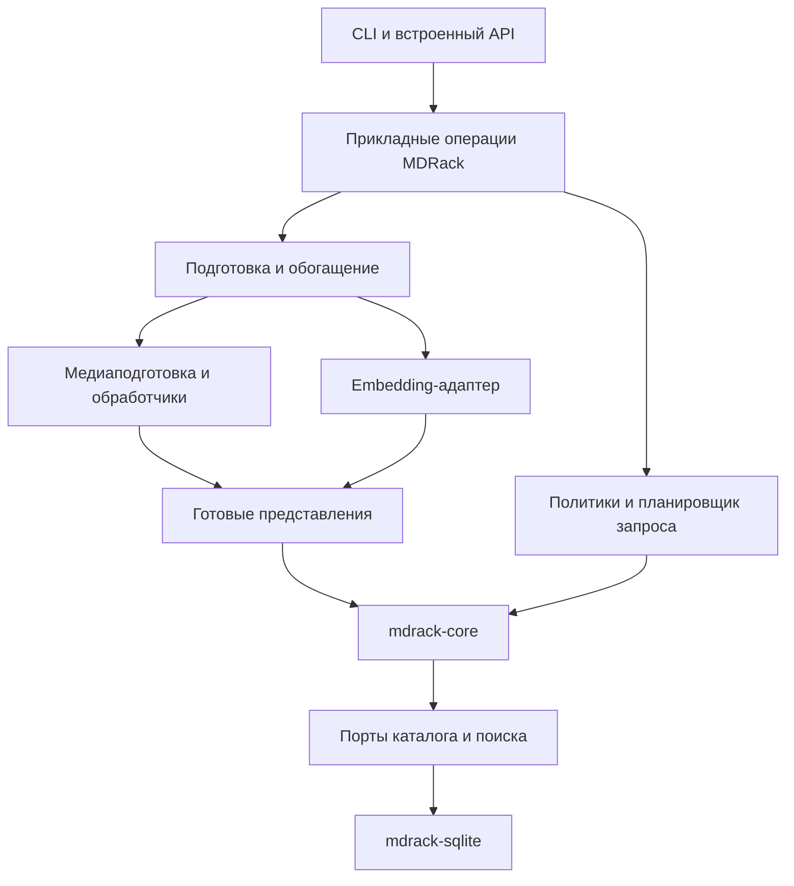
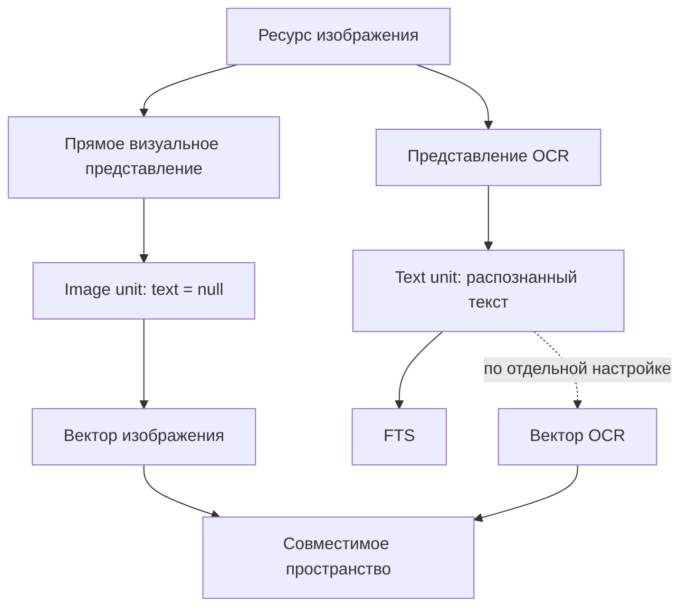
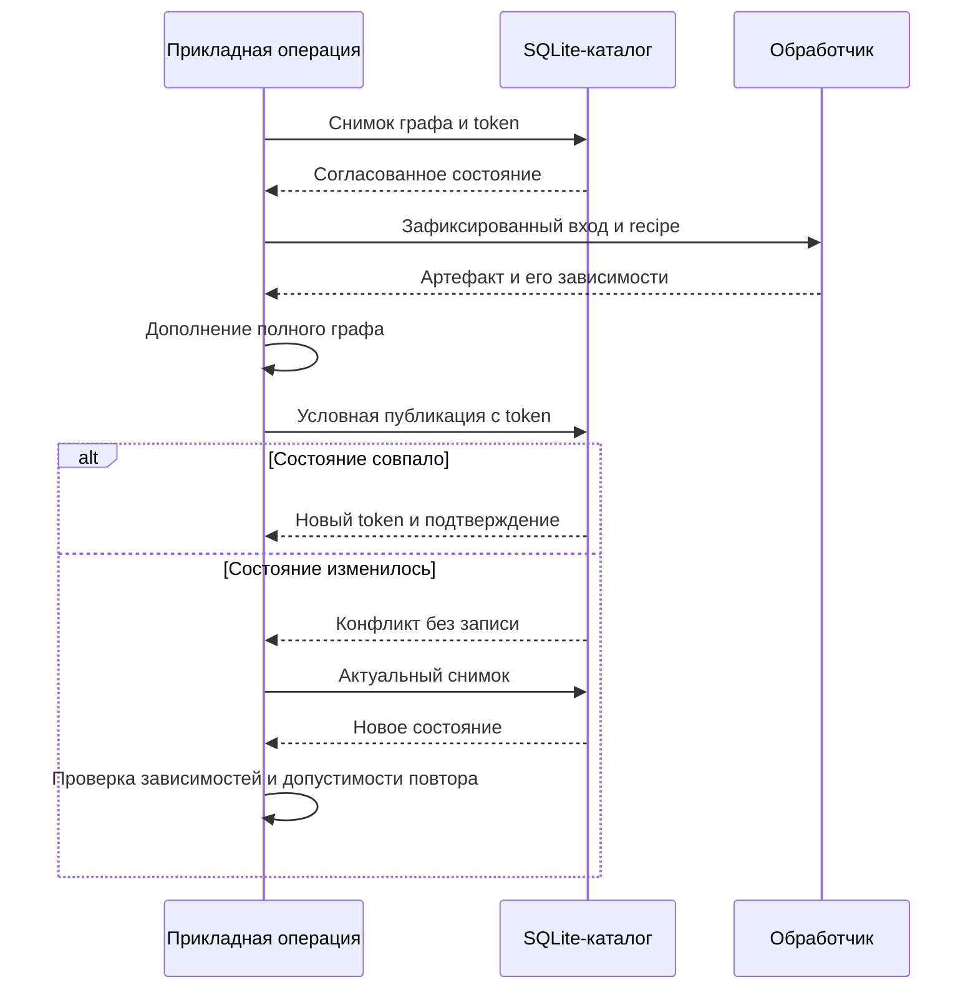

# 02. MDRack: архитектура и контракты мультимодального поиска

## Назначение и статус документа 📌

**Целевая архитектура расширяет MDRack тремя согласованными профилями: поиск через текст, прямое мультимодальное встраивание и прямое встраивание с последующим текстовым обогащением.** Существующее поисковое ядро получает подготовленные представления и ветки поиска. Прикладной слой отвечает за источники, обработчики, модели и выбор допустимых действий.

Документ определяет поведение, границы модулей и необходимые изменения контрактов. Общая философия изложена в заметке №01 «Поиск с поздним обогащением». Порядок изменения файлов и перехода между версиями относится к документу №03; подробные сценарии тестирования, измерения качества и каталог диагностических событий — к документу №04. Порядок подготовки комплекта: **02 → 04 → 03**.

База сверки — открытый репозиторий MDRack, ветка `master`, commit `843b0b4873b95ae80d08ec1d4a8707d6d7d9b676`, проверенный 20 октября 2026 года. Сверка выполнена чтением исходников, контрактов и относящихся к ним тестов. Исполнение тестов, модели или внешнего провайдера не является доказательством этого документа: такие прогоны здесь не выполнялись.

> [!important] CURRENT и TARGET
> Раздел о текущем состоянии описывает проверенную базу. Остальные архитектурные решения имеют статус **TARGET**: это предлагаемое устройство расширения. Имена новых типов и операций обозначают целевые контракты и не означают, что такие API уже доступны в установленном MDRack.

После реализации фактическое поведение должно быть отражено в действующих `API.md`, CLI-контрактах и `docs/current-architecture/`. Эта заметка задаёт изменение системы и не заменяет её текущие справочники.

## Текущая основа и реальные разрывы 🔎

MDRack уже разделён на приложение и самостоятельные пакеты. `mdrack_core` не вызывает модели, не открывает исходники и не владеет SQLite. `mdrack_sqlite` реализует каталог и получение кандидатов. `mdrack_media` предоставляет подготовленные медиаконтракты и преобразования. Приложение `mdrack` связывает их с источниками, LM Studio, CLI и `MDRackEngine`. [1]

| Область | CURRENT: что подтверждено | Следствие для расширения |
| --- | --- | --- |
| Представления и фрагменты | `RepresentationRecord.text` и `SearchUnitRecord.text` допускают `None` | Для нативного фрагмента не нужна текстовая заглушка |
| Готовый граф | Каждый unit должен иметь непустой текст или вектор; каждое representation — хотя бы один unit | Core хранит поисково пригодные проекции, а не произвольные незавершённые артефакты |
| Векторные пространства | Вектор связан с `unit_id` и `space_id`; пространство имеет размерность, метрику и fingerprint | Текст и медиа могут находиться в одном совместимом пространстве |
| Основной embedding-порт | `embed(list[str])` и `embed_query(str)` принимают текст | Требуется прикладной контракт медиавходов и возможностей провайдера |
| Изображения | Внедрённый visual provider может создать vector-only представление; текущий image service запрещает одинаковые ID текстового и визуального пространств | Требуется согласованный общий профиль и маршрутизация поиска по нужным пространствам |
| Image search | Смысловой запрос строится через текстовый provider и текстовое пространство | Наличие сохранённого visual vector ещё не даёт законченного перекрёстного поиска |
| Raw audio/video | Узкие CLI-пути вызывают выбранные внешние обработчики и передают результаты в текстовые композиции с `embeddings=False` | Это не готовое нативное аудио- или видеовстраивание |
| Публикация | `replace_resource(batch)` атомарно заменяет полный граф ресурса | Для независимого обогащения необходимы чтение всего графа, сохранение соседних представлений и условная публикация |
| Текст и FTS | SQLite индексирует все непустые `SearchUnitRecord.text` | Текст исключительно для чтения следует сохранять вне поискового графа |
| Публичное чтение | `UnitReadProjection.text` объявлено как `str`, хотя `project_unit()` передаёт допускающее `None` поле core | Nullable text нужно согласовать в публичных типах и сериализации |

Сведения о nullable records и валидности графа подтверждаются кодом core; маршруты изображений, raw audio/video и чтения — соответствующими прикладными сервисами. [2], [3], [4], [7], [8], [9], [10], [11]

Обычный поисковый запрос core уже может состоять только из векторных веток либо объединять векторные и лексические ветки. Следовательно, базовая комбинация «нативный вектор медиа плюс OCR только в FTS» выражается существующими поисковыми контрактами. [13]

**Для базового native-пути не требуется заново проектировать resource/representation/unit или создавать второе ядро.** Для безопасного позднего обогащения требуется небольшое дополнительное расширение версионированного чтения и записи. Эти задачи различаются по масштабу и не должны сливаться в переписывание всей системы.

## Область целевого расширения 🎯

Целевая возможность охватывает явную индексацию выбранного материала, поиск по текстовому или медиазапросу, поиск похожего на выбранный материал и получение недостающего представления по отдельной операции.

Медиавход считается поддержанным только тогда, когда весь прикладной путь способен его подготовить и передать выбранному провайдеру. Способность модели, поддержка endpoint и наличие адаптера — отдельные условия. Регистрация имени модели не заменяет ни одно из них.

Расширение сохраняет следующие проектные границы:

- **Один SQLite-каталог приложения.** Новые поисковые проекции и состояние публикации относятся к тому же `catalog.sqlite3`.
- **Независимое ядро.** Исходные файлы, декодирование, subprocess, HTTP и модельные runtime остаются за его пределами.
- **Одна выбранная embedding-модель по умолчанию.** Дополнительный текстовый энкодер не становится обязательным.
- **Общие прикладные операции для CLI и embedded API.** Интерфейсы адаптируют вызовы и ответы, сохраняя одного владельца логики.
- **Сохранение исходников.** Индексация и обогащение создают производные данные и не переписывают исходные файлы.
- **Поиск без обязательного reranker.** Объединение веток остаётся самостоятельной частью получения результатов.

Эти ограничения согласуются с действующими границами проекта; переход от исключительно текстового медиапоиска к нативному является явно обозначенным изменением. [1], [20]

Реализация GUI, сервера MCP, веб-сервера или плагина для другого приложения в область заметки не входит. Внешний хост может использовать библиотечный API или CLI и передавать выбранные источники. Он не должен переносить внутрь себя копию правил поиска и публикации MDRack.

Контракт провайдера должен быть расширяемым. Текущая производственная граница остаётся LM Studio HTTP; готовность облачного embedding-адаптера из этого документа не следует. Добавление конкретного облачного провайдера потребует собственной регистрации возможностей и изменения прикладной конфигурации. Нейтральность core при этом сохраняется.

Эта производственная граница закреплена архитектурными правилами проекта. Её расширение является отдельным явно оформляемым решением. [28]

## Профили подготовки и режимы поиска 🎛️

В MDRack необходимо различать **профиль подготовки представлений** и **режим получения результатов**. Существующий `--mode text` обозначает лексический поиск. Его нельзя переопределять как указание «всё предварительно превращать в текст».

Для новых профилей предлагаются отдельные значения:

| Профиль подготовки | Исходные тексты | Медиа | Производный текст |
| --- | --- | --- | --- |
| `textual` | Обычные текстовые проекции | Смысловой поиск через имеющийся или полученный текст | Используется как поисковое содержание медиа |
| `native` | Текстовый вход выбранной модели | Прямой вход поддерживаемой модальности | Новое распознавание по умолчанию выключено; готовые представления разрешаются отдельной политикой |
| `native_enriched` | Текстовый вход той же выбранной модели | Прямые медиавекторы | Дополнительно получается по запросу или автоматически для выбранных материалов |

Это наборы согласованных настроек. Второй и третий профиль используют одну архитектуру и могут вести себя одинаково при совпадающих настройках. Переход между ними меняет политику, сохраняя идентичность материала.

Для существующей установки исходной точкой остаётся текущий текстовый путь. Выбор native-профиля и пересчёт выбранных материалов выполняются явно; смена настройки сама по себе не доказывает готовность нативных проекций.

### Независимые решения о тексте 📝

Политика различает создание производного текста, использование готового артефакта, публикацию в FTS, создание дополнительного текстового вектора и участие опубликованной проекции в конкретном запросе.

**Отключение производных текстовых векторов не отключает встраивание обычных заметок.** Поэтому соответствующий параметр относится именно к `derived_text`, а не ко всем текстовым embeddings.

Для `native_enriched` базовая конфигурация — прямой медиавектор плюс текст для чтения и FTS. Дополнительный dense-вектор OCR/ASR включается явно. Он может быть получен той же мультимодальной моделью; отдельный текстовый encoder для этого не требуется.

Распознавание запроса задаётся независимо от распознавания корпуса. Например, голосовой запрос может получать ASR, хотя индексированные аудиофрагменты имеют только прямые векторы. Полученный текст запроса может использоваться для FTS, векторного запроса или обоих каналов.

### Пример целевой конфигурации ⚙️

Следующий фрагмент показывает назначение полей нового контракта, а не готовую конфигурацию текущего релиза:

```yaml
indexing_profile: native_enriched
embedding_profile: primary

derived_text:
  creation: on_demand
  use_existing: true
  lexical: true
  dense: false

query:
  extraction: "off"

retrieval:
  mode: hybrid
  allow_partial: true
```

Здесь обычный запрос не запускает распознавание корпуса. Он использует разрешённые готовые проекции. Отдельная операция обогащения может добавить текст в FTS. Политика `allow_partial` определяет реакцию на потерю запланированной ветки, но не разрешает произвольную замену модели или скрытое распознавание.

### Невозможная конфигурация обнаруживается заранее 🚦

Прямой аудиомаршрут с провайдером, принимающим только текст, является несовместимой конфигурацией. Он не превращается автоматически в ASR-путь. Разрешённый текстовый обход должен быть частью выбранной политики и отражаться в фактическом плане операции.

Если текстовый профиль получил медиа без пригодного текста, а распознавание запрещено, поиск по содержанию этого медиа ещё не готов. Такой исход описывается как отсутствие требуемого представления. В core не отправляется пустой batch ради создания видимости успешной индексации.

## Владельцы логики и направление зависимостей 🧱

Каждое решение получает одного владельца. В частности, правила выбора веток не дублируются в image service, CLI, engine и будущем внешнем клиенте.



Схема показывает поток данных и обращения к портам. Реализация SQLite зависит от контрактов core; core не импортирует SQLite-адаптер. Все компоненты могут работать в одном процессе.

| Владелец | Ответственность TARGET |
| --- | --- |
| `mdrack_core` | Неизменяемые поисковые records, валидация готового графа, поисковые ветки, группировка и RRF; нейтральный дополнительный контракт условной публикации |
| `mdrack_media` | Типизированные медиакоординаты, подготовленные временные/визуальные наблюдения и чистые builders; отсутствие файлового и модельного I/O |
| `mdrack_sqlite` | Физическое хранение, FTS, получение векторных кандидатов, согласованное чтение графа, транзакционная проверка состояния и запись |
| Прикладной слой `mdrack` | Выбор представлений, подготовка запросов, разрешение источников, вызовы обработчиков и провайдера, объединение артефактов перед публикацией |
| Provider adapters | Преобразование типизированного входа в конкретный запрос runtime и проверка возвращённого вектора |
| CLI и `MDRackEngine` | Вызов общей прикладной операции и согласованное отображение результата |
| Внешний хост | Выбор коллекции и материала, собственная связь заметок с вложениями, пользовательский интерфейс и длительное планирование при необходимости |

Для native audio/video нужны новые чистые builders подготовленных медианаблюдений. Текущие transcript/frame-caption builders сохраняют своё текстовое назначение. Визуальный вектор кадра не следует помещать в текстовый builder так, чтобы его происхождение осталось помеченным как текст подписи. [17]

Прикладной слой получает три согласованных центра ответственности: подготовку и индексирование, планирование и исполнение поиска, обогащение существующего ресурса. Это обязанности; количество классов определяется реализацией. Они не требуют трёх независимых подсистем с собственным хранением и правилами совместимости.

## Материал, представления и происхождение данных 🗂️

### Один материал, несколько независимых проекций 🧩

Resource обозначает логический материал. Representation обозначает определённый способ представить его содержание. Search unit обозначает поисковую единицу внутри этого представления. Вектор относится к конкретной единице и пространству. Эти существующие уровни сохраняются. [2], [4]

Изображение может иметь прямое визуальное представление, распознанный текст и описание сцены. Аудиозапись — нативные звуковые фрагменты и расшифровку с временными координатами. У видео могут независимо существовать кадры, аудиодорожка и текстовые производные. Наличие одного представления не предполагает наличия остальных.



Схема показывает вариант с OCR, опубликованным для поиска. Отсутствие OCR не меняет пригодность нативного image unit. Если оба вектора получены совместимыми входами одной модели, они могут ссылаться на одну запись пространства.

В текущем контракте уникальна пара `(unit_id, space_id)`. Поэтому прямой вектор изображения, вектор его OCR и совместный вектор «изображение плюс описание» нельзя записывать как три значения одной пары. Им соответствуют разные поисковые единицы и, при различном происхождении, разные представления. [4], [6]

Совместное мультимодальное кодирование является дополнительным рецептом. Базовые сценарии используют один подготовленный вход на единицу: текст, изображение либо ограниченный медиафрагмент. Произвольная сборка нескольких вложений и текстовых инструкций в один embedding не требуется для первого расширения.

### Идентичность не заменяет версию 🔖

Для позднего обогащения необходимо различать несколько идентификаторов:

| Значение TARGET | Что оно обозначает | Для чего используется |
| --- | --- | --- |
| `resource_id` | Логический материал в пространстве источников | Связь результатов, представлений и внешних ссылок |
| `source_revision` | Версия фактически обработанного исходника | Проверка применимости извлечённых данных и координат |
| `artifact_revision` | Версия конкретного OCR, transcript, кадра или другого артефакта | Обнаружение изменений непосредственного входа следующей операции |
| `recipe_fingerprint` | Каноническое описание обработки и её параметров | Воспроизводимость и повторное использование результата |
| `state_token` | Непрозрачная версия опубликованного состояния ресурса | Обнаружение конкурирующей записи |
| Идентификатор жизненного цикла | Жизнь ресурса между созданием и удалением | Защита от применения старой задачи после удаления и повторного создания |

Это разные смыслы, даже если конкретная реализация хранит часть сведений вместе. Хеш исходного файла не меняется при ручной коррекции расшифровки. Время индексирования не доказывает, что граф после чтения оставался прежним. Стабильный ID кадра также не означает неизменность его подписи.

Существующий `ResourceRecord.content_hash` нельзя безоговорочно объявить универсальной версией исходного файла: подготовленные media-пути могут вычислять идентичность содержимого по готовому артефакту. Raw-source provenance уже различает `raw_source_sha256` и `prepared_evidence_sha256`. Расширение сохраняет эти значения и вводит явно названную зависимость от обработанного исходника, не меняя задним числом смысл старого поля. [17], [22]

Для вновь создаваемых представлений прикладная metadata получает версионированный блок происхождения: входные ревизии, producer/recipe, выбранный диапазон, назначение представления и ключ операции. Core проверяет общую корректность records; смысл этого блока проверяет владеющий им прикладной контракт.

### Назначение, варианты и замещение (TARGET)

Новый representation ID не означает независимое назначение. Минимальная
версионированная app metadata различает `purpose_key`, `variant_key` (default),
source/artifact dependency revisions и `recipe_fingerprint`. Ключ активного выхода:
`(resource_id, purpose_key, variant_key)`. Назначение включает объявленные область,
track/range, но не hash модели. Операция явно объявляет заменяемые, добавляемые и
сохраняемые выходы. Конфликт owners одного назначения отклоняется.

| Изменение | Правило публикации |
| --- | --- |
| Те же входы/recipe | Переиспользовать артефакт; отдельно проверить publication postconditions |
| Новый профиль основного visual purpose | Заменить прежний active variant, не сохранять его автоматически |
| OCR или ручная правка | Обновить text/FTS/dense/joint зависимости; сохранить независимый native vector |
| Transcript к native audio | Добавить отдельное назначение без повторного native embedding |
| Два намеренных варианта | Явные variant keys и query policy, определяющая участие обоих |
| Новая source revision | Снять/заменить все действительно зависимые outputs старой ревизии |

Immediate artifact revisions важны независимо от raw source hash. Joint embedding
зависит от каждого входа; изменение OCR не инвалидирует независимо полученный
native vector неизменного изображения. Текущая полная замена графа не доказывает
накопления старых representations. Уже имеющийся compatible-space filtering
означает, что сохранённый старый vector не автоматически участвует в новом запросе.
Риск наивного будущего merge — актуальность, лишние active variants и lexical projections.

### Координаты относятся к конкретному содержимому 📍

Временной фрагмент обозначается полуоткрытым интервалом `[start_ms, end_ms)`; эта семантика уже принята в `mdrack_media`. Кадр имеет временную позицию, а изображение или его участок — соответствующий визуальный locator. [17]

Версия источника сопровождает координаты. Если файл заменён, прежняя отметка времени не должна выглядеть подтверждённой ссылкой на новое содержимое. Чтение возвращает состояние устаревшего или недоступного источника либо открывает сохранённый снимок той версии, если хост действительно его хранит.

Разбиение длинного аудио и видео принадлежит прикладному рецепту подготовки. Правило нарезки, перекрытие, выбор кадров и агрегация фиксируются в provenance. Изменение нарезки может изменить набор units. Сохранение старых IDs не должно достигаться ценой ссылки на другой фрагмент.

## Контракт встраивания и совместимость пространств 🧠

### Расширяемый порт находится в приложении 🔌

Текущий текстовый `EmbeddingProvider` сохраняется как совместимый вход для существующих клиентов. Новый мультимодальный порт вводится рядом с ним; переходный адаптер представляет прежний provider как реализацию возможностей только для текста. [8]

Целевой контракт содержит четыре части:

| Часть | Обязательное содержание |
| --- | --- |
| Подготовленный вход | Тип содержимого, явная полезная нагрузка или ограниченный handle, параметры уже выполненной подготовки и идентичность входа |
| Назначение кодирования | Документный вход, поисковый запрос или объявленная операция сходства |
| Описание возможностей | Поддержанные входы для каждой роли, совместимые маршруты запроса и кандидата, ограничения размера/длительности и результата |
| Результат | Вектор, разрешённая идентичность пространства и сведения, необходимые для проверки согласованности с запрошенным профилем |

Название будущего Python-протокола и DTO фиксируется при оформлении изменения публичного API. Его семантика фиксируется здесь: приложение передаёт провайдеру подготовленное содержимое, а core получает только готовые проверенные векторы.

Медиабайты не извлекаются провайдером по произвольному locator из базы. За доступ к выбранному исходнику отвечает прикладной resolver. Конкретный адаптер может использовать загрузку файла на стороне сервиса, если это часть явно выбранной интеграции; разрешение источника и границы передачи всё равно остаются в приложении.

Неподдержанный формат, превышение лимита, ошибочное число векторов, неверная размерность и несовпадение пространства обнаруживаются до публикации. Неявное обрезание длинного медиа недопустимо: обработанная часть и правило сокращения должны быть известны вызывающей стороне.

### Возможность модели должна доходить до работающего адаптера 🛠️

Возможности описывают используемую связку модели, runtime, endpoint и адаптера. Текущая регистрация размеров embeddings не доказывает поддержку image/audio payload. Аналогично наличие в проекте провайдера генерации текста не означает наличие облачного embedding-провайдера. [15], [24]

Профиль может, например, поддерживать текстовый запрос к изображениям и кодирование самих изображений, но не аудио. В этом случае изображение индексируется нативно, а аудио требует другого явно поддержанного маршрута. Система не обещает все перекрёстные сочетания только на основании слова «мультимодальный».

Для работающего пользовательского сценария необходим хотя бы один реальный адаптер, который передаёт нужный вход и возвращает совместимый вектор. Набор интерфейсов и тестовый provider сами по себе не являются реализованным нативным поиском.

### Одна модель может обслуживать несколько представлений 🌐

Embedding space объединяет векторы, между которыми разрешена определённая операция сравнения. Совпадение названия модели, длины массива или численного типа этого не доказывает.

Идентичность пространства учитывает модельную ревизию и значимые настройки её embedding-контракта: размерность, нормализацию, метрику, согласованные правила query/document и другие параметры, меняющие сопоставимость. Это идентичность совместимого контракта целиком: разные предусмотренные инструкции запроса и документа не требуют разных `space_id` для фактических ролей. При этом recipe конкретного кадра, OCR или временного окна описывается отдельно. Новый диапазон аудио не создаёт автоматически новое пространство.

Если текст, изображение и аудио используют объявленные совместимые входы одной модели, им соответствует общее каноническое описание пространства. Нельзя создавать записи с одним `space_id`, но разной metadata только потому, что текущий batch содержит другую модальность. Модальность относится к входу и представлению.

Нынешний запрет одинаковых text/visual space IDs в image service заменяется проверкой совместимости профилей. Одновременно планировщик должен включать нужные нативные units в область поиска. Устранение только запрета при записи не исправляет нынешний текстовый маршрут запроса. [7]

Несовместимая смена модели или рецепта кодирования требует другого пространства и подготовки нужных векторов. Простое переименование `space_id`, в том числе техническое rekeying готового batch, не выполняет такое преобразование.

### Сходство также имеет назначение кодирования 🧭

Повторное использование сохранённого вектора в качестве запроса допустимо, если соответствующий профиль разрешает этот маршрут. Для симметричного поиска «похожее изображение» это может быть обычная операция пространства. Для асимметричной модели правила document/query могут отличаться.

Повторное кодирование только запроса не превращает несовместимо подготовленный корпус в симметричное пространство. Планировщик должен выбрать объявленную совместимую пару query/document либо профиль симметричного сходства. Если такой пары нет, маршрут признаётся недоступным.

## Согласованность одного поискового ответа (TARGET)

Все ветки и все данные для формирования одного ответа читаются из одного
committed snapshot каталога. После HTTP/query preparation граница включает
разрешение embedding spaces, канонизацию векторов для выбранного пространства,
lexical/vector branches, fallback, basis resolution и hydration resources/units/
evidence/locators/metadata. Соединение verified read-only принадлежит одной операции,
не общему writer engine. До освобождения snapshot материализуются eager DTO;
наружу не выходят cursor или lazy generator. Исключение/отмена освобождает handle.
HTTP, ожидание пользователя и enrich не удерживают эту транзакцию.

Следующий самостоятельный `read` или `search` вправе видеть более новый commit.
Это не snapshot файловой системы и не транзакция от первого поиска до enrich.
Existing-vector similarity включает basis/vector/discovery multi-reads и hydration;
если нужен HTTP, immutable basis читается отдельно и затем проверяется revision.
Для standalone/legacy injected facade без capability гарантия явно ограничена;
молчаливый `nullcontext` не даёт общего normal-app claim.

Нормальный inventory: UnifiedTextSearchService, app RetrievalService и compatibility,
ResourcePresetSearchService, TimedRetrievalService, image search,
`MetadataCatalogService.search` (обе lexical body/metadata ветки),
ResourceQueryService existing-vector/textual basis и прямые CLI resources
search/similar/duplicates; будущий media route наследует ту же границу.
SQL owner отдельно делает preflight verify/open согласованным между своими SELECT,
сохраняя публичный `ACTIVE_TRANSACTION` guard. Его snapshot не обязан совпадать
с последующим search snapshot; schema/maintenance подчинены lifecycle-контракту.
Эта гарантия проверяется отдельно от publication snapshot: `M04-Q09`, не `M04-S01`.

## Планирование запроса и получение результатов 🔍

### Тип запроса и тип результата независимы 🔀

Новый прикладной запрос принимает один типизированный вход: текст, выбранное изображение, поддержанный аудио-/видеофрагмент либо ссылку на уже индексированную единицу. Возможность конкретного входа определяется профилем. Область кандидатов задаётся отдельно.

Текстовый запрос «иллюстрация к статье о тумане» может искать изображения. Изображение может искать заметки, если совместимый маршрут поддержан. Условие `modality=query.modality` не добавляется автоматически: такое ограничение уничтожило бы перекрёстный поиск.

Текущий `search_unified` является текстовым API: его scope aliases ограничены `modalities=("text",)`. Он сохраняет это поведение. Универсальный медиавход получает отдельный версионированный контракт, использующий общий планировщик. [18]

### План содержит только обоснованные ветки 🧮

Планировщик разрешает запрос и политику в готовые `LexicalBranch` и `VectorBranch`. Он выбирает совместимые пространства, веса, ограничения представлений и лимиты кандидатов. Core исполняет готовый запрос, группирует результаты и выполняет RRF. Второй реализации fusion в app не появляется. [12], [13], [14]

| Вход запроса | Векторный канал | Лексический канал |
| --- | --- | --- |
| Текст | Query embedding разрешённого профиля | Исходный текст запроса |
| Изображение без извлечения текста | Совместимый image query embedding | Отсутствует |
| Аудиофрагмент без ASR | Совместимый audio query embedding | Отсутствует |
| Медиа с разрешённым текстовым представлением запроса | Нативный или текстовый маршрут согласно политике | Подготовленный текст запроса |
| Сохранённая единица | Пригодный сохранённый вектор или отдельно разрешённая подготовка | Только действительно доступный и разрешённый текст |

Разрешение ASR запроса не разрешает расшифровку результатов поиска. Аналогично запрос с изображением не вызывает OCR всего корпуса. Обогащение корпуса остаётся отдельной операцией.

В новом API `hybrid` означает адаптивное объединение применимых каналов. Планировщик различает неприменимую ветку и отказ запланированной ветки. Для медиазапроса без разрешённого текстового входа FTS не планируется: запрос выполняется как vector-only с явно указанным фактическим режимом, в том числе при `allow_partial=false`.

`allow_partial` управляет отказом уже запланированных веток. При строгой политике такой отказ завершает операцию ошибкой; при разрешённой частичной работе остаются доступные ветки с объяснением пропуска. Если не осталось ни одной исполнимой ветки, это не успешная пустая выдача. Семантика существующих текстовых методов от этого нового контракта не меняется.

Отсутствие у части материалов OCR является нормальной неоднородностью корпуса, а не отказом всей FTS-ветки. Такие материалы участвуют через свои готовые векторы. Лексический канал способен находить только опубликованный текст.

### Дополнительное представление не получает неограниченный вес ⚖️

Прямые медиа, transcript и OCR могут давать разные свидетельства релевантности одного ресурса. Для профиля поиска задаётся ограниченный бюджет веса семейств представлений. Добавление десяти OCR-проекций не должно автоматически давать десятикратное преимущество перед материалом с одной проекцией.

Практическое правило — конечный набор семейств веток и явные веса. Поиск по одному пространству и одной разрешённой группе представлений объединяет соответствующих кандидатов в одной ветке, где это выражается текущим scope. Если требуются отдельные ветки, их суммарный вес в семействе ограничивается политикой. Лексическая и векторная ветки одного текста остаются осознанными двумя сигналами гибридного поиска.

Фильтры ресурса и разрешённых представлений передаются при получении кандидатов, до окончательного ограничения выдачи. При `target="resource"` используются группировка по ресурсу и предел evidence; при `target="unit"` отдельные кадры и интервалы закономерно остаются самостоятельными результатами.

Лимиты кандидатов учитывают последующую группировку: нынешний core не пополняет ветку автоматически, если множество её первых кандидатов принадлежит одному ресурсу. Поэтому слишком короткий список units не гарантирует требуемого числа разных материалов. Бюджет кандидатов задаётся профилем и оценивается отдельно от числа итоговых результатов. [14]

### Existing-vector similarity сохраняет свой контракт 🖼️

В текущем core `ResourceDiscoveryService.similar()` использует готовый вектор `whole_resource`, не вызывает provider и ограничивает кандидатов такими же whole-resource units. Операция `resources similar` представляет этот путь. Удобная операция `find-similar <resource_id>` разрешает именно текстовую whole-resource проекцию. [14], [19]

Эти операции не следует молча превращать в поиск по произвольным фрагментам. Новый запрос от конкретного кадра или интервала разрешается прикладным планировщиком и выполняется обычным retrieval по готовому вектору. Выбор basis определяет, что именно сравнивается: весь материал, выбранное изображение, звуковой фрагмент или текстовая проекция.

Если у ресурса несколько подходящих проекций, выбор задаётся профилем либо явно передаётся вызывающей стороной. Отсутствие нужного whole-resource или range-вектора не разрешает незаявленное усреднение соседних векторов. Подготовка нового basis является отдельной разрешённой работой.

Существующий similarity в core возвращает raw score адаптера, тогда как обычный retrieval в core формирует RRF score. Новые ответы явно указывают `score_kind`; эти числа нельзя смешивать в один универсальный порог уверенности. Это не утверждение о единой сериализации всех старых прикладных projections. [14]

## Прикладные операции и публичные ответы 📬

### Общий контракт для CLI и embedded API 🤝

Новые операции оформляются на прикладной границе. Ниже приведены их семантические имена TARGET; это не перечень уже существующих команд или готовых сигнатур `MDRackEngine`.

| Операция | Вход | Обязательный результат и граница работы |
| --- | --- | --- |
| `ingest` | Выбранный источник или готовые артефакты, профиль подготовки и политика публикации | Идентичность материала, опубликованные проекции, фактическое покрытие; непригодный пустой граф не публикуется |
| `search` | Типизированный запрос, scope, профиль поиска и лимиты | Ранжированные материалы или units, evidence и фактически выполненные ветки; корпус не обогащается |
| `similar` | Выбранный ресурс/unit, basis и scope | Явно определённый маршрут сходства; подготовка отсутствующего basis выполняется только при отдельном разрешении |
| `read` | Ссылка на результат, требуемая проекция или диапазон | Доступный текст/артефакт либо сведения о его отсутствии; чтение само не запускает распознавание |
| `enrich` | Материал, диапазон, требуемые артефакты, recipe, режим публикации и бюджет | Что вычислено, что опубликовано, для какой версии и с каким покрытием |
| `capabilities` | Выбранный профиль и доступные зависимости | Возможные маршруты и ограничения без притворного подтверждения непроверенных возможностей |

Старые текстовые методы сохраняют значения аргументов и смысл результата. Ввод новых обязательных полей в существующие закрытые DTO либо изменение интерпретации старого метода требуют версии контракта. Новые media DTO не должны принудительно проходить через Markdown-проекции, предполагающие текстовый preview.

### Результат показывает основание совпадения 🧾

Минимальная media projection содержит логические `resource_id`, `representation_id` и `unit_id` для каждого evidence, тип представления, модальность, locator и версию исходника. На уровне ранжированного результата передаются позиция, score, `score_kind` и использованный профиль или basis.

Текст имеет тип `str | None`. Отдельно указываются его происхождение и доступность. Отсутствие текста не заменяется именем файла или сгенерированной подписью. Название материала может отображаться отдельным полем, не выдавая себя за распознанное содержание.

В одном resource-level результате может быть несколько evidence: визуальное совпадение, строка OCR и временной аудиофрагмент. Представительная единица не подменяет весь набор свидетельств. Сведения о выполненных каналах относятся к операции, а сведения о конкретном совпадении — к evidence.

Доступность исходника, текста и поискового вектора различается. Вектор способен оставаться пригодным для поиска после удаления временного текстового артефакта. Обратная ситуация также возможна: текст доступен для чтения, но ещё не опубликован в поисковом графе. Универсальное поле `ready=true` не описывает эти состояния.

### Отсутствие представления не равно пустой выдаче 🚥

Следующие различия являются частью целевого ответа, независимо от выбранных названий Python exceptions или JSON-кодов:

| Ситуация | Наблюдаемое поведение |
| --- | --- |
| Корректный запрос исполнен, совпадений нет | Успешный ответ с пустым списком |
| Провайдер не поддерживает нужный вход или роль | Отказ маршрутизации до модельной работы либо заранее разрешённый альтернативный маршрут |
| Нет нужного сохранённого basis | Явная недоступность выбранного сходства; новый вектор не вычисляется скрыто |
| Одна запланированная ветка недоступна | Ошибка при строгой политике или частичный результат с причиной пропуска |
| Нет ни одной исполнимой ветки | Запрос не исполнен; это не нулевая релевантность корпуса |
| Для обогащения недоступен оригинал | Производные данные не вычисляются; существующая выдача остаётся доступной |
| Обнаружено изменение входа или публикации | Конфликт, ограниченная повторная попытка либо вычисленный, но не опубликованный артефакт |
| OCR/ASR не обнаружил текста | Нормальный исход `no_text`; пустая поисковая единица не создаётся |

Детальная схема диагностических событий и измерений относится к заметке №04. Здесь фиксируется необходимая семантика, которую эти события должны суметь выразить.

### Доступ к исходнику разрешается вне core 📂

Существующий `RawSourceSnapshot` является временным снимком; временный файл удаляется. Переносимый `source_ref` не является готовым механизмом повторного открытия исходника. Поэтому наличие ресурса в каталоге само по себе не гарантирует возможность будущего `enrich`. [22]

Прикладной `SourceResolver` TARGET принимает namespace, переносимую ссылку, ожидаемую ревизию и ограниченный диапазон. Он возвращает доступный источник или явный отказ. Альтернатива — переданный вызывающей стороной ограниченный source handle. Конкретный локальный путь, корень коллекции или способ доступа принадлежат приложению/хосту.

Resolver проверяет фактический тип, пределы диапазона и соответствие выбранной версии. Обработчик получает зафиксированный вход; его результат всегда связан именно с этим содержимым. Проверка файла после чтения не является блокировкой внешней файловой системы: если хост не предоставляет снимки, он должен уметь сообщить изменение оригинала.

Для встроенных сценариев связи заметок и вложений передаёт хост. Markdown scan не начинает автоматически открывать все ссылки на изображения. Связанный файл может быть самостоятельным ресурсом; наличие ссылки не разрешает смешивать векторы заметки и вложения или менять их логические IDs.

## Позднее обогащение как отдельная операция 🌱

### Сначала артефакт, затем разрешённая публикация 🪄

Обогащение получает недостающее представление уже известного материала: OCR, transcript, caption, выбранные кадры или дополнительные нативные фрагменты. Операция ограничена исходником, диапазоном, рецептом и бюджетом. Она может выполняться непосредственно по вызову или запускаться внешним планировщиком.

Внутренне разделяются вычисление и публикация. Полученный transcript ещё не означает, что FTS обновлён. Успешная модельная обработка с последующим конфликтом записи возвращает доступный артефакт и отсутствие публикации, если артефакт действительно сохранён или передан вызывающей стороне.

Это разделение допускает повторное использование дорогого результата и небольшие транзакции. Оно не требует обязательной очереди, брокера, сервиса задач или постоянного job store. При необходимости хост добавляет планирование поверх тех же операций.

### Текст получает явное назначение 📖

Сочетание флагов lexical/dense определяет, какая поисковая проекция публикуется. Сохранение текста для чтения задаётся отдельно.

| Lexical | Dense | Публикация производного текста TARGET |
| --- | --- | --- |
| Нет | Нет | Артефакт для чтения вне поискового графа; новые text units не нужны |
| Да | Нет | Обычный текстовый unit для FTS без дополнительного вектора |
| Нет | Да | Unit с `modality="text"`, `text=None` и готовым вектором; полный текст доступен через прикладной artifact reference |
| Да | Да | Текстовый unit с настоящим текстом и соответствующим вектором |

Третий вариант не превращает происхождение вектора в нативное медиа: это вектор производного текста, что явно отражается в representation/provenance. `RepresentationRecord.text` в этом варианте также остаётся `None`. Существующая валидация допускает такую единицу, поскольку вектор присутствует. [2], [3]

Nullable text относится к поисковой проекции. Сами `TranscriptArtifact`, `TimedTextAtom` и `FrameCaptionObservation` сохраняют нынешние требования к настоящему тексту; создавать в них фиктивное пустое содержание не требуется. [17]

Вариант с FTS использует текущую обязанность SQLite индексировать непустой `unit.text`. Для первого расширения не требуется универсальное поле `lexical_eligible` в core. Включение лексической публикации для уже подготовленного dense-only текста может заполнить текст того же логического unit, сохранив вектор, если его непосредственный вход и embedding-рецепт не изменились. [6]

При включении только FTS прямой медиавектор остаётся прежним. Если для OCR требуется дополнительный embedding, его может вычислить тот же мультимодальный provider. Решение о дополнительном текстовом энкодере остаётся отдельной необязательной конфигурацией.

### Кеш и долговременный текст имеют разные гарантии 🗄️

Существующий `ArtifactCache` уже подходит для повторного использования результатов: он хранит неизменяемые файловые артефакты с fingerprints источника, producer, модели, prompt, конфигурации и preprocessing. Кеш допускает очистку и восстановление после повреждения. Он не является авторитетным архивом расшифровок или готовым сервисом управления обогащением. [16]

Целевое прикладное чтение использует `DerivedArtifactRef`: непрозрачную ссылку, связанную с ресурсом, его версией, видом артефакта и recipe. Минимальная реализация может опираться на текущий кеш. Небольшая metadata поискового ресурса может хранить такую ссылку; полный текст остаётся вне поисковых полей, когда FTS запрещён.

Если кеш очищен, чтение сообщает недоступность артефакта и возможность разрешённого повторного получения. Это не удаляет пригодный нативный вектор. Если текст уже опубликован в FTS, его копия в SQLite продолжает существовать независимо от кеша.

Долговременное хранение текста только для чтения требует явно предоставленной способности хоста сохранять артефакты. Запрос такой гарантии при её отсутствии завершается явным отказом. Он не подменяется скрытой публикацией текста в FTS. Единственная копия ручной расшифровки не должна находиться в очищаемом кеше.

### Зависимости определяют, что пересчитывается 🔄

При появлении OCR неизменное изображение не требует повторного native embedding. При исправлении transcript меняются его текстовые проекции и только те векторы, для которых исправленный текст был входом. Нативное аудио остаётся независимым, если байты, диапазон и рецепт его обработки не изменились.

Совместный embedding «медиа плюс текст» зависит от обоих входов. Изменение любого из них делает такой вектор устаревшим. Поэтому совместная проекция хранится отдельно от прямой нативной и имеет явные зависимости.

Ручная правка создаёт новую ревизию артефакта с известным происхождением. Автоматический обработчик не заменяет её только потому, что завершился позже. Для каждого назначения выбирается действующий артефакт; историческая копия может храниться вне активного поискового графа.

Публикуемая версия содержит только согласованные units и vectors. Устаревший зависимый вектор удаляется либо заменяется вместе с изменением текста. Если после удаления вектора unit не имеет текста, он также исключается; пустое representation не публикуется. Если пригодных проекций не осталось, поисковый граф условно снимается с публикации. Жизненный цикл материала сохраняется, а подготовка новых проекций остаётся обязанностью приложения/хоста.

Покрытие относится к конкретному представлению: выбранные минуты аудио, кадры или страницы. Факт наличия одного OCR-фрагмента не превращается в утверждение «всё изображение распознано», а transcript короткого отрезка — в расшифровку всей записи.

> [!note] Граница влияния на поиск
> Обогащение уже найденных кандидатов может улучшить их чтение и последующее ранжирование по доступному тексту. Оно не обеспечивает обнаружение материалов, которые первоначальный поиск вообще не вернул. Для этого требуется расширение проекций корпуса или отдельная следующая итерация запроса; автоматической гарантии полноты здесь нет.

## Согласованная публикация в одном SQLite-каталоге 🔐

### Почему полной замены недостаточно для обогащения 🧵

Существующий `replace_resource(batch)` выполняет транзакционную замену полного графа. Он сохраняет атомарность одной записи: старое состояние не должно смешиваться с половиной нового. Однако это не проверка того, что batch построен из актуального состояния. [5], [6]

Если OCR и ASR прочитали одну исходную версию, каждый может построить корректный полный граф со своим дополнением. Последующая последовательная запись обоих batch способна удалить результат первого. Внутренний mutex и `BEGIN IMMEDIATE` сериализуют запись, но не обнаруживают устаревшее чтение до неё.

Приложение не решает эту проблему внешним `BEGIN`: текущий writer отвергает уже активную транзакцию вызывающей стороны. Сверка ожидаемого состояния и замена должны находиться внутри одной операции владельца хранения. [6]

### Дополнительный порт снимка и условной записи 🧷

Целевое решение — **необязательный версионированный порт публикации**, реализуемый SQLite-адаптером. Нынешние обязательные методы `CatalogPort` не меняют сигнатуры. Потребитель, которому нужна защищённая публикация обогащения, явно требует новую capability.

Для обсуждения используются следующие имена TARGET:

| Контракт | Требование |
| --- | --- |
| `ResourceSnapshot` | Согласованное состояние: полный batch при наличии проекций, непрозрачный `state_token`, идентичность жизненного цикла и привязка источника |
| `read_snapshot(resource_id)` | Различает живой ресурс с проекциями, живой ресурс без опубликованных проекций, «никогда не создан» и «удалён» |
| `compare_and_publish(batch, expected_state)` | Проверяет ожидаемое состояние и публикует полный проверенный граф в одной короткой транзакции; при конфликте не записывает ничего |
| `withdraw_if_current(resource_id, expected_state)` | Условно снимает поисковый граф, сохраняя живой жизненный цикл и привязку источника; меняет token |
| `delete_if_current(resource_id, expected_state)` | Условно удаляет поисковый граф и сохраняет новое состояние удаления |

`expected_state` различает ожидаемый живой снимок и явно разрешённое создание. Обогащение всегда ожидает живой ресурс. Оно не становится операцией создания только потому, что прежняя запись исчезла.

Состояние `live_without_projections` относится к ранее опубликованному материалу, чьи поисковые проекции были сняты. Оно хранится как служебное состояние публикации, а не как пустой `PreparedResourceBatch`. Новая подготовка может вернуть такой материал в поиск с актуальным token и прежним жизненным циклом. Настоящее удаление переводит его в другое состояние и не даёт такого права старым задачам.

Первичный источник, ещё ни разу не получивший пригодной проекции, по-прежнему не регистрируется в core ради отображения прогресса: его подготовкой владеет приложение/хост. Дополнительный порт не становится универсальным реестром очереди и необработанных файлов.

Базовые records и порт остаются нейтральными к SQLite. SQL-чтение графа, хранение состояния, сравнение token и транзакция принадлежат `mdrack_sqlite`. Приложение проверяет смысл source/artifact revisions, вычисляет дополнение и собирает полный batch.

Валидация подготовленного графа сохраняет одного владельца в core. Новый условный путь индексирования использует тот же валидатор, что существующий, и затем вызывает новый порт. Копировать правила из закрытого `_validate_batch` в приложение или обходить их при обогащении не следует. Публичная форма нового entry point оформляется как добавочное версионированное изменение core. [3], [12]

### Готовое чтение графа следует перенести к владельцу хранения 🏛️

В приложении уже есть `PreparedResourceExportService.export_batch()`: он восстанавливает resource, representations, units, spaces, vectors и facets в согласованной read-транзакции. Это полезная существующая основа, а не повод писать вторую независимую SQL-сборку. [11]

При расширении алгоритм восстановления полного графа переносится в SQLite-реализацию нового snapshot-порта. Существующий export facade делегирует ей там, где позволяет его контракт. Снимок включает состояние публикации из той же read-транзакции.

Жизненный цикл старого `PreparedResourceCatalog.open` нельзя механически переиспользовать для этого: его текущий конструктор привязан к v1 storage, тогда как приложение использует фиксированный v2-каталог. Переиспользуется логика восстановления графа, а открытие выполняет действующая композиция приложения. [11]

### Вычисления выполняются за пределами транзакции ⏱️



Обработка файлов, декодирование и обращения к модели не удерживают write-транзакцию. Во время публикации проверяется только актуальность ожидаемого состояния и записывается заранее подготовленный граф. Ошибка записи откатывает эту транзакцию; отдельные поколения каталога или резервный активируемый индекс не вводятся.

При конфликте операция перечитывает граф. Если жизненный цикл тот же и все непосредственные входы вычисленного артефакта не изменились, результат можно присоединить к актуальному состоянию и ограниченно повторить условную запись. Повторное обращение к модели для неизменных входов не обязательно.

Если исходник, выбранная расшифровка, recipe или иной непосредственный вход изменился, прежний результат не публикуется как актуальный. Source revision проверяется по зафиксированному содержимому и принятому состоянию каталога. Это гарантия согласованности внутри системы, а не транзакционная блокировка произвольного внешнего файла.

### Все пути записи участвуют в проверке состояния 🛡️

Token изменяется при каждой успешной публикации, снятии проекций и удалении, включая сохранившиеся безусловные `replace_resource` и `delete_resource`. Иначе старый путь записи сможет изменить граф незаметно для новой условной операции. Привязка источника сохраняется и проверяется также при состоянии без проекций.

Удаление оставляет минимальную запись состояния. Она предотвращает восстановление ресурса запоздалой задачей. Явное повторное создание начинает новый жизненный цикл. Даже если логический `resource_id` и байты совпали, старая задача не переносится в этот цикл после конфликта.

Такое состояние хранится в том же фиксированном `catalog.sqlite3`. Новая таблица и связанные изменения оформляются штатной версией схемы и упорядоченной миграцией, учитываемой manifest-проверкой. Приложение не создаёт собственные служебные SQL-объекты обходным путём; применённые миграции не редактируются. Конкретная совместимость открытия и процедура обновления относятся к заметке №03. [25]

Безусловная полная замена сохраняет свой низкоуровневый смысл: вызывающая сторона явно предоставляет весь граф. Она не обещает автоматически сохранить представления, отсутствующие в её batch. Прикладные rescan/index/enrich-пути, которым требуется сохранение независимых дополнений, должны пользоваться чтением актуального графа и условным объединением.

### Повтор операции сохраняет соседние представления ♻️

Ключ вычисления строится из непосредственных входных ревизий, диапазона и recipe; embedding-рецепт входит в ключ, когда операция вычисляет вектор. Одного `raw_source_sha256` недостаточно для операции над вручную исправленным transcript.

Совпадение ключа вычисления позволяет переиспользовать артефакт. Публикация признаётся уже выполненной только тогда, когда актуальное состояние содержит все запрошенные проекции с нужными входными ревизиями и embedding-профилем. Например, готовый dense-only transcript ещё не удовлетворяет последующему запросу включить его в FTS.

Смена назначения публикации не включается автоматически в ключ дорогого вычисления: включение FTS не должно само по себе повторять ASR. При пересборке сохраняются независимые representations, их units, vectors, facets и прикладная metadata. Изменяются только заявленные выходы операции и их устаревшие зависимости.

Идемпотентность фиксируется в опубликованном результате и provenance. Для этого не требуется глобальная таблица всех когда-либо запущенных задач. Если публикация не состоялась, кеш или возвращённый артефакт могут облегчить следующую попытку, но не изображают успешное обновление индекса.

## Карта изменений и совместимость 🧰

### Изменения распределяются по существующим владельцам 🗺️

Таблица фиксирует границы необходимых изменений. Она не задаёт очередность коммитов, оценку сроков или перечень тест-кейсов: эти вопросы рассматриваются в заметках №03 и №04.

| Модуль или действующая граница | Изменение TARGET | Что определяет корректность границы |
| --- | --- | --- |
| `src/mdrack/ports/embeddings.py`, `domain/profiles.py` | Дополнительный типизированный embedding-порт, входные роли и capabilities, совместимые маршруты | Старый текстовый provider адаптируется без обязательной поддержки медиа; совместимость задаётся целым профилем |
| `src/mdrack/embeddings/runtime.py`, `config/models.py`, `integrations/` | Явная композиция поддержанных адаптеров и профилей подготовки | Регистрация нового provider не наследует случайно LM Studio HTTP или идентичность `offline-test` |
| `src/mdrack/ingestion/images.py` | Подготовка по общим capabilities, корректная работа совместимого общего пространства | Нативный вектор доступен соответствующему поисковому маршруту; OCR не является обязательным входом |
| `src/mdrack/ingestion/raw_audio.py`, `raw_video.py` | Отдельные поддержанные native-пути и доступ к исходной версии через resolver | Нынешние узкие внешние extractors не объявляются универсальными нативными кодировщиками |
| `packages/mdrack-media` | Чистые подготовленные native observations/builders и проекции текста для выбранного назначения | Никаких файлов, HTTP или моделей; действующие текстовые artifacts сохраняют свои инварианты |
| `src/mdrack/application/resources.py` и прикладные search services | Общий планировщик типизированного запроса, разрешение spaces/basis, фильтры и бюджеты | Ветки и политика имеют одного владельца; RRF остаётся в core |
| `src/mdrack/application/artifact_cache.py` и новый прикладной сервис обогащения | Повторное использование артефактов, dependency-aware пересборка полного графа, явная публикация | Кеш не выдаёт долговременные гарантии; вычисление отделено от записи |
| `mdrack_core.ports` и `application/indexing.py` | Добавочный snapshot/publication-контракт и условный вход индексирования | Общая валидация сохраняется; обязательный старый `CatalogPort` не расширяется несовместимым методом |
| `packages/mdrack-sqlite` | Согласованный снимок, состояние ресурса, условная запись и участие всех writers | Сравнение token и замена атомарны; физическое хранение принадлежит одному пакету |
| `src/mdrack/application/resource_catalog.py` | Nullable read projection; делегирование восстановления графа SQLite-владельцу | Нет второй SQL-реализации каталога и зависимости нового пути от v1 lifecycle facade |
| `src/mdrack/public_api/engine.py`, `cli/commands/` | Добавочные media operations и ответы; вызов общих app services | CLI и embedded API имеют одинаковую семантику, legacy text methods сохраняют контракт |

Имена текущих файлов и перечисленные ограничения проверены по baseline. Новые модули, DTO и методы в этой таблице являются проектируемыми изменениями. [7], [8], [9], [10], [11], [15], [18], [26], [27]

### Расширение core проходит через версионирование API 📦

Поддержка nullable media units уже содержится в базовых records; менять их обязательную форму ради нативных векторов не требуется. Snapshot и условная публикация являются отдельным расширением.

Публичные exports core зафиксированы на линии `1.0.0rc1`, то есть release candidate. Поэтому новые records, протоколы и entry points нельзя представить как незаметный внутренний рефакторинг. Требуются предусмотренные проектом версионирование, фиксация архитектурного решения и обновление снимка публичного API. Детальные проверки совместимости формулируются в заметке №04, а порядок изменения — в №03. [12]

Адаптер без новой capability может продолжать поддерживать прежнюю индексацию и поиск. Обогащение, требующее условной записи, обнаруживает отсутствие capability до вычисления дорогого артефакта. Эмулировать гарантию CAS парой обычных `read` и `replace` нельзя.

### Формат переноса не становится журналом публикации 📤

Действующий prepared-resource manifest v1 описывает переносимый подготовленный граф и имеет фиксированную структуру. Новые верхнеуровневые служебные поля не добавляются в него без изменения версии. Прикладное provenance размещается только в предусмотренных расширяемых metadata-полях и получает собственную схему. [21]

Token текущего каталога, состояние удаления и идентичность жизненного цикла относятся к принимающему хранилищу. При импорте они не восстанавливаются из чужой публикации как действующие права на запись. Новый ресурс получает состояние принимающего каталога.

Экспорт поискового графа сам по себе не упаковывает исходные медиа и внешние read-only артефакты. Их перенос требует отдельной способности хоста. Если artifact reference после переноса не разрешается, текст обозначается недоступным; наличие импортированного вектора не доказывает наличие исходного файла.

### Границы следующей заметки 🧪

Архитектурный контракт определяет наблюдаемое поведение: допустимые профили, истинное отсутствие текста, выбор совместимых веток, независимость представлений, подтверждённую публикацию и честный отказ при недоступной возможности.

Существующая нейтральная граница observability в core сохраняется. Прикладные стадии и состояние публикации дают ей и app-наблюдателю осмысленные результаты операции; конкретные события и поля определяются отдельно. [23]

Следующая заметка **№04** переводит эти обязательства в критерии приёмки, контрактные проверки, оценку качества поиска и необходимую наблюдаемость. После неё заметка **№03** задаёт порядок реализации с опорой на уже определённые критерии. Ни конкретные пороги качества мультимодальных моделей, ни детальная схема логов, ни план миграции не подменяются предположениями этого документа.

## Источники и основание выводов 📚

Все ссылки на репозиторий закреплены за commit `843b0b4873b95ae80d08ec1d4a8707d6d7d9b676`. Источники подтверждают разделы CURRENT и исходные ограничения, из которых выведены решения TARGET. Они не являются подтверждением того, что предлагаемое расширение уже реализовано.

1. [Текущее устройство системы][1] — пакеты, направления зависимостей и прикладная композиция.
2. [Core: resources][2] — resource/representation/unit, nullable text и locators.
3. [Core: indexing][3] — проверка полного графа и существующая публикация.
4. [Core: vectors][4] — embedding spaces, fingerprints и принадлежность вектора.
5. [Core: catalog ports][5] — действующий контракт чтения, замены и удаления.
6. [SQLite: resource store][6] — физическая замена графа, транзакции и заполнение FTS.
7. [App: image ingestion/search][7] — visual injection и ограничения текущего image-пути.
8. [App: embedding port][8] — существующий текстовый вход провайдера.
9. [App: raw audio][9] — внешний STT и публикация без vectors.
10. [App: raw video][10] — внешний extractor и текстовая композиция без vectors.
11. [App: resource catalog][11] — read projections, export_batch и прежний lifecycle facade.
12. [Публичный API core][12] — границы standalone пакета и линия совместимости.
13. [Core: search contracts][13] — ветки, scope, target и параметры запроса.
14. [Core: retrieval/discovery][14] — grouping, RRF и whole-resource similarity.
15. [App: embedding profiles][15] — fingerprint профиля и нынешние capabilities.
16. [Контракт artifact cache][16] — ключи, неизменяемые артефакты, очистка и обязанности кеша.
17. [Публичный API media][17] — подготовленные текстовые artifacts, builders, IDs и временные координаты.
18. [App: resource queries][18] — текстовые unified scopes и прикладная маршрутизация.
19. [CLI: resource discovery][19] — различие `resources similar` и текстового `find-similar`.
20. [Текущие ограничения][20] — зафиксированная область поддержанных сценариев.
21. [Prepared-resource manifest v1][21] — формат переноса готового графа.
22. [App: raw-source provenance][22] — версии raw/prepared evidence, source_ref и временный снимок.
23. [Core: observability boundary][23] — существующая нейтральная граница событий; основание для последующей заметки №04.
24. [App: optional text-generation providers][24] — отдельная природа LM Studio/OpenRouter chat-completions.
25. [Правила SQLite и миграций][25] — владелец схемы, её идентичность и ограничения изменения.
26. [App: embedding runtime composition][26] — нынешняя фабрика provider и построение runtime identity.
27. [Публичный MDRackEngine][27] — существующие текстовые и подготовленные media operations.
28. [Архитектурные правила проекта][28] — границы core, media, app, SQLite и производственных интеграций.

[1]: https://github.com/VladimirMonin/MDRack/blob/843b0b4873b95ae80d08ec1d4a8707d6d7d9b676/docs/current-architecture/system-overview.md
[2]: https://github.com/VladimirMonin/MDRack/blob/843b0b4873b95ae80d08ec1d4a8707d6d7d9b676/packages/mdrack-core/src/mdrack_core/domain/resources.py
[3]: https://github.com/VladimirMonin/MDRack/blob/843b0b4873b95ae80d08ec1d4a8707d6d7d9b676/packages/mdrack-core/src/mdrack_core/application/indexing.py
[4]: https://github.com/VladimirMonin/MDRack/blob/843b0b4873b95ae80d08ec1d4a8707d6d7d9b676/packages/mdrack-core/src/mdrack_core/domain/vectors.py
[5]: https://github.com/VladimirMonin/MDRack/blob/843b0b4873b95ae80d08ec1d4a8707d6d7d9b676/packages/mdrack-core/src/mdrack_core/ports/catalog.py
[6]: https://github.com/VladimirMonin/MDRack/blob/843b0b4873b95ae80d08ec1d4a8707d6d7d9b676/packages/mdrack-sqlite/src/mdrack_sqlite/resource_store.py
[7]: https://github.com/VladimirMonin/MDRack/blob/843b0b4873b95ae80d08ec1d4a8707d6d7d9b676/src/mdrack/ingestion/images.py
[8]: https://github.com/VladimirMonin/MDRack/blob/843b0b4873b95ae80d08ec1d4a8707d6d7d9b676/src/mdrack/ports/embeddings.py
[9]: https://github.com/VladimirMonin/MDRack/blob/843b0b4873b95ae80d08ec1d4a8707d6d7d9b676/src/mdrack/ingestion/raw_audio.py
[10]: https://github.com/VladimirMonin/MDRack/blob/843b0b4873b95ae80d08ec1d4a8707d6d7d9b676/src/mdrack/ingestion/raw_video.py
[11]: https://github.com/VladimirMonin/MDRack/blob/843b0b4873b95ae80d08ec1d4a8707d6d7d9b676/src/mdrack/application/resource_catalog.py
[12]: https://github.com/VladimirMonin/MDRack/blob/843b0b4873b95ae80d08ec1d4a8707d6d7d9b676/packages/mdrack-core/API.md
[13]: https://github.com/VladimirMonin/MDRack/blob/843b0b4873b95ae80d08ec1d4a8707d6d7d9b676/packages/mdrack-core/src/mdrack_core/domain/search.py
[14]: https://github.com/VladimirMonin/MDRack/blob/843b0b4873b95ae80d08ec1d4a8707d6d7d9b676/packages/mdrack-core/src/mdrack_core/application/retrieval.py
[15]: https://github.com/VladimirMonin/MDRack/blob/843b0b4873b95ae80d08ec1d4a8707d6d7d9b676/src/mdrack/domain/profiles.py
[16]: https://github.com/VladimirMonin/MDRack/blob/843b0b4873b95ae80d08ec1d4a8707d6d7d9b676/docs/contracts/v1.1-artifact-cache.md
[17]: https://github.com/VladimirMonin/MDRack/blob/843b0b4873b95ae80d08ec1d4a8707d6d7d9b676/packages/mdrack-media/API.md
[18]: https://github.com/VladimirMonin/MDRack/blob/843b0b4873b95ae80d08ec1d4a8707d6d7d9b676/src/mdrack/application/resources.py
[19]: https://github.com/VladimirMonin/MDRack/blob/843b0b4873b95ae80d08ec1d4a8707d6d7d9b676/src/mdrack/cli/commands/resources.py
[20]: https://github.com/VladimirMonin/MDRack/blob/843b0b4873b95ae80d08ec1d4a8707d6d7d9b676/docs/current-architecture/limitations.md
[21]: https://github.com/VladimirMonin/MDRack/blob/843b0b4873b95ae80d08ec1d4a8707d6d7d9b676/docs/contracts/prepared-resource-manifest-v1.md
[22]: https://github.com/VladimirMonin/MDRack/blob/843b0b4873b95ae80d08ec1d4a8707d6d7d9b676/src/mdrack/ingestion/raw_source_provenance.py
[23]: https://github.com/VladimirMonin/MDRack/blob/843b0b4873b95ae80d08ec1d4a8707d6d7d9b676/packages/mdrack-core/src/mdrack_core/observability.py
[24]: https://github.com/VladimirMonin/MDRack/blob/843b0b4873b95ae80d08ec1d4a8707d6d7d9b676/src/mdrack/integrations/providers/contracts.py
[25]: https://github.com/VladimirMonin/MDRack/blob/843b0b4873b95ae80d08ec1d4a8707d6d7d9b676/instructions/DATA.sqlite.instructions.md
[26]: https://github.com/VladimirMonin/MDRack/blob/843b0b4873b95ae80d08ec1d4a8707d6d7d9b676/src/mdrack/embeddings/runtime.py
[27]: https://github.com/VladimirMonin/MDRack/blob/843b0b4873b95ae80d08ec1d4a8707d6d7d9b676/src/mdrack/public_api/engine.py
[28]: https://github.com/VladimirMonin/MDRack/blob/843b0b4873b95ae80d08ec1d4a8707d6d7d9b676/instructions/ARCH.system.instructions.md
