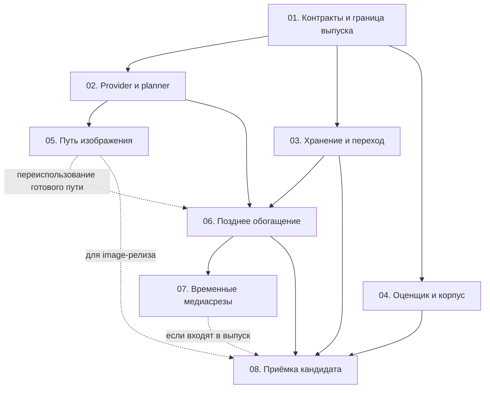
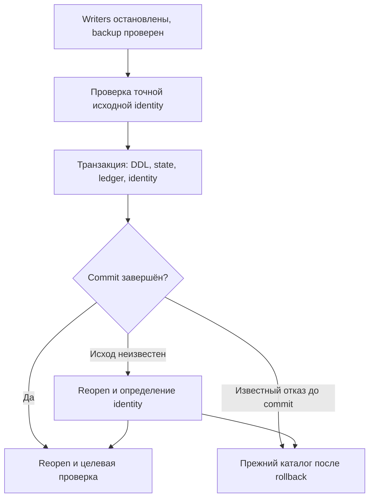

# 03. MDRack: план внедрения, совместимость и переход

## Назначение документа 📌

**Расширение MDRack внедряется через небольшие законченные этапы: общие контракты, независимая подготовка хранения и запросов, первый нативный сценарий, позднее обогащение и последующие медиавходы.** Изменения опираются на существующее ядро и один каталог SQLite. Каждая стадия имеет владельца, проверяемый результат и понятного преемника.

Документ завершает комплект в согласованном порядке **01 → 02 → 04 → 03**. [Заметка №02](02-mdrack-architecture-and-contracts.md) определяет целевое поведение и границы модулей. [Заметка №04](04-mdrack-acceptance-quality-and-observability.md) задаёт критерии приёмки, метрики и диагностику. Здесь устанавливаются последовательность изменения кода, зависимости работ, переход существующего каталога и условия выпуска.

План предназначен для разработчика и управляющего агента. Он не пересказывает сравнение моделей и не создаёт дополнительный каталог тест-кейсов. Обозначения `M04-*` ссылаются на уже сформулированные обязательства. Обозначения `M03-01`–`M03-08` — этапы этого плана.

Исходная ревизия — `master` репозитория MDRack, commit `843b0b4873b95ae80d08ec1d4a8707d6d7d9b676`, сверенный 20 октября 2026 года по UTC. Исследование выполнено чтением исходников, миграций, контрактов и тестов. Код проекта, каталог, модели, сборка и тестовые прогоны при подготовке заметки не изменялись и не запускались.

> [!important] Статус плана
> **CURRENT** обозначает проверенные особенности указанной ревизии. **TARGET** обозначает предлагаемое изменение. Условие завершения этапа не является утверждением, что этот этап уже выполнен. Названия новых операций и модулей не следует использовать как готовые команды установленного MDRack.

## Исходная точка и границы работ 🔎

### Сохраняются действующие владельцы 🧱

`mdrack_core` принимает подготовленные данные, проверяет граф и исполняет поиск. `mdrack_sqlite` владеет общим каталогом, FTS и получением векторных кандидатов. `mdrack_media` содержит чистые медиаконтракты и builders. Приложение связывает источники, обработчики, HTTP-провайдер, CLI и `MDRackEngine`. Текущая производственная граница embeddings — LM Studio HTTP; прямой запуск моделей из Python в неё не входит. [1], [2]

Нативное расширение не требует смены векторного backend. Обычный app-каталог использует точный линейный поиск в Python поверх SQLite. Производительность этого пути оценивается отдельно по №04; включение sqlite-vec или ANN остаётся самостоятельным изменением со своей доказанной необходимостью. [3]

Работа охватывает три профиля подготовки из №02: `textual`, `native`, `native_enriched`. Один выбранный encoder остаётся нормальным вариантом. Дополнительный dense-вектор OCR или transcript может строиться той же моделью. Плагин внешнего приложения, GUI, сервер и reranker не являются зависимостями внедрения.

### Найденные разрывы определяют очередность 🧭

| CURRENT: существенный факт | Следствие для плана |
| --- | --- |
| Текстовый embedding-порт принимает строки; capabilities описывают dimension probe | Сначала фиксируются типизированный вход, роли и реальные возможности адаптера |
| Фабрика provider отправляет любое имя, кроме `fake`, в LM Studio; non-LM Studio identity получает `offline-test` | Регистрация и формирование профиля исправляются до добавления новых адаптеров |
| Image service может сохранить visual vector, но текущий поиск строит текстовый запрос в текстовом пространстве | Первый этап должен включать запись, запрос и чтение результата целиком |
| Обычный `search_unified()` выбирает текстовые проекции даже для image/audio/video scopes | Универсальный медиазапрос получает отдельный контракт |
| App-композиция передаёт `catalog.connection` и создаёт новый `SQLiteResourceStore` | Новая capability должна доходить через композицию до приложения |
| Обычный `open()` не выполняет миграцию; завершённая v2 identity проверяется точно | Для существующего v2 нужен отдельный явный переход |
| Общий verifier привязан к release packet версии 1.3 | Контур следующего выпуска согласуется до первого изменения публичных версий |

Эти ограничения подтверждены соответствующими портами, фабрикой, поисковыми сервисами, storage-композицией и release scripts. [6], [7], [8], [9], [10], [13], [14], [15], [31], [34], [35]

## Исполняемые семьи и три разных результата

Это canonical полный programme; короткий execution entry находится в
[активном плане](../../../.hermes/plans/2026-10-21-native-media-foundation.md).
Документационный/setup срез W1-A реализует поддержку знаний, но не media API.
Технические metadata `verification` выше сохраняют историческую границу исходной
статической сверки; редакционная дата не освежает её доказательства.

| Результат | Достаточная граница |
| --- | --- |
| Runtime proof | Настоящие pixels через конкретный допустимый HTTP interface, finite vector и совместимые query/document recipes |
| Public image без OCR | CLI + engine ingest/search/read, text→image/image→image и image→text если заявлено, nullable text, reopen/new process/installed |
| Image + late-enrichment release | Дополнительно безопасное добавление текста, rescan и сохранение независимых проекций, точный release candidate |

Первый image slice допустим на fresh неизменённом v2. W1-C/Q09 независим от CAS
и его миграции. Image-release исходной программы включает late enrichment;
выпуск без него — отдельное сокращение scope после рабочего public slice.
На доступном исследованном runtime не установлен допустимый HTTP pixels contract:
конкретный live image route BLOCKED, не вся программа и не все версии LM Studio.
Текстовый smoke не является image/quality PASS; speculative payload adapter не внедряется.

| Семья | Зависимости и полный оставшийся результат |
| --- | --- |
| W1-A | Source setup, полный bundle, PFK rules, bounded checker/navigation, verify/CI и installed launcher; отдельное независимое review |
| W1-B / M03-04 | Actual evaluate_quality grade>0; затем versioned target/cutoff, resource duplicate rejection, temporal owner/positive/revision/one-to-one, null misses, negative cases; frozen v1 не переписывать |
| W1-C / Q09 | Operation-owned verified read session после HTTP через spaces/branches/fallback/basis/hydration; MetadataCatalogService обе lexical ветки и non-embedding discovery/CLI consumers; отдельный verify/open barrier; fresh v2 без CAS |
| W1-D / O01–O06 | Технический/source-срез D26 независимо ACCEPTED; четыре knowledge updates выполнены. Actual core/app serialized sinks, полезные поля + privacy sentinels, bounded noise/handlers/cleanup и sink-I/O isolation подтверждены на Windows/CPython 3.14.2 source с fake/MockTransport и реальными SQLite/files/CLI; см. [O03 и graph-only O06](04-mdrack-acceptance-quality-and-observability.md#принятый-срез-w1-d-o03-и-graph-only-o06). OPEN: token/repeat oracle после W3, новый build/installed logging runtime и полные repository/release/model gates; вся O01–O06/native/enrichment программа не закрыта |
| V / M03-01 | Один владелец versions/pins/contracts/lock/tooling expectations, не позднее первого требующего этого public contract delta |
| W2 / M03-02,05 | После общих контрактов и read session: typed provider/roles/capabilities, text adapter embed_query, unknown fail-closed, canonical spaces, independent query/candidates, budgets/family weights, nullable evidence/score_kind и authorized SourceResolver; CLI/engine image без OCR; live boundary отдельно BLOCKED |
| W3 / M03-03 | После contract freeze: neutral publication capability, общий core validator, SQL graph reader/state/token на всех unconditional/CAS/delete/withdraw writers; явный recognized old-v2 upgrade, maintenance/backup/atomic DDL+state+ledger+identity/reopen |
| W4 / M03-06 | После W3 и provider/planner contracts: purpose/variant/source-dependency merge, bounded CAS retry без повторной модели при прежних immediate inputs; manual correction, rescan/import/delete after withdrawal/SQL-owned FTS rebuild; durable manual artifact owner; E01–E11/S01–S07 |
| W5 / M03-04,07 | После общих механизмов: чистые media observations/builders, app decoding/range/sampling/budget; frames, audio, direct video — разные capabilities, async без nested asyncio.run; versioned real media RU/EN/cross-language, unicode61 lexical policy, hard negatives/source-group dev/held-out, original judgments, public search runner A–D/optional E и paired enrichment |
| W6 / M03-08 | Все семьи заявленного scope: exact candidate/versions/exports/imports, installed CLI/engine, фактические OS/Python cells, migration/reopen; G01 requirement→run/status, stale latest PASS не переживает failure; отдельные contract/runtime/quality-cost verdict, R01–R04/T01–T02, cold/warm/sample counts/p50/p95/errors/actual-or-unknown CPU/RSS/runtime/cost/index/sidecars/coverage |

Координатор назначает Coder и одного независимого Reviewer; repairs возвращаются
тем же ролям. Shared contracts/versions имеют одного интеграционного владельца;
app/SQL/core/media/eval owners не дублируются. Git/package publication отдельно
не разрешена. Обычная последующая реализация и необходимая семья V уже входят
в программу и не требуют повторного общего approval.

## Программа из восьми этапов 🗺️

### Зависимости важнее календарной оценки 🔗

План задаёт последовательность готовых результатов. Сроки определяются после ранней проверки нужного runtime и объёма перехода существующих данных. Отсутствие подтверждённого audio endpoint нельзя спрятать в произвольной оценке «ещё два дня».

| Этап | Законченный результат | Основная зависимость |
| --- | --- | --- |
| `M03-01` | Зафиксированы контракты, границы выпуска и первый runtime-маршрут | Сверка текущего checkout и заметок №02/№04 |
| `M03-02` | Типизированный provider, канонические пространства и общий planner работают с прежним текстовым путём | `M03-01` |
| `M03-03` | Snapshot/CAS, все writers и явный переход признанного v2 готовы | `M03-01` |
| `M03-04` | Оценщик исправлен, новый корпус и политика сравнения определены | `M03-01` |
| `M03-05` | Принят контракт сквозного пути изображения без OCR; runtime имеет отдельный статус | `M03-02`; реальная image capability для runtime-приёмки |
| `M03-06` | Позднее обогащение и повторное индексирование сохраняют независимые представления | `M03-02`, `M03-03`; подготовленные графы и артефакты |
| `M03-07` | Добавлены заявленные временные и дополнительные медиамаршруты | Общие механизмы предыдущих стадий и соответствующие capabilities |
| `M03-08` | Принят точный кандидат с проверенной совместимостью, качеством и процедурой перехода | Все стадии заявленного объёма выпуска |



После `M03-01` независимы storage, прикладной embedding/planner и оценочный контур. Разработка первого native-сценария может идти на изолированных тестовых каталогах, пока готовится новая схема. В `M03-05` контракт сквозного пути и реальная runtime capability получают отдельные статусы. Для `M03-06` достаточно принятых контрактов `M03-02`, условной публикации `M03-03` и подготовленных ресурсов с артефактами. Доступность image endpoint не является зависимостью обогащения; готовый image-путь переиспользуется по мере его появления.

Отсутствующий реальный runtime блокирует подтверждение соответствующей capability. Оно не отменяет возможность закончить чистые контракты, SQLite-публикацию, работу с готовым transcript или исправление оценщика. В отчёте эти границы сохраняют разные статусы, как установлено в №04.

Ссылка на `M04-*` в раннем этапе определяет часть обязательства, которую можно проверить на его границе. Полный `PASS` присваивается только после выполнения всего сценария №04, включая зависимые слои. Проверка provider/planner сама по себе не закрывает storage/token-часть `M04-P06`.

### M03-01. Зафиксировать контракт и следующую линию выпуска 📐

На старте реализации проверяются HEAD и незакоммиченные изменения выбранного checkout. План привязывается к фактической ревизии; посторонние изменения сохраняются. Если код уже отличается от baseline заметки, сначала устанавливается конкретная разница в затрагиваемых модулях. Новое полное исследование всего продукта для этого не требуется. [1], [38]

Принимается один согласованный пакет контрактов: подготовленные embedding inputs и роли, capability маршрутов, канонический профиль пространства, политика производного текста, типизированный query/result, source/artifact provenance и дополнительный publication-порт. В этот же пакет входят принадлежащая приложению схема событий и nullable media projection.

До расхождения исполнителей фиксируются точные имена экспортируемых типов, сигнатуры и закрытые поля ответов. Старый `CatalogPort` не получает обязательные методы snapshot/CAS. Новая capability описывается отдельным портом; её отсутствие обнаруживается до дорогой операции обогащения. Валидация графа остаётся общей.

Правила core уже требуют оформлять следующий RC через ADR, точный export snapshot, compatibility evidence и migration note. Следующие номера пакетов назначаются на этой стадии. Номер distribution, версия API, версия схемы SQLite и fingerprint модели остаются отдельными идентичностями. [4]

Сейчас app имеет версию `1.3.0` и точные зависимости на core/media `1.0.0rc1`, SQLite `1.0.0rc2`. Release validator проверяет именно этот набор. Поэтому одновременно выбирается контракт следующей линии: development gates проверяют изменяемую реализацию, а итоговый release packet создаётся для точного нового кандидата. Исторический packet сохраняет принадлежность прежним исходникам. [30], [31]

Ранняя проверка осуществимости берёт один разрешённый image input, конкретную связку модели/runtime/endpoint и нужные query/document роли. Её задача — подтвердить транспорт и совместимость результата, а не выбрать модель по качеству. Dimension probe и fake provider такого подтверждения не дают. Если выбранная интеграция медиавход не поддерживает, это фиксируется как блокировка конкретного маршрута; незаявленный облачный adapter не подставляется автоматически. [7], [8]

**Граница завершения:** интерфейсы позволяют независимо реализовать storage и app, назначен один владелец общих версий/exports, определены применимые `M04-U02–U03`, `M04-G01` и проверяемый native-маршрут. Открытые runtime-ограничения перечислены точно. Новая версия API не означает, что её возможности уже прошли runtime- или quality-приёмку.

### M03-02. Ввести provider и planner через совместимый текстовый путь 🔌

Основные существующие файлы — `ports/embeddings.py`, `domain/profiles.py`, `embeddings/runtime.py`, `config/models.py`, `application/textual_embedding_space.py` и `application/resources.py` внутри `src/mdrack/`. Конкретный HTTP-протокол остаётся в `integrations/`. Новые узкие модули допустимы для подготовленных inputs и planner, например `domain/embedding_inputs.py` и `application/query_planning.py`; это предлагаемые пути TARGET.

Старый текстовый provider оборачивается в новый контракт с text-only capability. Его поисковый метод продолжает вызываться как `embed_query()`: подмена на обычный `embed([query])` способна изменить query instruction и сопоставимость пространства. В реестре неизвестное имя адаптера отклоняется; случайный переход в LM Studio или `offline-test` устраняется. [6], [7], [8]

Каноническое пространство формируется из целого совместимого профиля. Один разрешённый профиль создаёт одно и то же описание space для разных модальностей. Старый `CanonicalTextEmbeddingSpace` может остаться совместимым facade. Для неизменного текстового профиля сохраняются прежние IDs и смысл fingerprints; простой `rekey_batch()` не используется как конвертер чужих векторов. [41]

Общий planner подготавливает core-ветки. Он разрешает роль, пространство, basis, scope и бюджеты представлений, затем передаёт исполнение и RRF существующему ядру. Политика старых методов сохраняется в адаптации их входа. В частности, прежний `search_unified()` остаётся поиском текстовых проекций, а новый typed API умеет выбирать кандидатов независимо от модальности запроса. [10], [39]

Настройки `textual/native/native_enriched` добавляются отдельно от `search.default_mode`. Параметры создания артефакта, lexical/dense публикации и обработки запроса проверяются до I/O. Обычная заметка продолжает получать embedding при `derived_text.dense=false`. Медиа без разрешённого текста не создаёт фиктивную FTS-ветку.

Новые операции подключаются к `MDRackEngine` и CLI через один use case. Новая бизнес-ветка внутри Click не создаётся. Диагностика маршрута и безопасные ошибки вводятся вместе с этим путём: они нужны для проверки реально выбранных действий уже на первом этапе.

**Граница завершения:** прежние текстовые результаты и provider calls сохраняют принятый контракт; новые типизированные планы проходят соответствующие `M04-P02–P06`, `M04-Q01–Q08`, `M04-U01–U03` и `M04-O01–O05` на объявленной offline/local границе. Нативная полезная нагрузка пока не считается принятой только на основании этих тестов.

### M03-03. Подготовить публикацию и переход каталога 🔐

В core добавляются нейтральные records/порт публикации и условный entry point индексирования. Нынешний `CoreIndexingService` уже владеет валидацией batch. Общая проверка выделяется так, чтобы безусловный и условный маршруты использовали одну реализацию; приложение не копирует `_validate_batch`. [19]

В SQLite-пакете меняются `resource_store.py`, `catalog.py`, `migrations_v2.py`, `contract_v2.py` и новая прошедшая review миграция в `v2_migrations/`. Сначала фиксируется соответствие состояний, ограничений и SQL, затем пишется миграция. Применённые `0000`–`0004` остаются неизменными. Подробная процедура перехода приведена ниже. [3], [16]

Сборка полного графа переносится из `PreparedResourceExportService.export_batch()` к владельцу SQLite. Общий reader используется существующим export facade и новым snapshot, где позволяет контракт. Snapshot читает graph и state в одной read-транзакции. Старый v1 facade не становится способом открытия app v2. [12]

Для записи выделяется внутренняя операция сохранения графа, используемая внутри принадлежащей store транзакции. CAS проверяет expected state и публикует граф вместе с новым token. Нельзя открыть внешнюю транзакцию и вызвать прежний публичный `replace_resource()`: текущий writer такое вложение отвергает. [18]

Все реализации безусловного replace/delete на новой схеме также обновляют состояние. Сама низкоуровневая полная замена сохраняет свой прежний смысл. Сохранение независимых representations обеспечивает прикладное объединение на стадии `M03-06`.

Отдельная задача — передать проверенный каталог и publication capability через app-композицию. Сейчас `create_application_storage()` оставляет только соединение, а `CoreCompatibilityStorage` создаёт новый store. Добавление методов исключительно в `SQLiteCatalog` не исправит этот путь. Композиция должна сохранять проверенную identity, корректный lifecycle handle и одного владельца SQL. [13]

**Граница завершения:** принята storage-часть `M04-S01–S08` на настоящем актуальном файловом каталоге и применимые части `M04-U03`, `M04-O02/O05/O06`. Приняты fresh-create, явное обновление признанного v2, повторное открытие и взаимодействие всех writers с новым состоянием. Повторное прикладное объединение обоих дополнений из `M04-S02` окончательно принимается в `M03-06`. Проверка на старом общем v1 fixture не заменяет app v2 evidence.

### M03-04. Подготовить оценщик до сравнения моделей 📏

Работа идёт параллельно с provider и storage. Её владельцы — `src/mdrack/eval/`, соответствующие `tests/unit/test_eval_*`, контракт и validator публичного корпуса, сценарии в `scripts/`. Сначала закрываются арифметические и смысловые ошибки, перечисленные в №04: grade 0, повторный gain ресурса, принадлежность временных координат, отсутствие совпадения и единица cutoff.

После прохождения ручного эталона `M04-M01–M02` фиксируется новая версия оценочного набора. В неё входят реальные медиавходы, русский и английский, независимые dev/held-out группы и необходимые отрицательные примеры. Старые frozen bytes не переписываются ради новой модели. Матрица направлений отражает заявленные capabilities.

Первые сравнения используют одинаковые подготовленные тексты, чтобы отделить влияние encoder от ошибок OCR/ASR. Затем выполняется сравнение полного пути с реальной обработкой. Конфигурации A–E, определения метрик и ограничения неполной разметки уже заданы в №04; здесь требуется реализовать их через общий публичный search-путь.

До итогового прогона у профиля фиксируются допустимая регрессия, критические срезы, требуемая польза нового сценария и бюджет затрат. Числа зависят от корпуса и окружения и не назначаются задним числом по удачному результату. Отсутствие согласованной политики блокирует вывод о пригодности профиля, сохраняя возможность принять его технические контракты.

**Граница завершения:** оценщик проходит собственный эталон, corpus/query/judgments/evaluator версионированы, выбранная политика воспроизводима. Выполнение `M04-R01–R04` и `M04-T01–T02` с настоящей моделью продолжается по мере готовности сквозных маршрутов; текущий этап не выдаёт подготовку набора за измеренное качество.

### M03-05. Закончить нативный сценарий изображения 🖼️

Первый сквозной результат включает явно выбранное изображение без OCR, его индексирование, текстовый запрос к изображению, запрос самим изображением и чтение найденного unit с `text=None`. Если профиль заявляет image → text, в этот же срез входит поиск заметок по изображению.

Основная реализация расширяет `ingestion/images.py`, общий embedding adapter и planner, `public_api/engine.py`, новые media DTO и CLI. Текущий image service уже создаёт vector-only representation. Эту основу следует подключить к общим контрактам. При этом нынешний CLI требует caption/OCR и сам собирает текстовый путь; наличие injected visual provider только в Python не закрывает CLI-сценарий. [9], [11]

Запрет одинаковых text/visual space IDs заменяется проверкой полного канонического профиля. Существующий `ImageEmbeddingSpace.core_record()` создаёт разную metadata в зависимости от модальности, поэтому удаления одного условия недостаточно. Запись и запрос должны пользоваться согласованным record одного пространства. [9]

Nullable чтение исправляется вместе с этим срезом. Нынешнее объявление `UnitReadProjection.text: str` расходится с допускающим `None` core-полем. Новая версия публичного контракта описывает отсутствие текста честно; имя файла, OCR-заглушка или пустая строка не становятся подставным содержимым. [12]

Контракт сначала проверяется управляемыми inputs/vectors, затем один реальный разрешённый image payload проходит adapter и публичный поиск. Смысловая релевантность подтверждается оценочным набором отдельно. Для этой стадии не требуется сразу реализовывать распознавание всех картинок или весь набор аудиоформатов.

**Граница завершения контрактной части:** применимые части `M04-P01–P06`, `M04-Q01–Q08`, `M04-U01–U03`, `M04-O01–O06` связаны со сквозными offline/local проверками. Runtime-приёмка реальной image capability фиксируется отдельно и может оставаться заблокированной после завершения этой части. Для выпуска с заявленным native image она обязательна в `M03-08`. Общая готовность обновлённой установки дополнительно зависит от storage-перехода `M03-03`.

### M03-06. Подключить обогащение и сохранение независимых проекций 🌱

Первая семья [ready OCR v1](../../contracts/ready-ocr-v1.md) и
[ADR-0015](../../decisions/0015-ready-ocr-publication.md) независимо принята на
Windows/CPython 3.14.2 в source/local-component и non-editable installed границах;
W4-R1 CLOSED. Проверены публичные engine/CLI, caller-owned файл, actual FTS,
сохранение native/independent графа и vector bytes, repeat/correction, bounded CAS,
stale-result refusal, reopen/new process и нормальный source-validated image rescan.
Готовый контур M03-06 — [prepared enrichment v1](../../contracts/prepared-enrichment-v1.md)
и [ADR-0016](../../decisions/0016-prepared-enrichment-and-artifact-custody.md) — также
независимо принят в Windows/CPython 3.14.2 actual Root/local-component и свежей
non-editable installed границах; W4-R2 CLOSED. Проверены готовые OCR/text/transcript/
frame/video projectors, четыре lexical/dense intent, зависимости и ручные коррекции,
bounded CAS, source-transition/reindex/withdrawal, отдельный реальный host archive
и reopen после удаления caller/cache копий. Affected strict gate проходит; прежние
103 whole-repository diagnostics остаются отдельным долгом. Документированный Core
publication inventory синхронизирован без изменения Core. Live runtime,
качество/стоимость, W5/W6 и полная квалификация выпуска из этого результата не следуют.

Реализованные `application/enrichment.py`, `PreparedArtifactService` и `ReindexService`
владеют объединением готовых артефактов и условной публикацией. Caller file либо
отдельный host archive подтверждает фактическую доступность. `ArtifactCache` остаётся
очищаемым средством повторного использования, не каталогом жизненных циклов,
обязательным job store или единственным владельцем ручного текста.

Извлечение отделено от окончательного ingest. Готовые projectors переиспользуют
provider-free `TranscriptIngestionService.prepare()` и `VideoCompositionService.prepare()`,
не вызывая целый `ingest()` ради дополнения. Управляемые обычные producers используют
условное сохранение; низкоуровневый явный replacement сохраняет прежний смысл. [21], [22]

До вычисления и внешнего I/O читается исходный snapshot: фиксируются lifecycle, token, source binding и непосредственные входные ревизии. Затем определяется, пригоден ли готовый артефакт для этих входов и recipe, либо требуется разрешённое вычисление. Строятся только запрошенные поисковые проекции по четырём сочетаниям lexical/dense из №02. Настоящий transcript остаётся текстовым артефактом; nullable становится поисковая проекция, когда FTS запрещён. Вариант только для чтения не требует нового core batch.

Для уже подготовленного внешнего артефакта snapshot читается в начале новой операции публикации. Само наличие артефакта не даёт права записать его в текущий lifecycle без проверки привязки и ревизий.

Ключ дорогого вычисления учитывает непосредственный вход. Для операции над исправленной расшифровкой это её artifact revision, а не только hash исходного аудио. Смена намерения публикации, например включение FTS, не должна сама создавать необходимость нового ASR. Существующие cache fingerprints дают основу для этого разделения. [20]

После вычисления use case проверяет исходное expected state, сохраняет независимые representations/units/vectors/facets и публикует полный граф через CAS. При конфликте разрешены перечитывание snapshot и ограниченный повтор объединения, если lifecycle и непосредственные входы прежние. Новый snapshot после вычисления не выдаёт старой операции право на новый lifecycle после delete/recreate. Изменившийся исходник или ручная правка не вытесняются запоздалым автоматическим результатом.

В эту же стадию входит повторное индексирование. Корректный enrichment не спасает данные, если следующий rescan снова отправляет неполный replacement. Прикладные producers переходят на общее сохранение независимых дополнений; низкоуровневый безусловный replace остаётся доступным по своему явному контракту.

Read-only текст в очищаемом кеше получает честную гарантию доступности. Для единственной ручной расшифровки нужен долговременный artifact owner хоста. Очистка кеша не удаляет независимый native vector и уже опубликованный текст в SQLite. Запрос долговременного хранения не удовлетворяется скрытым включением FTS.

**Граница завершения:** `M04-E01–E08`, `M04-S01–S07` и связанные `M04-O02/O05/O06` проходят на объединённом пути. Проверяется не только cache hit, но и выполненное намерение публикации. Обогащение готовым артефактом можно принять без live OCR/ASR; способность реально получить такой артефакт подтверждается отдельно.

### M03-07. Расширить временные и дополнительные медиамаршруты 🎞️

Следующие срезы используют те же provider, planner и publication service. Практический порядок начинается с доступного повторного использования: кадры видео могут кодироваться уже работающим image adapter; audio segments требуют собственной подтверждённой audio capability. Прямой video input является отдельной возможностью и не следует из поддержки кадров.

В `mdrack_media` добавляются чистые подготовленные native observations/builders. Нынешние `TimedTextAtom`, transcript и frame-caption records сохраняют требование настоящего текста. Acoustic vector не помещается в transcript builder, а пустая подпись не превращает frame-caption в нативный кадр. [26]

Прикладной слой отвечает за декодирование, диапазон, выбор кадров и абсолютные координаты относительно исходного материала. Recipe и provenance фиксируют реально обработанный интервал. Несколько кадров не объявляются обработкой всего видеосодержимого; один аудиоклип не означает расшифровку всей записи.

Текущие `raw_audio.py` и `raw_video.py` — синхронные узкие пути с внешними обработчиками и внутренним `asyncio.run(...)`; подготовленные текстовые композиции вызываются с `embeddings=False`. Новый async engine-путь выделяет awaitable orchestration, а прежняя синхронная обёртка остаётся на внешней границе. Вложенный `asyncio.run()` внутри уже работающего event loop не используется. [24], [25]

`raw_source_provenance.py` даёт основу для ограниченного снимка, проверки сигнатуры, бюджета и изменения входа. Его временный snapshot не обещает долговременного хранения оригинала. Новый resolver вводит явную политику доступа к выбранному вложению; прежнее ограничение raw-import на расположение файла относительно root не переносится автоматически на все источники внешнего хоста. Обычный Markdown scan при этом сохраняет свою политику обработки ссылок. [23], [24], [25]

**Граница завершения:** каждый заявленный маршрут проходит применимые P/Q/U/E/S-критерии и временные M/R-критерии №04 с корректным locator. Поддержка кадров, аудиодорожки и прямого video input указывается раздельно. Ограниченный image-релиз может выйти раньше; он не рекламируется как уже проверенный audio/video-релиз.

### M03-08. Принять точный кандидат и завершить поставку 📦

На этой стадии сходятся техническая приёмка, работа реального runtime, решение о качестве и процедура перехода. Статусы остаются раздельными. При заявленном native image нельзя заменить отсутствующий runtime-прогон зелёными fake tests, а хорошим nDCG нельзя компенсировать потерю представления после rescan.

Собирается согласованный набор distributions с актуальными pins и проверенными публичными импортами. CLI и embedded API проверяются на установленных артефактах вне source import path. Предусмотренная среда Windows требует своих фактических проверок; наличие Windows job в CI не доказывает исполнение всех медиасценариев. [32], [33], [42]

Обновлённый release packet связывает исходники, параметры сборки, артефакты, выполненные проверки и ограничения. Он относится к точному кандидату. Изменение отслеживаемых байтов после фиксации, включая current docs, требует обновления идентичности кандидата и затронутых доказательств по действующему release-контракту. [31], [36]

**Граница завершения:** `M04-G01` содержит результаты всех обязательных критериев заявленного объёма, `M04-R01–R04` и `M04-T01–T02` для принятых профилей, package/repository gates и проверку перехода каталога. Пригодность остающихся экспериментальными профилей не подразумевается. Публикация пакета или release выполняется отдельной разрешённой операцией с этим конкретным кандидатом.

## Переход существующего каталога к новой схеме 🗄️

### Решение ограничено признанным app v2 🎯

План предлагает **явное обслуживание существующего чистого app v2**. Это отдельное изменение нынешнего правила, по которому приложение не обновляет существующие каталоги. Оно оформляется в ADR и синхронизируется с DATA/ARCH и lifecycle-документацией при реализации. Запрет нормального app-перехода из legacy v1/app bridge сохраняется. [2], [3]

Baseline v2 имеет family `mdrack_sqlite_catalog_v2`, version `0004` и точный manifest `0000`–`0004`. Новая ревизия сохраняет эту семью и добавляет прошедшую schema review миграцию. Номер и имя файла резервируются по актуальному дереву до SQL-работы; приведённый план не выдаёт ещё не созданную миграцию за существующий файл. [16]

Одного дополнения `v2_migrations/` недостаточно. `_validated_applied_prefix()` сравнивает уже записанную завершённую identity с compiled version/digest текущего пакета. После расширения manifest прежняя завершённая identity перестанет совпадать. Возобновление незавершённого создания и обновление работающего каталога должны оставаться разными операциями. [15]

### Матрица открытия задаётся до реализации 🚪

| Сочетание | TARGET: результат |
| --- | --- |
| Старый binary открывает baseline v2 | Прежнее поддержанное поведение |
| Старый binary заново открывает новую ревизию | Отказ по несовместимой identity/schema |
| Новый обычный app открывает baseline v2 | Понятное требование явного обновления, без записи в базу |
| Новый read-only app открывает baseline v2 | Такое же отсутствие автоматического перехода; обычный старый режим работы не добавляется |
| Новый app открывает новую ревизию | Полная проверка и штатное открытие |
| Maintenance получает точный baseline v2 | Допустим только объявленный переход к целевой identity |
| Maintenance получает уже целевую identity | Проверка и идемпотентный исход «уже соответствует» |
| Обычный app или maintenance получает v1, app bridge, неизвестную или повреждённую схему | Отказ без попытки угадать совместимость |

Для первого внедрения новый app имеет одну рабочую schema identity. Узкий maintenance preflight умеет проверить исходную identity, но не превращается в параллельный production reader/writer старой схемы. Самостоятельный generic SQLite API сохраняет свою отдельно объявленную совместимость; она не становится fallback нормального приложения. [3], [14]

### Подготовка начинается с остановки writers 🛑

Перед переходом останавливаются приложение, embedded consumers и фоновые действия, закрываются их SQLite handles. Старый binary обычно отвергает новую схему при новом открытии, но уже открытое старое соединение не начнёт автоматически вести новые tokens. `BEGIN IMMEDIATE` сериализует запись, однако не запрещает старому процессу вернуться после commit миграции. [14], [18]

Режим обслуживания принадлежит приложению или хосту, управляющему данным store. Проверка lock/busy является дополнительной проверкой, а не доказательством отсутствия всех старых процессов. Если исключительное обслуживание обеспечить нельзя, обновление откладывается с конкретной причиной. Оно не заменяется попытками одновременно обслуживать старых и новых writers.

Согласованная резервная копия создаётся через SQLite-aware механизм и проверяется до изменения каталога. Простое копирование только main-файла активной WAL-базы не задаётся процедурой резервирования. Копия хранится по явно выбранному пути **вне `<store>`**: текущая topology рекурсивно отвергает второй SQLite main даже в подкаталоге и даже после переименования расширения. [17]

Backup является артефактом восстановления. Он не становится вторым активным индексом, поколением каталога или кандидатом, который приложение автоматически ищет при ошибке. Текущий рабочий путь остаётся `<store>/catalog.sqlite3`.

### Что меняется внутри перехода 🧬

Новая state-таблица хранит состояние, переживающее снятие поискового графа. Она не должна исчезать через `ON DELETE CASCADE` вместе с `core_resources`: иначе потеряются и `live_without_projections`, и tombstone удаления. Это проверяется на стадии schema review до написания SQL.

У уже существующих живых ресурсов создаются новые локальные lifecycle IDs и tokens. Привязка источника опирается на подтверждённый namespace и locator. Представления, units, векторы, facets и FTS сохраняют своё содержание. Обновление схемы не вызывает encoder, OCR/ASR, не меняет codec и не пересчитывает модельные fingerprints.

История удалений до перехода не восстанавливается из отсутствующих строк. Старым задачам не выдаются новые tokens задним числом. Повторное выполнение после перехода начинается с актуального состояния и проверенных входных зависимостей.

`ResourceRecord.content_hash` не переименовывается по смыслу в raw-source revision: у подготовленного медиа это может быть идентичность артефакта. Если старое provenance не доказывает ревизию оригинала, миграция сохраняет отсутствие такой гарантии. Доступный путь к файлу сам по себе её не восстанавливает. [23]

Для последующего сырьевого обогащения такой материал проходит отдельную проверку привязки. Если сопоставимость старых проекций с выбранным исходником доказать нельзя, требуется явно подготовленная новая публикация или переиндексация нужных представлений. Старые векторы не объявляются подтверждёнными для только что прочитанных байтов. Готовый поисковый граф остаётся читаемым в пределах своей фактической provenance.

### Переход выполняется одной атомарной операцией ⚛️

Maintenance проверяет точную исходную identity, полный ordered manifest, canonical object fingerprint и целостность. После получения права записи исходное состояние проверяется повторно внутри операции. Объявленный переход объединяет DDL, инициализацию state, новые ledger rows и замену schema identity в одну транзакцию.

Текущий `apply_v2_migrations()` применяет SQL через отдельные `executescript(... BEGIN ... COMMIT ...)`, затем отдельно записывает identity. Оборачивание этой функции ещё одним `BEGIN` не даст требуемый атомарный upgrade. Нужен transaction-aware путь перехода у владельца SQLite; контракт свежего создания сохраняется и проверяется отдельно. [15]

До commit проверяются целевая схема, ограничения и ожидаемая сохранность графа. После commit каталог заново открывается и проверяется целевым кодом. При управляемой ошибке до commit остаётся прежний целый каталог. При прерывании около неизвестной границы commit допустима исходная либо целевая завершённая identity; смешанная схема недопустима.



Если после прерывания identity не соответствует ни одному завершённому состоянию, это отдельный отказ проверки. Обычный app не открывает такую базу и не начинает ремонт по догадке.

Cleanup свежего `create_v2()` не переиспользуется для upgrade. При создании допустимо убрать только что зарезервированный неготовый файл. Ошибка обновления существующего каталога такого права не даёт. Повреждение или неудачная проверка не означают разрешения удалить прежнюю коллекцию. [14]

### Уточнение приёмки M04-S08 для перехода 🧪

Здесь конкретизируется уже установленный критерий схемы. Фикстура baseline v2 создаётся по неизменной исходной identity. Проверяются fresh target и явный old-v2 → target переход, включая повторный вызов на целевой схеме.

| Проверка этапа | Необходимое доказательство |
| --- | --- |
| Сохранность данных | Совпадают логические графы, locators, metadata/facets, payload bytes векторов, codecs и fingerprints |
| FTS и поиск | Опубликованный текст и результаты контрольных запросов сохранились в объявленной области |
| Новое состояние | Каждый существующий живой ресурс получил согласованные lifecycle/token; чужая история не придумана |
| Управляемый отказ до commit | После reopen остаются исходные identity и полный граф |
| Прерывание процесса | После reopen видна одна завершённая признанная identity, проверки integrity/FK выполняются отдельно |
| Соседние файлы и backup | Исходники не изменены, резервная копия пригодна, основной путь каталога единственный |
| Несовместимость | Unknown/legacy/mixed store отвергаются; обычный open не мигрирует |

Одного сравнения количества строк недостаточно. Хеш основного SQLite-файла также не служит оракулом логического состояния: в WAL-режиме часть подтверждённых изменений может находиться в sidecar до checkpoint. Проверяется содержательная сохранность нужных данных через корректно открытый каталог и отдельно появление нового состояния.

### Откат зависит от того, что произошло после обновления 🛟

| Ситуация | Допустимая процедура |
| --- | --- |
| Контролируемый отказ до commit | Обычный rollback транзакции; прежний каталог сохраняется |
| Ответ о завершении потерян | Reopen и определение фактической identity; исход не угадывается по отсутствию лога |
| Новая схема записана, новых пользовательских изменений ещё нет | Явное восстановление проверенного backup в режиме обслуживания |
| После перехода появились новые расшифровки, правки или публикации | Исправление новой версии либо отдельно спроектированный перенос данных; старый backup не обеспечивает возврат без потерь |
| Новый embedding-профиль даёт плохую выдачу | Возврат к пригодному профилю или ограничение capability; SQL downgrade для этого не требуется |

Восстановление снова требует остановки всех потребителей и корректного обращения с WAL/SHM. Старый backup не включает позднейшие изменения. Если единственные read-only артефакты хранятся у хоста, их сохранность проверяется отдельно: копия SQLite не обещает упаковать всё внешнее содержимое.

## Все пути записи входят в один план публикации 🧵

### Инвентаризация защищает от обходных маршрутов 🗂️

Storage CAS защищает от устаревшего expected state. Он не может сохранить отсутствующие в переданном batch проекции за приложение. Поэтому приёмка охватывает и низкоуровневого writer, и производителей полного графа.

| Существующий владелец | Изменение или обязательная проверка |
| --- | --- |
| `mdrack_sqlite/resource_store.py` | Один механизм записи графа; state меняется вместе с replace/delete/CAS/withdraw |
| `mdrack_sqlite/catalog.py` | Проверенный handle, новая capability и верная identity; корректное закрытие соединения |
| `application/compatibility.py` | Capability не теряется при композиции; `replace_file` и `delete_file` участвуют в принятой lifecycle-политике |
| `application/resource_catalog.py` | SQL-export делегирует общему reader; delete учитывает живое состояние без графа |
| `application/manifest.py` и import facade | Импорт проходит общую валидацию и запись; не наследует чужое право публикации |
| `ingestion/images.py` | Source guard действует и в условном пути; ingestion/delete не обходят state |
| `application/transcript_ingestion.py`, `video_composition.py` | Подготовка дополнения отделена от окончательной публикации |
| `cli/commands/rebuild.py` | FTS rebuild и embedding rebuild имеют явно ограниченную область действия |

В таблице сокращённые пути `application/`, `ingestion/`, `cli/` относятся к `src/mdrack/`; `mdrack_sqlite/` — к `packages/mdrack-sqlite/src/`. Перечисленные текущие writers и facade подтверждены кодом. [9], [12], [13], [14], [18], [21], [22], [28], [29]

На стадии интеграции отдельно проверяются оболочки наподобие `_GuardedWritePort`: новая публикация должна сохранить проверку исходной ревизии перед записью. Прямой вызов нижнего store ради получения CAS не должен обходить существующую проверку источника. [9]

### Удаление работает и после withdrawal 🗑️

Нынешний прикладной `delete_resource()` сначала проверяет `read_resource()` и вызывает writer только при найденной поисковой строке. После withdrawal такая строка отсутствует, хотя lifecycle жив. Этот shortcut заменяется проверкой состояния публикации. Аналогичные предпосылки проверяются в `delete_file()` и обслуживании удалённых исходников. [12], [13]

Для новой версии предлагается точная семантика сохраняемого boolean `deleted`: `true`, если завершён живой lifecycle, в том числе без опубликованных проекций; `false`, если материал никогда не существовал либо уже удалён. Для прежних состояний результат сохраняется. Новый случай фиксируется в версии контракта и тестах, без добавления неожиданных обязательных полей в старый JSON.

Удаление не используется как замена withdrawal. При временном отсутствии пригодных проекций материал может снова публиковаться с актуальным token того же lifecycle. После настоящего удаления прежняя задача такого права не получает.

### Обслуживание FTS не извлекает скрытый текст 📝

Сейчас `CoreCompatibilityStorage.rebuild_fts_index()` напрямую выполняет SQL в application. Эту механику следует делегировать SQLite-владельцу и оставить восстановлением из уже опубликованных `unit.text`. Внешний read-only artifact или dense-only transcript не становится текстом FTS из-за команды rebuild. [13]

Детерминированное восстановление FTS из того же принятого графа само по себе не меняет resource lifecycle/token: оно восстанавливает производный индекс, сохраняя смысл графа. Операция сериализуется с обычными записями у владельца SQLite. Если меняются опубликованные тексты, назначения проекций или соответствующая политика, это оформляется как предусмотренная публикация либо изменение версии, а не маскируется ремонтом индекса.

Нынешний `rebuild embeddings` запускает принудительное Markdown индексирование. Он не является готовой командой пересчёта всех новых native media representations. Новая операция подготовки выбранных медиапроекций вводится явно и проходит общий use case. [29]

## Переход между профилями подготовки 🎛️

### Настройка не изменяет уже сохранённые векторы 🧠

Смена `textual` на `native` определяет будущую подготовку. Для материала, у которого есть только текстовый embedding, нативный вектор ещё нужно получить. Смена названия профиля, `space_id` или metadata не выполняет этого преобразования.

Переход выполняется для явно выбранного набора ресурсов. Сначала определяется готовность источников и нужных входов, затем строятся новые представления, после чего публикуется актуальный полный граф. Операция возвращает фактическое покрытие: сколько материалов подготовлено, что не поддерживается и где исходник недоступен. Ни search, ни read не запускают массовый пересчёт по факту изменения настройки.

| Переход | Что действительно требуется |
| --- | --- |
| `textual` → `native` | Подготовить прямой медиавход и новый пригодный вектор; прежний текст остаётся по явной политике |
| `native` → `native_enriched`, lexical only | Получить или взять совместимый готовый текст и опубликовать его в FTS; независимый native vector не пересчитывается |
| Dense-only transcript → FTS + dense | Проверить доступность того же текста и входную ревизию, добавить lexical projection; использовать прежний совместимый вектор |
| Изменение самой расшифровки | Обновить её проекции и зависимые vectors; независимое нативное аудио сохранить |
| Несовместимая смена encoder/embedding recipe | Создать совместимое новое пространство и фактически пересчитать нужные векторы |
| Изменение нарезки или выборки кадров | Пересобрать зависимые units и их координаты/provenance; прежние IDs не приписывать другому диапазону |

Если единственная нужная копия dense-only текста была очищена из кеша, дешёвое включение FTS уже невозможно обещать. Требуется доступный долговременный artifact либо явно разрешённое повторное получение. Возможность reuse зависит от наличия и применимости артефакта, а не только от существования вектора.

### Частично подготовленный корпус описывается явно 🌓

В каталоге могут временно оставаться прежние пространства, пока готовится выбранный новый профиль. Это сохранённые данные для объявленного перехода или возврата; они не требуют одновременного запуска второго encoder.

Новый запрос сравнивается только с совместимыми готовыми векторами. Старые векторы другой модели не включаются в тот же nearest-neighbor расчёт и не получают новый fingerprint ради заполнения выдачи. Если профиль разрешает FTS, лексический канал может продолжать работать по уже опубликованному тексту.

Принятие нового профиля учитывает готовность требуемой части корпуса. Результат на небольшой подготовленной доле нельзя объявить качеством всего каталога. Критерий достаточного покрытия входит в паспорт перехода и в `M04-R/T`; окончательная смена выбранного профиля выполняется после этого решения.

Старые представления удаляются отдельной управляемой публикацией, когда понятны их потребители и возможность восстановления. Отключение их участия в запросе не обязано немедленно уничтожать данные. При этом не вводятся две автоматически переключаемые базы или поиск случайного «рабочего поколения».

## Совместимость публичных поверхностей 📬

### Старые входы проверяются своими оракулами 🤝

| Поверхность | Контракт внедрения |
| --- | --- |
| Прежний `EmbeddingProvider` | Работает через совместимую text-only адаптацию; query/document semantics сохраняются |
| `--mode text` | Продолжает обозначать лексический поиск |
| `search_unified()` и его `scope=all` | Сохраняют текстовый контракт; новый typed media search вводится отдельно |
| Existing whole-resource similarity | Сохраняет basis и отсутствие provider call; запрос от кадра/интервала является отдельным retrieval route |
| Закрытые DTO/envelopes | Новые обязательные поля вводятся только в новой версии/новом контракте |
| Старый минимальный `CatalogPort` | Не получает обязательный publication-порт; поддержанная старая capability остаётся пригодной |
| Prepared-resource manifest v1 | Переносит подготовленный граф с прежней формой, сохраняя versioned metadata extension rules |

Существующий unified-text контракт и compatibility registry дают инвентарь старых потребителей. Обёртку не обязательно удалять ради нового дизайна: она может делегировать общему владельцу. Удаление требует предусмотренных importer, parity и installed-package проверок. [39], [40]

Старые методы могут иметь собственные исторические правила деградации и score mapping. Общий planner принимает их явную политику совместимости. Новый adaptive hybrid не распространяется на них незаметно. Raw similarity score и RRF score нового retrieval сохраняют различимый смысл, как определено в №02.

### Import/export сохраняет границу переносимого графа 📤

Prepared-resource manifest v1 не становится журналом состояния каталога. `state_token`, локальный lifecycle и tombstone принимающего хранилища не импортируются как действующее право записи. Импорт создаёт или меняет локальное состояние через проверенный writer. [27], [28]

Для существующего ID прежний режим import сохраняет явно описанную полную замену. Merge независимых проекций является отдельной операцией со snapshot/CAS; его нельзя внезапно приписать старому import. Повторный импорт на новой схеме учитывается среди writers и меняет token по принятому контракту.

Manifest не гарантирует переноса медиабайтов и внешних read-only artifacts. Если ссылка на артефакт после переноса не разрешается, это доступность артефакта, а не повреждение уже принятого вектора. Snapshot/export reader может иметь общий внутренний механизм, но публичный manifest не получает служебные верхнеуровневые поля без новой версии.

## Версии, проверки и выпуск 🏷️

### Согласуется весь набор версий 🔧

Изменение public API затрагивает больше одной строки `version`. На стадии `M03-01` составляется ограниченный список файлов единого versioning-среза. При сборке он проверяется целиком.

| Группа | Существующие точки синхронизации |
| --- | --- |
| Distribution и зависимости | Корневой и package `pyproject.toml`, `uv.lock`, app version export |
| Контракты и exports | Core/media contract modules, соответствующий SQLite API contract, ordered export snapshots |
| Схема | `contract_v2.py`, immutable migration manifest, схема и migration notes |
| Старые потребители | `tests/core/test_contract_freeze.py`, `test_v11_contract_freeze.py`, packaging tests и future-host fixture |
| Установка | `scripts/check_installed_package.py`, exact dependency expectations в `offline_release_matrix.py` |
| Активный выпуск | Release packet/validator, `verify.sh`, `verify.ps1`, CI и runbook |

В CURRENT `check_installed_package.py` содержит `EXPECTED_VERSION` и списки imports/exports, а `offline_release_matrix.py` — точные зависимости между пакетами. Поэтому произвольная смена версии в одном `pyproject.toml` создаст противоречивый комплект. [30], [32], [33]

### Семья V: конечная синхронизация, не вечный запрет lock

В W1-A версии/dependencies/lock не меняются: setup failure нельзя скрывать refresh.
Далее **не позднее первого требующего этого изменения публичного контракта**
один владелец выполняет уже разрешённую семью V. Согласуются затронутые package
pyprojects, version exports, contract/export snapshots, exact dependency expectations,
fixtures, ADR/API/migration notes и `uv.lock` через pinned uv. Проверки:
`uv lock --check`, locked sync и затронутые package/installed gates.
Это целевая delta, не массовый dependency upgrade и не новый вопрос об общем
разрешении реализации. Публикация и расширение runtime boundary остаются отдельными.
Исторический packet не переписывается как доказательство нового кандидата.

### Историческое доказательство остаётся историческим 🧾

`check_v13_release_packet.py` проверяет фиксированный набор версий и снимок исходников. Оба расширенных verifier вызывают этот validator. При начале новой линии выбирается актуальный gate, сохраняя возможность проверить старый packet в его собственной границе. Старые хеши и ожидаемые результаты не переписываются только для прохождения новой ветки. [31], [34], [35]

Во время разработки выполняются проверки текущего кода и принятых контрактов. Финальная привязка release evidence к полному кандидату создаётся на стадии `M03-08`. Проверка исторического packet не заставляет изменённое дерево изображать прежний релиз; одновременно новая линия не остаётся без заменяющего release gate.

После фиксации кандидата изменение его входов оценивается по release-контракту. Достаточно повторять доказательства, затронутые конкретным изменением, когда это допускает gate; обязательная проверка нового идентификатора кандидата сохраняется. Не следует многократно запускать дорогой model benchmark из-за поправленного formatter, но и отчёт прежней ревизии не становится новым автоматически. [36]

### Проверки запускаются по этапу и перед общей приёмкой 🛠️

Во время работы выбирается минимальная проверка изменённого обязательства. Ошибка метрики требует ручного эталона, CAS — реального SQLite и управляемой конкуренции, новая модальность — фактического payload, публичный контракт — parity и installed package. Детальная методика и названия существующих фокусных проверок остаются в №04.

Ниже приведены существующие repository commands для будущего исполнения из корня нужного checkout. **При подготовке этого документа они не запускались.** Общая последовательность закреплена в правилах проекта. [37]

```bash
uv run pytest
```

```bash
uv run ruff check src/ tests/
```

```bash
uv run python scripts/check_no_forbidden_deps.py
```

```bash
git diff --check
```

Расширенные существующие точки запуска включают package checks и release evidence. Перед применением к новой линии их активный release contract должен быть согласован на `M03-01`. Они также требуют предусмотренного доступного набора зависимостей. [34], [35]

```bash
bash scripts/verify.sh
```

```powershell
./scripts/verify.ps1
```

Не вводится вторая универсальная система проверок рядом с ними. Новый native quality runner и maintenance-операция получают реальные CLI-контракты при реализации; пока таких подтверждённых команд нет, в плане не приводятся вымышленные флаги.

Текущий CI охватывает Ubuntu/Windows и Python 3.11/3.12, но полные pytest-дорожки ограничены Linux. Новый медиарелиз заявляет только фактически выполненные OS/runtime комбинации. Тест установленного пакета и runtime-прогон сохраняют свои отдельные границы. [42]

## Организация работы без разрастания проекта 🧩

### У общих файлов один владелец 🧑‍💻

Параллельная работа начинается после принятия общего контракта. Storage-исполнитель владеет SQLite и его адаптерной частью, app-исполнитель — подготовкой и planner, evaluation-исполнитель — оценщиком и корпусом. Изменения shared DTO, package versions, export lists, migration identity и публичной композиции проходят через одного владельца интеграции.

Это ограничение относится к пересекающимся решениям, а не ко всей работе. Независимые tests и реализации могут готовиться одновременно. Если downstream-срезу действительно не хватает поля, фиксируется конкретный разрыв контракта и решение владельца; обходной metadata-dict вместо типизированного поля не становится случайным новым API.

Практическая единица задания — завершённый результат этапа или его небольшой вертикальный срез. Задание на одну функцию редко включает проверку поведения целиком; задание «сделать всю мультимодальность» не задаёт проверяемых границ. Принятые правила планирования уже требуют bounded scope, done condition и структурированную передачу работы. [38]

### Передача работы содержит достаточные сведения 📨

| Поле задания или handoff | Содержание |
| --- | --- |
| Основание | Commit, принятая версия контракта, этап и объявленная capability |
| Граница файлов | Разрешённые изменения и соседние read-only владельцы |
| Результат | Наблюдаемое поведение, которое должно появиться |
| Приёмка | Применимые `M04-*`, реально выполненные команды и границы доказательств |
| Ограничения | Конкретные причины FAIL/BLOCKED/NOT_RUN; сохранённые артефакты и незакрытые зависимости |
| Продолжение | Следующий готовый срез, необходимый вход и владелец решения при конфликте |

После предметного review исправляются конкретные дефекты, затем выполняются затронутые проверки и уже разрешённый преемник. Повторное общее исследование требуется только при новом существенном факте. Завершённые независимые этапы не возвращаются в неопределённое состояние из-за того, что другая модальность ещё ждёт runtime.

Причина остановки должна быть проверяемой: отсутствует заявленный endpoint, исходная schema identity не признана, недостаточно прав для выбранного источника, обнаружен конфликт общего контракта. Простое наличие следующего этапа не является причиной снова запрашивать подтверждение на уже разрешённую работу. Необратимая публикация или расширение за границы поручения остаются отдельными действиями.

Состояние ведётся в одном активном плане/карточке и evidence по `M04-G01`. Новая база задач внутри MDRack, обязательный сервис очередей и бесконечные JSONL-дампы не нужны для исполнения этого плана. Подробная диагностика остаётся ограниченной правилами №04.

### Четырёх проектных заметок достаточно 📚

После этой заметки комплект 01–04 содержит философию, архитектурные контракты, план реализации и правила приёмки. Дополнительные большие документы на каждый режим, модальность или logger не требуются.

При реализации обновляются действующие владельцы документации. Один новый ADR закрепляет согласованное расширение и ограниченный v2-переход. Package `API.md`/`CHANGELOG.md` отражают реальные контракты. CLI-контракт и current public interfaces описывают новые входы. SQLite persistence и migration notes описывают принятую схему. Current retrieval/assets/limitations фиксируют реально работающие маршруты и их ограничения. README, индексы и release runbook направляют к актуальным сведениям.

При этом старые решения не переписываются как будто всегда описывали новую систему. Например, ADR о text-only media дополняется новым решением для нативных представлений и совместимого общего пространства. Формулировки текущих инструкций сверяются с кодом: planner выбирает политику в приложении, исполнение группировки и RRF остаётся в reusable core. [2], [5]

Завершение плана означает конкретное принятое состояние реализации: объявленные capabilities работают через общий API, существующие каталоги имеют проверенную процедуру перехода, независимые проекции сохраняются, а качество и расходы измерены в обозначенной области. До выполнения соответствующих стадий эта заметка остаётся планом TARGET.

## Источники и границы сверки 📎

Все ссылки закреплены за baseline commit. Они подтверждают устройство CURRENT и ограничения, влияющие на последовательность работ. Новые модули, переход схемы и этапы реализации имеют статус TARGET. Отдельные ссылки на тесты и scripts не означают выполненного прогона.

**Правила проекта:** [AGENTS][1], [архитектурные границы][2], [SQLite и миграции][3], [quality gates][37], [планирование и handoff][38].

**Контракты и совместимость:** [core RC][4], [историческое text-only media решение][5], [unified text search][39], [реестр прежних потребителей][40], [prepared-resource manifest v1][27].

**Provider и запросы:** [runtime factory][6], [текстовый embedding port][7], [профиль и dimension capabilities][8], [каноническое текстовое пространство][41], [resource search services][10].

**Подготовка и публикация в приложении:** [image ingestion][9], [image CLI][11], [resource catalog и export][12], [app storage composition][13], [artifact cache][20], [transcript preparation][21], [video composition][22], [manifest import][28], [rebuild CLI][29].

**SQLite и core indexing:** [catalog lifecycle][14], [v2 migration runner][15], [compiled v2 identity][16], [фиксированный app-каталог и topology][17], [resource store][18], [общая валидация и indexing][19].

**Медиаподготовка:** [raw-source provenance][23], [raw audio][24], [raw video][25], [чистые media records][26].

**Версии и выпуск:** [app pyproject][30], [release 1.3 validator][31], [offline build/install matrix][32], [installed-package checker][33], [verify.sh][34], [verify.ps1][35], [release runbook][36], [фактическая CI matrix][42].

[1]: https://github.com/VladimirMonin/MDRack/blob/843b0b4873b95ae80d08ec1d4a8707d6d7d9b676/AGENTS.md
[2]: https://github.com/VladimirMonin/MDRack/blob/843b0b4873b95ae80d08ec1d4a8707d6d7d9b676/instructions/ARCH.system.instructions.md
[3]: https://github.com/VladimirMonin/MDRack/blob/843b0b4873b95ae80d08ec1d4a8707d6d7d9b676/instructions/DATA.sqlite.instructions.md
[4]: https://github.com/VladimirMonin/MDRack/blob/843b0b4873b95ae80d08ec1d4a8707d6d7d9b676/docs/decisions/0003-core-1.0-rc-contract.md
[5]: https://github.com/VladimirMonin/MDRack/blob/843b0b4873b95ae80d08ec1d4a8707d6d7d9b676/docs/decisions/0009-text-only-media-capability.md
[6]: https://github.com/VladimirMonin/MDRack/blob/843b0b4873b95ae80d08ec1d4a8707d6d7d9b676/src/mdrack/embeddings/runtime.py
[7]: https://github.com/VladimirMonin/MDRack/blob/843b0b4873b95ae80d08ec1d4a8707d6d7d9b676/src/mdrack/ports/embeddings.py
[8]: https://github.com/VladimirMonin/MDRack/blob/843b0b4873b95ae80d08ec1d4a8707d6d7d9b676/src/mdrack/domain/profiles.py
[9]: https://github.com/VladimirMonin/MDRack/blob/843b0b4873b95ae80d08ec1d4a8707d6d7d9b676/src/mdrack/ingestion/images.py
[10]: https://github.com/VladimirMonin/MDRack/blob/843b0b4873b95ae80d08ec1d4a8707d6d7d9b676/src/mdrack/application/resources.py
[11]: https://github.com/VladimirMonin/MDRack/blob/843b0b4873b95ae80d08ec1d4a8707d6d7d9b676/src/mdrack/cli/commands/images.py
[12]: https://github.com/VladimirMonin/MDRack/blob/843b0b4873b95ae80d08ec1d4a8707d6d7d9b676/src/mdrack/application/resource_catalog.py
[13]: https://github.com/VladimirMonin/MDRack/blob/843b0b4873b95ae80d08ec1d4a8707d6d7d9b676/src/mdrack/application/compatibility.py
[14]: https://github.com/VladimirMonin/MDRack/blob/843b0b4873b95ae80d08ec1d4a8707d6d7d9b676/packages/mdrack-sqlite/src/mdrack_sqlite/catalog.py
[15]: https://github.com/VladimirMonin/MDRack/blob/843b0b4873b95ae80d08ec1d4a8707d6d7d9b676/packages/mdrack-sqlite/src/mdrack_sqlite/migrations_v2.py
[16]: https://github.com/VladimirMonin/MDRack/blob/843b0b4873b95ae80d08ec1d4a8707d6d7d9b676/packages/mdrack-sqlite/src/mdrack_sqlite/contract_v2.py
[17]: https://github.com/VladimirMonin/MDRack/blob/843b0b4873b95ae80d08ec1d4a8707d6d7d9b676/src/mdrack/adapters/sqlite/canonical_catalog.py
[18]: https://github.com/VladimirMonin/MDRack/blob/843b0b4873b95ae80d08ec1d4a8707d6d7d9b676/packages/mdrack-sqlite/src/mdrack_sqlite/resource_store.py
[19]: https://github.com/VladimirMonin/MDRack/blob/843b0b4873b95ae80d08ec1d4a8707d6d7d9b676/packages/mdrack-core/src/mdrack_core/application/indexing.py
[20]: https://github.com/VladimirMonin/MDRack/blob/843b0b4873b95ae80d08ec1d4a8707d6d7d9b676/src/mdrack/application/artifact_cache.py
[21]: https://github.com/VladimirMonin/MDRack/blob/843b0b4873b95ae80d08ec1d4a8707d6d7d9b676/src/mdrack/application/transcript_ingestion.py
[22]: https://github.com/VladimirMonin/MDRack/blob/843b0b4873b95ae80d08ec1d4a8707d6d7d9b676/src/mdrack/application/video_composition.py
[23]: https://github.com/VladimirMonin/MDRack/blob/843b0b4873b95ae80d08ec1d4a8707d6d7d9b676/src/mdrack/ingestion/raw_source_provenance.py
[24]: https://github.com/VladimirMonin/MDRack/blob/843b0b4873b95ae80d08ec1d4a8707d6d7d9b676/src/mdrack/ingestion/raw_audio.py
[25]: https://github.com/VladimirMonin/MDRack/blob/843b0b4873b95ae80d08ec1d4a8707d6d7d9b676/src/mdrack/ingestion/raw_video.py
[26]: https://github.com/VladimirMonin/MDRack/blob/843b0b4873b95ae80d08ec1d4a8707d6d7d9b676/packages/mdrack-media/src/mdrack_media/records.py
[27]: https://github.com/VladimirMonin/MDRack/blob/843b0b4873b95ae80d08ec1d4a8707d6d7d9b676/docs/contracts/prepared-resource-manifest-v1.md
[28]: https://github.com/VladimirMonin/MDRack/blob/843b0b4873b95ae80d08ec1d4a8707d6d7d9b676/src/mdrack/application/manifest.py
[29]: https://github.com/VladimirMonin/MDRack/blob/843b0b4873b95ae80d08ec1d4a8707d6d7d9b676/src/mdrack/cli/commands/rebuild.py
[30]: https://github.com/VladimirMonin/MDRack/blob/843b0b4873b95ae80d08ec1d4a8707d6d7d9b676/pyproject.toml
[31]: https://github.com/VladimirMonin/MDRack/blob/843b0b4873b95ae80d08ec1d4a8707d6d7d9b676/scripts/check_v13_release_packet.py
[32]: https://github.com/VladimirMonin/MDRack/blob/843b0b4873b95ae80d08ec1d4a8707d6d7d9b676/scripts/offline_release_matrix.py
[33]: https://github.com/VladimirMonin/MDRack/blob/843b0b4873b95ae80d08ec1d4a8707d6d7d9b676/scripts/check_installed_package.py
[34]: https://github.com/VladimirMonin/MDRack/blob/843b0b4873b95ae80d08ec1d4a8707d6d7d9b676/scripts/verify.sh
[35]: https://github.com/VladimirMonin/MDRack/blob/843b0b4873b95ae80d08ec1d4a8707d6d7d9b676/scripts/verify.ps1
[36]: https://github.com/VladimirMonin/MDRack/blob/843b0b4873b95ae80d08ec1d4a8707d6d7d9b676/docs/offline-release-verification.md
[37]: https://github.com/VladimirMonin/MDRack/blob/843b0b4873b95ae80d08ec1d4a8707d6d7d9b676/instructions/TEST.quality-gates.instructions.md
[38]: https://github.com/VladimirMonin/MDRack/blob/843b0b4873b95ae80d08ec1d4a8707d6d7d9b676/instructions/WORKFLOW.plan-orchestration.instructions.md
[39]: https://github.com/VladimirMonin/MDRack/blob/843b0b4873b95ae80d08ec1d4a8707d6d7d9b676/docs/contracts/v1.2-unified-search.md
[40]: https://github.com/VladimirMonin/MDRack/blob/843b0b4873b95ae80d08ec1d4a8707d6d7d9b676/docs/compatibility/v0.3-compatibility-registry.md
[41]: https://github.com/VladimirMonin/MDRack/blob/843b0b4873b95ae80d08ec1d4a8707d6d7d9b676/src/mdrack/application/textual_embedding_space.py
[42]: https://github.com/VladimirMonin/MDRack/blob/843b0b4873b95ae80d08ec1d4a8707d6d7d9b676/.github/workflows/offline-release-matrix.yml

