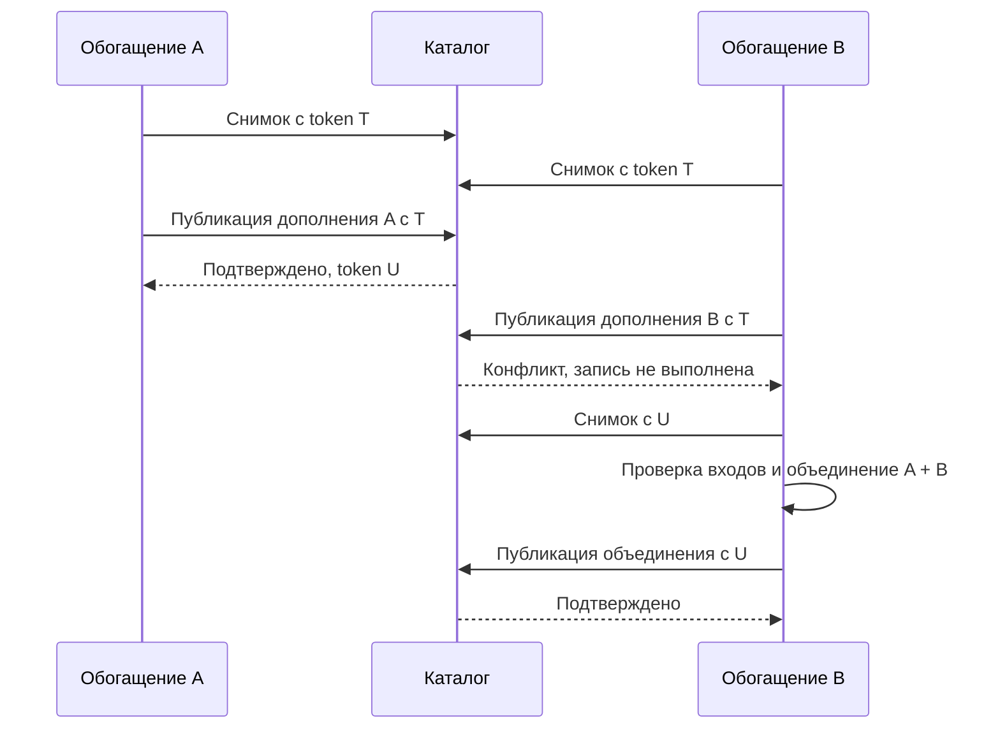

# 04. MDRack: приёмка, качество поиска и наблюдаемость

## Назначение документа 📌

**Готовность мультимодального поиска подтверждается отдельно на уровне контрактов, реального маршрута обработки и качества найденных материалов.** Корректно сохранённый вектор подтверждает работу хранения. Успешный запрос к модели подтверждает работу адаптера. Полезность поиска определяется размеченным набором задач и воспроизводимым сравнением.

Документ переводит решения [заметки №02](02-mdrack-architecture-and-contracts.md) в проверяемые обязательства. Он определяет критерии приёмки, необходимые тесты, методику оценки релевантности, измерения затрат и контракт диагностики. Архитектура модулей остаётся в №02, а порядок изменения кода и перехода между версиями — в следующей заметке №03. Согласованный порядок подготовки комплекта: **01 → 02 → 04 → 03**.

База сверки — `master` открытого MDRack, commit `843b0b4873b95ae80d08ec1d4a8707d6d7d9b676`, проверенный 20 октября 2026 года. Исходники, тесты и сценарии проверки изучены статически. В рамках подготовки документа тесты репозитория, модели, индексирование и измерения производительности не запускались.

> [!important] Статус критериев
> **CURRENT** означает подтверждённое устройство указанной версии. **TARGET** означает требование к расширению из №02. Приведённые критерии и команды предназначены для будущей приёмки; этот документ не присваивает реализации статус PASS.

Раздел наблюдаемости дополнен принятым source-срезом W1-D. Этот более поздний
результат имеет собственную границу и не меняет исторические `verification` выше
или статус TARGET остальных обязательств.

## Что именно считается доказанным 🔬

### У каждого результата есть граница 🧭

Действующие правила MDRack уже различают проверки с подставными зависимостями, реальные локальные компоненты, установленный пакет, отдельный исходный корпус, внешний сервис и выполнение на Windows. Результат одной проверки не переносится автоматически на другую среду или более широкий сценарий. [1], [2]

| Граница | Что выполняется | Допустимый вывод |
| --- | --- | --- |
| Unit/offline | Чистые функции, управляемые векторы, fake provider, подготовленные fixtures | Соблюдены проверенные правила валидации, маршрутизации и вычислений |
| Local components | Настоящие SQLite и временные файлы; зависимости явно перечислены | Проверены транзакции, повторное открытие, файловый доступ и соответствующая композиция |
| Installed package | Собранные distributions вне пути импорта исходного checkout | Проверены упаковка, зависимости и объявленные публичные входы |
| Real source | Зафиксированный разрешённый набор настоящих материалов | Получены результаты именно на этом корпусе и его версиях |
| Live provider | Настоящий adapter/runtime получает фактический текстовый или медиавход | Подтверждена указанная capability связки модели, endpoint и адаптера |
| Конкретная ОС | Команды действительно выполнены в указанной системе | Подтверждено поведение именно этой дорожки на данной ОС |

Реальная локальная модель также требует отдельного runtime-прогона: её работа не следует из offline-теста с fake provider. Аналогично открытие SQLite в памяти не проверяет восстановление файлового каталога после прерывания.

### Три решения о готовности ✅

**Контракт принят**, когда обязательные инварианты, совместимость, целостность и диагностика проверены. **Маршрут работает**, когда реальный провайдер и прикладная подготовка поддерживают объявленный тип входа. **Профиль пригоден для выбранных задач**, когда его качество и расходы подтверждены на соответствующих срезах корпуса.

Технически работающий native-профиль может оставаться экспериментальным по качеству. Хороший показатель nDCG не компенсирует потерю расшифровки при параллельной записи. Эти результаты хранятся раздельно.

Для отдельного критерия используются состояния `PASS`, `FAIL`, `BLOCKED`, `NOT_RUN` и `NOT_APPLICABLE`. Последнее означает, что возможность явно не заявлена в оцениваемом профиле. Отсутствующий runtime для заявленной возможности означает `BLOCKED`; пропущенная обязательная проверка не становится успешной.

## Проверенная исходная база MDRack 🔎

### Существующие проверки нужно расширять 📚

| CURRENT: существующая основа | Что в ней уже выражено | Что предстоит доказать для TARGET |
| --- | --- | --- |
| Core indexing tests | Vector-only unit допустим; пустой граф, неверная ownership, размерность и нечисловые значения отклоняются | Новые producers действительно формируют такие графы и передают их общему валидатору |
| Общий suite memory/SQLite | Replace/read/delete, фильтры, пространства, порядок и f32-поведение | Snapshot, CAS и жизненный цикл на актуальном app v2 |
| Core retrieval tests | Передача scope, grouping, RRF, strict/partial, различие отказа и пустого ответа | Общий прикладной planner правильно подготавливает медиазапросы |
| SQL integration и one-store E2E | Атомарная замена, FTS, manifest, создание и открытие одного каталога | Совместная атомарность графа и нового состояния публикации |
| Image integration | Локальные файлы, fake visual/text providers, неизменность исходника | Работа нативного и перекрёстного маршрута с реальным провайдером |
| Eval и frozen corpus | Формат judgments, метрики, публичные артефакты и отчёты | Корректные оценщики для новых краевых случаев, русский язык и настоящие медиавходы |
| Safe events и privacy oracle | Закрытые схемы core, редактирование значений, проверка диагностических поверхностей | Новые стадии, фактическая сериализация полей и устойчивость к отказу sink |

Эта база подтверждается соответствующими тестами и контрактами; наличие теста здесь означает наличие проверяемого сценария в исходниках, а не успешный прогон при подготовке заметки. [5], [6], [7], [8], [9], [10], [11], [14], [25]

### Два ограничения, влияющие на интерпретацию результатов 🧱

Обычный app v2 использует **точный линейный поиск по векторам в Python поверх SQLite**. Текущий backend обозначен как `builtin-exact-v1`; sqlite-vec/ANN в этом пути не используется. Поэтому измерение нынешнего хранилища подписывается как exact scan. Количество векторных сравнений и стоимость декодирования являются существенной частью его профиля. [3], [9], [23]

Общий параметризованный тест каталога вызывает `SQLiteCatalog.create()`, то есть проверяет v1. Часть SQL integration использует прежнюю app-bridge схему. Их зелёный результат сам по себе не доказывает новые операции в нормальном `catalog.sqlite3` приложения. Для них используется актуальный путь создания app v2 и его будущая явно поддержанная версия схемы. [6], [8], [9], [10]

## Контрактные проверки профилей и поиска 🎛️

### Условия приёмки имеют устойчивые идентификаторы 🏷️

Обозначения `M04-P01`, `M04-S01` и подобные — идентификаторы обязательств документа. Они связываются с реальными тестами и отчётом при реализации. Это не придуманные имена уже существующих pytest-функций.

Один сценарий проверяет наблюдаемый результат и существенные действия зависимостей. Fake задаёт ответ и считает обращения; он не воспроизводит внутри себя бизнес-логику planner. Иначе реализация и её подставная копия могут одинаково ошибиться.

### Подготовка представлений 🗂️

| Критерий | Контрольная ситуация | Условие PASS |
| --- | --- | --- |
| `M04-P01` | Native-медиа, распознавание выключено, пригодный вектор получен | `text=None` сохраняется; extractor не вызван; вектор находится через объявленное пространство; фиктивный текст в FTS не появляется |
| `M04-P02` | Textual-медиа без готового текста при запрещённом extraction | Явное отсутствие требуемого представления; нет пустого batch и сообщения об успешной индексации |
| `M04-P03` | Все четыре сочетания `derived_text.lexical/dense` | `00`: только внешний артефакт; `10`: текст в FTS; `01`: text-modality unit без текста, с вектором; `11`: текст и вектор |
| `M04-P04` | Обычная заметка при `derived_text.dense=false` | Встраивание исходной заметки работает; настройка производного текста его не отключает |
| `M04-P05` | Новая модальность, роль или неподдержанный формат | Capability проверяется до неподходящей обработки; нет скрытого ASR, смены модели или усечения входа |
| `M04-P06` | Неверная размерность, fingerprint, NaN/Infinity или недопустимый cosine vector | Ошибка обнаружена до публикации; прежний опубликованный граф и token сохранены |

В `M04-P03` отсутствие текста относится к поисковой проекции. Контракты настоящих transcript/OCR artifacts не превращаются в контейнеры пустых строк. При наличии готовых совместимых векторов core уже допускает nullable units; эта возможность защищена отдельным текущим тестом. [5]

Исходные файлы проверяются по байтовым хешам до и после разрешённых операций. Для обычного Markdown scan дополнительно устанавливается наблюдение за файловым доступом: ссылка на изображение не должна инициировать открытие или диагностирование самого вложения. Явная индексация выбранного изображения проверяется отдельным сценарием. [2], [25]

### Маршрутизация и выдача 🔀

| Критерий | Контрольная ситуация | Условие PASS |
| --- | --- | --- |
| `M04-Q01` | Текст → изображение и изображение → текст в поддержанном пространстве | Модальность кандидатов не приравнивается автоматически к модальности запроса |
| `M04-Q02` | Image query без extraction, adaptive hybrid, `allow_partial=false` | FTS неприменима и не планируется; vector-only выполняется без ложной деградации |
| `M04-Q03` | Отказ одной запланированной ветки, всех веток; отдельно успешный пустой ответ | Strict/partial соблюдены; все отказы дают ошибку; исполненный поиск без совпадений даёт успешный пустой список |
| `M04-Q04` | Общая модель с совместимыми query/document ролями; рядом другое пространство той же размерности | Разрешённый общий контракт работает; одинаковая размерность не обходит проверку несовместимости |
| `M04-Q05` | В scope допускается один материал, а лучшие глобальные кандидаты исключены | Ограничения действуют при получении кандидатов до окончательного limit |
| `M04-Q06` | Много кадров одного видео при двух значениях target | Resource-выдача группирует материал; unit-выдача допускает отдельные фрагменты; evidence ограничен |
| `M04-Q07` | Сохранённый basis для сходства и отсутствие нужного basis | Разрешённое повторное использование вектора не вызывает модель; отсутствие basis не запускает скрытый пересчёт или усреднение |
| `M04-Q08` | Несколько OCR/ASR проекций одного материала | Дополнительные проекции не получают незаявленные независимые голоса; соблюдён бюджет семейств веток |

Проверка `M04-Q06` учитывает размер candidate pool. Нельзя требовать десять разных ресурсов из десяти units, принадлежащих одному видео. Недостаточное наполнение итогового списка должно быть объяснимо планом и счётчиками, а увеличение бюджета кандидатов — отдельным управляемым решением. [7]

Для существующего whole-resource similarity сохраняется его публичная семантика. Новые запросы от кадра или интервала проверяются как отдельный разрешённый маршрут. Raw score similarity и RRF обычного retrieval различаются в `score_kind`; числовое равенство этих оценок не является условием parity.

### M04-Q09: согласованность всего поискового ответа

На fresh файловом app v2 два независимых соединения и детерминированные barriers
публикуют новую версию после space resolution, между lexical/vector ветками и
перед hydration. Текущий ответ остаётся целиком старым согласованным снимком,
следующий запрос видит новый commit. Проверяются metadata body/metadata lexical
ветки `MetadataCatalogService.search`, existing-vector basis/discovery и прямые
CLI resources search/similar/duplicates, а не только embed_query consumers.

Внутри read session находятся spaces/canonicalization, все branches/fallback и
hydration. HTTP заканчивается до snapshot. Соединение operation-owned, DTO eager;
последующий independent read может быть новее. Проверяются delete/recreate,
empty/partial/error/fallback, отсутствие разделения handle между операциями,
освобождение при отказе/отмене и успешный следующий запрос. Provider spy проверяет
отсутствие transaction во время await. Legacy injected facade без capability имеет
отдельную честную boundary, не общий normal-app PASS.

Отдельный barrier между FTS counts при verified open/verify доказывает согласованность
preflight, сохраняя публичный ACTIVE_TRANSACTION guard. Это отдельный snapshot,
не требование слить его с search snapshot. Q09 независим от CAS и M04-S01;
обычный fresh unchanged v2 достаточен. Гонки baseline здесь ещё не воспроизведены.

### CLI, embedded API и совместимость 📬

`M04-U01` связывает одно действие через CLI и `MDRackEngine`: после исключения объявленных непостоянных полей должны совпадать логические IDs, порядок, target, locators, nullable text, фактический маршрут и причины частичного результата. В JSON-режиме stdout содержит один разбираемый объект; сообщения журнала не примешиваются к нему.

`M04-U02` защищает старые текстовые методы, значения `--mode text`, прежний whole-resource basis и закрытые DTO. Новые обязательные поля не добавляются в старый envelope незаметно. Снимки контракта обновляются после принятого решения о версии, сохраняя контроль старой совместимой поверхности. Существующая textual parity уже проверяется отдельным E2E. [27]

`M04-U03` проверяет независимость пакетов и установленный артефакт: отсутствие обратных импортов в app из core/SQLite, отсутствие Click внутри engine, отсутствие загрузки ML-моделей в Python и корректные публичные imports. Source-tree import не заменяет проверку wheel за пределами checkout. Эти границы уже входят в правила проекта. [1], [2]

## Приёмка позднего обогащения 🌱

### Вычисление и публикация проверяются раздельно 🧩

| Критерий | Контрольная ситуация | Условие PASS |
| --- | --- | --- |
| `M04-E01` | К нативному материалу добавлен OCR только для FTS | Нативный вектор и независимые представления сохранены; нового native embedding нет; текст действительно находится через FTS; source/artifact зависимости проверены |
| `M04-E02` | Уже готовый dense-only transcript затем разрешён для FTS | Артефакт переиспользован; ASR не повторён; новая лексическая проекция опубликована |
| `M04-E03` | Полностью выполненная операция повторена | Нет дубликатов units/FTS и лишних модельных обращений; подтверждены запрошенные постусловия |
| `M04-E04` | Ручная правка transcript во время старого ASR | Ручная ревизия не вытеснена; изменены только зависимые text/dense/joint проекции; независимый native audio vector сохранён при прежних bytes/range/recipe |
| `M04-E05` | Изменился непосредственный вход совместного embedding | Старый зависимый вектор снят или заменён; не выдаётся за актуальный; проверены artifact revisions всех immediate inputs, не только hash оригинала |
| `M04-E06` | OCR/ASR вернул отсутствие текста | Исход `no_text`; нет пустого unit; пригодное нативное представление продолжает работать |
| `M04-E07` | Read-only артефакт удалён из очищаемого кеша | Read сообщает недоступность; сохранённые векторы и опубликованный FTS не зависят от этой копии кеша |
| `M04-E08` | Оригинал недоступен, изменился или превышает бюджет обработки | Отдельный понятный исход; прежняя выдача не объявляется обновлённой; обработанные диапазон и версия не выдумываются |
| `M04-E09` | Новый embedding profile того же purpose/default variant | Новый active выход замещает старый; другой representation ID не сохраняет старый автоматически |
| `M04-E10` | Намеренно сохранены два варианта | Явные variant keys и query policy определяют участие; семейный бюджет не удваивается скрытно |
| `M04-E11` | Новая source revision | Все действительно зависимые outputs сняты/заменены; независимость доказывается provenance, не различием IDs |

Ключ активного выхода — `(resource_id, purpose_key, variant_key)`, с объявленными
scope/track/range в назначении, не model hash. Текущий full replacement не доказывает
накопления старых representations, а compatible-space filtering уже ограничивает
участие старых vectors. Проверяется риск будущего merge, а не выдуманный current defect.

Проверка кеша опирается на существующие ключи, неизменяемые записи и счётчики транспорта. Но cache hit ещё не доказывает выполнение намерения публикации: его подтверждает актуальный граф. Именно поэтому `M04-E02` проверяет повторное использование артефакта и появление FTS независимо. [26], [36]

Для частичного transcript измеряется объединение реально покрытых интервалов. Перекрывающиеся окна не считаются дважды. Для выбранных кадров указываются число и политика выборки; несколько кадров не обозначаются как «100% понимания видео».

Read и search не запускают обогащение корпуса без отдельной операции. Этот запрет проверяется счётчиками extractors и провайдера на успешной, пустой и аварийной ветках. Распознавание самого запроса, если оно разрешено политикой, учитывается отдельно.

## Согласованность хранения и конкуренция 🔐

### Проверяется состояние после операции 🧵

Будущий publication-порт проверяется на настоящем файловом app-каталоге и отдельных соединениях. Memory adapter полезен для общей семантики, но не доказывает SQLite-locking, rollback и видимость после reopen. Нынешний write-порт содержит replace/delete; snapshot, CAS и withdrawal здесь являются новыми обязательствами. [24]

| Критерий | Управляемый сценарий | Условие PASS |
| --- | --- | --- |
| `M04-S01` | Чтение снимка пересекается с записью | Batch, token и жизненный цикл относятся к одному committed state |
| `M04-S02` | Два обогащения начали с одного token | Первое публикуется; второе получает конфликт без записи; разрешённое повторное объединение сохраняет оба дополнения |
| `M04-S03` | Управляемый отказ после начала записи, но до commit | После reopen сохранены именно прежний полный граф и прежний token |
| `M04-S04` | Между snapshot и CAS выполнен старый безусловный writer | Token изменён; старое ожидаемое состояние отклонено |
| `M04-S05` | Снята последняя пригодная проекция, затем опубликована новая | `live_without_projections` сохраняет lifecycle/source binding; возврат в поиск требует актуального token |
| `M04-S06` | Delete и явное recreate того же ID и тех же байтов | Старый job не публикуется и не переносится в новый жизненный цикл |
| `M04-S07` | Commit состоялся, но ответ/диагностика не дошли до вызывающей стороны | Повтор устанавливает состояние по каталогу и постусловиям; не создаёт дубликаты и не предполагает rollback из отсутствия ответа |
| `M04-S08` | Создание, параллельное открытие, повреждённая/неподдержанная схема | Сохранены compiled manifest, целостность и один основной `catalog.sqlite3`; чужие базы не используются как fallback |

В гонке `M04-S02` последовательность задаётся барьерами, а не подбором задержек. Каждое участвующее выполнение использует собственное соединение. Конечные ожидания и завершение участников проверяются явно.



Условие проверки включает сохранение исходных native vectors, соседних representations, facets и нужной metadata. Финальный текстовый поиск проверяет появление обоих дополнений. Сравнение только числа строк этого не доказывает.

### Аварийные точки имеют ограниченную область доказательства 🧯

В текущем SQLite store уже предусмотрены failure hooks до транзакции, после её начала, удаления старого графа, записи representations/units/vectors/facets/FTS и перед commit. Их можно расширить для совместной проверки state record и графа. [8]

Исключение через такой hook подтверждает обработку указанного отказа. Оно не является доказательством поведения при внезапном завершении процесса или отключении питания. Для заявленной устойчивости после прерывания отдельно проверяются реальный дочерний процесс, повторное открытие и integrity/FK; невыполненная граница указывается в отчёте.

Если процесс прерван около неизвестной границы commit, допустимо прежнее либо новое состояние, но graph и token обязаны принадлежать одной завершённой публикации. Эта неопределённость не ослабляет `M04-S03`: при известном управляемом отказе до commit новая публикация недопустима.

`withdraw` и `delete` имеют разные ожидаемые переходы. Снятие поискового графа не создаёт tombstone удаления. Начальный материал без единой пригодной проекции остаётся в подготовке приложения/хоста; тест не заставляет core принять пустой batch.

Инвариант одной базы относится к одному **основному файлу SQLite**. Допустимые WAL/SHM sidecars не являются второй базой. Новая служебная таблица принимается только как часть объявленной схемы; применённые миграции и frozen manifests не переписываются ради зелёного теста. [3], [9], [10]

## Сначала проверяется сам оценщик качества 📏

### Найденные ограничения CURRENT 🐛

В MDRack есть низкоуровневые метрики в `eval/metrics.py` и отдельный graded evaluator в `eval/quality.py`. Чтение последнего выявляет несколько случаев, которые необходимо закрыть до применения к новому набору. Это статические выводы о поведении кода на определённых входах, а не утверждение, что каждый прежний отчёт был рассчитан неверно. [12], [13]

| CURRENT: место расчёта | Возможное искажение | Обязательство TARGET |
| --- | --- | --- |
| `positive = set(grades)` | Размеченный grade 0 считается релевантным для Recall/MRR | В positive входят только оценки выше нуля |
| `_temporal_metrics()` | Числовые координаты сравниваются без проверки владельца и положительной релевантности | Совпадают ресурс, версия и допустимое основание сопоставления |
| Resource-target nDCG | Разные units одного ресурса могут повторно получить gain | Resource-level оценка принимает корректную выдачу разных ресурсов |
| `duplicate_rate = 0.0` | Константа выглядит измерением повторов | Явный invariant либо вычисленный показатель с названным знаменателем |
| Отсутствующее временное совпадение | Начальная ошибка границ равна 0 | Отсутствие измеримого совпадения обозначается `null` и отдельным hit/miss |
| `evaluation_latency_ms` | Время всего evaluator воспринимается как задержка search | Пользовательская задержка измеряется на границе операции отдельно |

В frozen query set сейчас встречаются grades 1, 2 и 3, хотя контракт разрешает 0–3. Поэтому отсутствие отрицательного размеченного кандидата скрывает первую проблему. Все 170 случаев также помечены `language:en` и `length:short`; их нельзя считать проверкой русского языка. [14], [15]

### Уточнение границы actual grade-zero finding

На baseline actual module `eval/quality.py` воспроизведён случай A=0/B=3,
returned A: наблюдались Recall@5=0,5 и MRR=1 вместо обоих нулей. Это ограниченное
module reproduction, не pytest/installed/model-quality PASS. W1-B должен проверить
реальный evaluate_quality: A→оба 0; A затем B→RR=0,5; unjudged не positive;
положительные прежние случаи сохранены. Low-level `metrics.ndcg_at_k` уже имеет
`seen`; его не объявляют неисправным. Frozen v1 bytes не переписываются;
несовместимый input/report shape требует версии.

### Небольшой ручной эталон 🧮

`M04-M01` требует отдельного набора, правильный ответ которого можно проверить вручную. Он не использует модель и не вызывает production ranker.

| Вход эталона | Правильный исход |
| --- | --- |
| Gold: A имеет grade 0, B имеет grade 3; возвращён только A | Recall и reciprocal rank равны 0 |
| Единственный релевантный материал находится на второй позиции | Reciprocal rank равен 0,5 |
| Два релевантных материала, найден один из них | Recall равен 0,5 |
| Resource-выдача содержит A дважды через разные units | Нарушение контракта resource-выдачи; дополнительный gain не начисляется |
| Gold относится к видео A, результат — к видео B с теми же миллисекундами | Временное попадание отсутствует |
| Ресурс тот же, но source revision другая | Старые координаты не считаются попаданием в актуальный gold |
| Корректного временного совпадения нет | Hit = 0; ошибка границ не изображает идеальную точность |
| Повтор одного ID при расчёте nDCG низкоуровневой функцией | Повтор не даёт нового gain; значение не превышает 1 |

Сначала проверяется арифметика метрик, затем форма входов evaluator и только потом production retrieval. Это три разных причины отказа; они не объединяются одним неясным сообщением «низкое качество».

### Target и cutoff имеют точный смысл 🎯

`M04-M02` фиксирует единицу оценки. Для `target=resource` K означает количество разных материалов. Для `target=unit` — количество поисковых единиц. Если ранкер начинает с units, преобразование в resource-выдачу выполняется до передачи в resource evaluator и до его cutoff.

Оценщик не должен молча чинить ошибочный публичный ответ удалением дубликатов и пересчётом позиций. Такая выдача сначала получает нарушение контракта. В отдельной диагностике можно показать raw duplicate rate, определив его как долю повторных позиций среди возвращённых позиций соответствующего target.

Gold ограничивается тем же scope, что запрос. Материал за пределами выбранной коллекции или допустимого типа не включается в знаменатель Recall. Если после корректного ограничения положительного gold нет, случай переводится в заранее предусмотренную категорию отрицательных запросов, а не оценивается произвольным нулём.

Отсутствие judgment отличается от явного `grade=0`. Для ограниченного контрольного корпуса требуется полный gold в объявленном scope. При неполной разметке указываются правило обработки `unjudged` и доля размеченных результатов top-K. Recall по размеченному пулу так и обозначается; он не доказывает полноту относительно всех релевантных материалов корпуса. Дополнение judgments создаёт новую версию и требует одинакового пересчёта сравниваемых профилей.

### Метрики и их интерпретация 📊

| Метрика TARGET | Что означает | Ограничение интерпретации |
| --- | --- | --- |
| Recall@5 и Recall@10 | Доля релевантных элементов gold, найденных в первых K результатах | Требует определённого набора положительных judgments в данном scope |
| Hit@K | Найден ли хотя бы один релевантный элемент | Не показывает, сколько других полезных материалов потеряно |
| MRR@10 | Среднее обратной позиции первого релевантного результата в первых десяти | Оценивает удобство первого попадания, а не всю выдачу |
| nDCG@10 | Качество порядка с учётом grades и снижения веса дальних позиций | Требует фиксированных grades и одинакового определения gain |
| Temporal hit | Найден ли допустимый интервал/кадр нужного ресурса и версии | Зависит от заранее объявленного правила совпадения |
| IoU и ошибка границ | Насколько совпадают допустимые временные интервалы | Ошибка границ считается для сопоставленных пар; пропуски показываются отдельно |
| Покрытие оценки | Сколько запланированных случаев действительно обработано и оценено | Низкое покрытие не маскируется высоким средним по оставшимся случаям |

Для nDCG сохраняется явно названная формула: gain равен `2^grade − 1`, а вес позиции делится на `log2(position + 1)` при нумерации с единицы. Нормировка выполняется относительно идеального порядка того же gold. Средние и срезы всегда сопровождаются числом случаев.

Текущая `precision_at_k` в `metrics.py` делит число попаданий на фактически возвращённое количество, ограниченное K. Это точность среди возвращённых результатов. Если новый отчёт использует фиксированный знаменатель K, показатель получает отдельное явное определение; старое поведение не переименовывается незаметно. [13]

Для оценки новой нарезки gold привязывается к ресурсу, версии исходника и смысловому интервалу. Сравнение разных recipes не должно требовать одинаковых `unit_id`, если они намеренно порождают разные единицы. При неизменной нарезке точность хранения locator проверяется строго, независимо от оценки релевантности.

При сопоставлении разных recipes используется заранее определённое детерминированное правило matching. Один gold-фрагмент не получает повторный hit или gain из-за нескольких перекрывающихся returned units. Порядок выбора пары, разрешение равенств и учёт составных интервалов входят в версию оценщика; этот случай добавляется в ручной эталон.

Правило temporal hit задаётся в наборе заранее: например, требуемое IoU либо сочетание покрытия эталонного интервала и ограничения лишнего контекста. Крошечное пересечение и слишком длинный фрагмент не должны автоматически означать полезную локализацию. Для кадра отдельно фиксируется допустимое временное отклонение. Старые определения «любой IoU выше нуля» и «точное равенство timestamp» не переносятся на новую задачу без такого решения. [12]

## Оценочный корпус и сравнение профилей 🧪

### Три набора решают разные задачи 🗃️

Существующий public corpus содержит 50 синтетических текстовых ресурсов: Markdown и JSON с OCR/captions/transcripts. Настоящих изображений, звука и видео в нём нет. `media_quality_eval.py` ранжирует его через пересечение текстовых токенов. Это полезная проверка оценочного контура, но она не измеряет нативную релевантность. [14], [16]

Для расширения используются три уровня данных. Маленький детерминированный набор защищает контракт. Версионированный публичный медианабор проверяет модельные маршруты и релевантность. Отдельный разрешённый прикладной корпус проверяет пригодность для реальных коллекций; его содержимое не попадает в публичные fixtures и диагностические отчёты.

`M04-R01` требует нового manifest/digest для новых байтов, запросов, judgments и политик. Старый frozen corpus не переписывается под новую модель. Воспроизводимость включает происхождение артефактов и возможность их использовать в соответствующей дорожке. Действующий corpus validator уже проверяет digest, ownership, структуру, публикационную пригодность и связи gold; его правила расширяются согласованно с новой версией. [14], [29]

### Обязательные срезы определяются заявленными возможностями 🌍

| Срез | Что размечается | Какие ошибки особенно важны |
| --- | --- | --- |
| RU → RU и EN → EN | Смысл заметок и перефразирование | Тематически близкие, но неверные документы |
| RU → EN и EN → RU | Межъязыковое соответствие | Сильное падение одного направления при хорошем общем среднем |
| Точные слова, числа, имена и код | Требуемая лексическая деталь | Подмена числа, имени функции или названия похожим значением |
| Text → image | Содержание исходного изображения | Хорошая сгенерированная подпись при неверном изображении |
| Image → image | Объявленное сходство объекта, сцены или композиции | Смешение разных критериев визуального сходства |
| Text → audio: речь | Смысл сказанного и нужный интервал | Тот же говорящий с другой темой, соседняя лекция |
| Text → audio: звуковая сцена | Неречевые события и характер звука | Оценка акустики через transcript, который этих признаков не содержит |
| Audio → audio | Отдельно заданное смысловое или акустическое намерение | Необъявленная смена того, что считается похожим |
| Видео | Нужный материал и пригодный кадр/отрезок | Правильное видео с неправильным временем |
| Позднее обогащение | Выдача до и после выбранной публикации | Улучшение только заранее отобранных удачных примеров |

Image → text, audio → text и другие направления добавляются, когда соответствующая capability заявлена. Неподдержанное направление отмечается в паспорте покрытия. Его нельзя вычеркнуть после неудачного прогона или записать как успешную ячейку.

Лексические проверки русского языка выполняются на реальном FTS: кириллица, регистр, `ё/е`, пунктуация, фразы, числа и кодовые идентификаторы. Ожидаемое поведение задаётся принятым tokenizer/normalization contract. В v2 migration сейчас указан `unicode61`; наличие FTS само по себе не объявляет русскую морфологию продуктовой возможностью. Смена такой политики требует отдельной версии и сравнения. [32]

### Разметка не подстраивается под энкодер 🧑‍🔬

Judgments по изображениям и аудио формируются по оригиналу, а не только по автоматически полученному описанию. Иначе тест проверит согласие модели с другим автоматическим пересказом.

Grades задаются единой рубрикой: 0 — не соответствует запросу, 1 — частично связано, 2 — пригодно, 3 — точно соответствует цели. Для разных задач рубрика уточняет конкретное намерение: смысл речи, звуковую сцену, объект или композицию. Спорные примеры проходят независимую повторную оценку; разногласия сохраняются как сведения о сложности разметки.

Похожие кадры, crops, фрагменты одной записи и переводы связанных запросов объединяются в одну группу. Такая группа целиком попадает в dev либо в итоговый held-out набор. Подбор весов, RRF, разбиения и допустимых fallback выполняется на dev; итоговый набор не используется для доводки этих настроек.

Разметка должна содержать правдоподобные отвлекающие материалы. Набор, где у каждой картинки есть одно очевидное уникальное слово, слабо проверяет смысловой поиск. Отрицательные кандидаты включают близкую тему, другой объект, изменённое число или похожий фрагмент с другим содержанием.

### Компактный эксперимент отвечает на архитектурный вопрос ⚖️

`M04-R02` сравнивает пять конфигураций без полного произведения всех моделей и флагов:

| Вариант | Encoder и представления | Какой вопрос решается |
| --- | --- | --- |
| A | Текущий текстовый encoder и фиксированные текстовые проекции | База существующего текстового пути |
| B | Текстовый вход выбранной мультимодальной модели и те же проекции | Теряется ли качество текста при смене encoder |
| C | Та же мультимодальная модель, прямые медиавходы | Что даёт нативное представление без распознавания |
| D | Вариант C плюс тот же фиксированный OCR/ASR в FTS | Какова польза лексического обогащения |
| E, необязательный | Вариант D плюс dense-вектор производного текста той же моделью | Оправдан ли дополнительный вектор |

Варианты B–E не требуют второго encoder. Дополнительный вектор в E является ещё одной проекцией той же модели.

Сравнение A/B изолирует encoder: подготовленный текст, разбиение и остальные условия одинаковы. Сравнение B/C/D показывает влияние представления в пределах одной модели. Готовые OCR/ASR artifacts сначала фиксируются, чтобы отделить поиск от ошибок извлечения. Затем отдельный end-to-end прогон включает настоящее распознавание, его качество, время и расходы.

Corpus, query и judgment digests, источник и его версия, profile/recipe fingerprints, размерность, normalization, роли, FTS tokenizer, target, scope, веса, K и candidate budgets записываются в паспорт эксперимента. Когда исследуется одна настройка, остальные сохраняются. Если меняется весь pipeline, результат так и обозначается.

Одинаковый итоговый K недостаточен для сравнения затрат: варианты могут хранить разное число units и векторов. Отчёт показывает количество представлений, суммарный бюджет кандидатов, размер индекса и время подготовки. При сравнении retrieval-политик фиксируется объявленный бюджет; при сравнении готовых продуктовых профилей различие расходов сохраняется как часть результата.

### Позднее обогащение оценивается парно 🌿

`M04-R03` сравнивает один и тот же набор запросов до и после заранее определённого обогащения. В отчёте указано, какие материалы и диапазоны были обработаны, что опубликовано в FTS/dense и как изменились покрытие, качество и затраты.

Read-only обогащение не должно менять поисковый граф. Это проверяется детерминированно. Публикация FTS может изменить ранжирование; улучшение каждого отдельного запроса не является инвариантом. Здесь применяется оценка по всему согласованному набору и критическим срезам.

Если обогащаются только уже найденные кандидаты, такой эксперимент отдельно помечается как зависимый от первой выдачи. Он не доказывает, что стали обнаруживаться ранее не найденные материалы. Стоимость первой выдачи, выбора кандидатов, обогащения и повторного поиска учитывается полностью.

### Отрицательные запросы и неопределённость 📉

У текущего positive-quality evaluator запросы без положительного gold отклоняются. Для них нужен отдельный тип оценочного случая. Ближайший векторный сосед может существовать даже при отсутствии подходящего материала; требование пустой выдачи допустимо только при объявленном механизме отказа, которого этот документ не добавляет. [12], [14]

`M04-R04` требует показывать среднее, число запросов и результат каждого критического среза. Русский язык, точные числа и локализация не должны исчезать за общим средним. Для парных разностей используются одни и те же запросы; интервал неопределённости рассчитывается по независимым группам исходников, а не по тысячам соседних кадров одной записи.

Допустимая регрессия, требуемая польза нового сценария и бюджет затрат фиксируются в версии политики **до итогового прогона**. Например, 0,02 абсолютного изменения nDCG означает два процентных пункта шкалы, а не относительные два процента. Такое число является проектным порогом, а не известным свойством модели.

Документ не назначает единый универсальный порог всем видам аудио, изображений и железа. Паспорт выбранного профиля обязан содержать конкретные значения и критические срезы до сравнения. Без них можно принять технический контракт и работающий маршрут, но нельзя объявить доказанный выбор нового профиля по качеству. Недостаточные данные дают `BLOCKED` для этого решения, а не автоматический PASS.

## Скорость, объём и стоимость ⏱️

### Измеряются разные участки пути 🛤️

`M04-T01` отделяет задержку пользовательского search от оценки метрик и фонового обогащения. End-to-end время начинается на выбранной публичной границе и заканчивается готовым ответом. Подготовка входа, кодирование запроса, получение кандидатов, grouping/fusion и сериализация измеряются как отдельные стадии.

Для enrichment отдельно считаются разрешение исходника, извлечение, embedding, публикация и конфликтные повторы. Время ожидания очереди показывается только там, где хост действительно использует очередь. Параллельные stage durations не складываются механически в пользовательскую задержку.

Нативный запрос может не использовать ASR, но всё равно требовать декодирования и подготовки медиавхода. Эти расходы входят в измерение. Загрузка модели и прогрев отделяются от обычного тёплого запроса; timeouts и ошибки не исчезают из отчёта при расчёте среднего успешных вызовов.

### Имеющийся benchmark сохраняет свою область 📐

`sqlite_envelope_benchmark.py` уже измеряет настоящий локальный exact backend на синтетических векторах: codecs, время, CPU/RSS, число просмотренных/декодированных векторов и размеры. Его можно использовать для изолированного storage-слоя. Он не включает нативный encoder и не является sqlite-vec benchmark. [18]

Его cold-серия означает первый запрос нового процесса после открытия каталога. Это не гарантия холодного кеша страниц ОС. Значение p99 из нескольких наблюдений математически вычислимо, но не подтверждает устойчивость хвоста производственной нагрузки. Отчёт всегда показывает размер серии, прогрев и определение cold/warm.

`live_lmstudio_eval.py` при явном live-запуске проверяет embedding dimensions. Он не измеряет retrieval relevance и не подтверждает способность endpoint принимать изображения или аудио. Для них требуется реальный payload соответствующего типа через новый прикладной маршрут. [17]

### Минимальный паспорт расходов 💾

`M04-T02` требует указать размеры корпуса, units, spaces и векторов, размерность/codec, candidate limits, число веток, параметры параллельности, версии Python/SQLite/runtime и класс оборудования. Для модели фиксируются значимые параметры размещения и квантования, если они доступны.

Показываются p50/p95 с числом наблюдений, доля отказов, память процесса, доступные показатели модельного runtime, размер основного каталога и пиковые sidecars. Недоступное измерение записывается как `null` или «не измерено», а не нулём.

Для подготовки корпуса учитываются обработанные изображения, длительность аудио/видео, число выбранных кадров, вызовы провайдера, reuse артефактов и фактически полученные данные об оплате, если используется соответствующая интеграция. Валюта и тарифная ревизия обязательны для денежных сравнений. Стоимость кешированного повтора показывается отдельно от первого получения представления.

Существующий core `input_bytes` суммирует UTF-8 тексты representations и units; это не размер исходного WAV, картинки или HTTP payload. Для vector-only batch он может быть нулевым. Новые `source_bytes` и `prepared_input_bytes` получают собственную прикладную семантику; старый счётчик не переопределяется. [28]

Порог задержки относится к конкретной операции, нагрузке и среде. Микробенчмарк точного сканирования не выдаётся за обещание end-to-end SLA. Приёмка выбранного профиля проверяет заранее зафиксированный бюджет вместе с качеством и частотой ошибок.

## Контракт наблюдаемости 🔭

### Сохраняется существующий механизм 🧰

В core уже есть `SafeEvent`, `emit_event`, закрытые имена событий и allowlist полей. Media использует собственную существующую схему `MediaEvent`; CLI и приложение работают через stdlib `logging`. Диагностические/eval отчёты имеют безопасную сериализацию и общий privacy oracle. [4], [11], [19], [20], [30], [31]

Прикладной слой наблюдает разрешение запроса, источник, extraction, provider calls, reuse и публикацию. Core наблюдает валидацию готового графа, поисковые ветки и fusion. SQLite сообщает результат условной записи. Новая база событий, отдельный сервис логирования и обязательный metrics server для этого не требуются.

Новые прикладные данные получают версионированную схему у своего владельца и используют общие механизмы безопасного представления и logging. Схема core расширяется только для сведений, которыми владеет core. Так сохраняется единый словарь результатов операции без переноса всех медиастадий внутрь ядра.

Нынешний `SafeEvent` не принимает произвольные поля `query_modality`, `publication_status` или `attempt`: неизвестный ключ вызывает ошибку. Не принадлежащие разрешённым типам строки редактируются; произвольный чужой enum не обходит это правило. TARGET требует согласованного изменения схемы и её тестов, а не передачи дополнительного словаря в старый конструктор. [11]

### Что должно быть видно по одному вызову 🧾

`M04-O01` требует восстановить фактический исход операции без чтения пользовательского содержимого.

| Группа TARGET | Нужные сведения | Какую неопределённость снимает |
| --- | --- | --- |
| Корреляция | Версия схемы, безопасный ID операции, parent ID при необходимости, номер попытки | Какие стадии и повтор относятся к одному вызову |
| Маршрут | Операция, тип входа, profile fingerprint, запрошенный и фактический режим | Был ли запрос нативным, текстовым или разрешённым fallback |
| Ветки | Число применимых, выполненных и отказавших веток; фиксированные причины | FTS неприменима или была запланирована и отказала |
| Кандидаты | Лимиты, полученные кандидаты, уникальные units/resources, итоговый target/count | Где возникло недостаточное наполнение после grouping |
| Артефакты | Запрошено, получено, переиспользовано, `no_text`, покрытие выбранного диапазона | Есть ли новое содержимое и какую часть источника оно описывает |
| Публикация | `not_requested`, `published`, `already_satisfied`, `conflict`, `failed` | Обновлён ли индекс после успешного вычисления |
| Время и объёмы | End-to-end и стадийные durations, явно определённые счётчики | Что заняло время и сколько данных реально обработано |
| Причины отказа | Принадлежащие проекту category/reason, допустимый HTTP status class | Несовместимость, недоступность, timeout, stale input и CAS conflict |

Для корреляции используется валидированный непрозрачный идентификатор операции. Запросы, пути и названия коллекций не становятся ключами связи событий. Каталожный `state_token` также не нужен в обычном журнале: достаточно исхода проверки и безопасной корреляции.

Следующий JSON — **иллюстрация новой прикладной схемы TARGET**, а не существующий формат `SafeEvent` или запись выполненного прогона. Он показывает переиспользование transcript с последующей публикацией в FTS; значения условные.

```json
{
  "schema": "mdrack.enrichment-observation.v1",
  "event": "app.enrich.finished",
  "operation_id": "00000000-0000-4000-8000-000000000001",
  "outcome": "completed",
  "artifact_kind": "transcript",
  "artifact_status": "reused",
  "publication_status": "published",
  "lexical_projection_published": true,
  "native_embedding_calls": 0,
  "attempt_count": 1
}
```

Имена и допустимые значения закрепляются в принадлежащей приложению схеме. Её статический allowlist и собственные enum проверяются общей отрицательной матрицей значений. Предварительное преобразование чужого enum в `.value` не должно обходить проверку допустимого типа. Вызов старого `SafeEvent` с этим JSON должен оставаться недопустимым, пока соответствующий контракт не введён явно.

### Статусы не подменяют друг друга 🚦

`M04-O02` проверяет четыре обязательных различия. Неприменимая ветка не считается отказавшей. Пустая исполненная выдача отличается от запроса, который невозможно исполнить. Полученный артефакт отличается от опубликованного представления. Cache hit отличается от уже удовлетворённого намерения публикации.

Нынешний core может завершить partial search событием `completed` при ненулевом `degraded_branch_count`. Поэтому проверяется весь результат и его счётчики, а не одно название завершающего события. Новая прикладная projection должна сохранять эту информацию.

Для контролируемого вызова фиксируется согласованный терминальный исход. При внезапном завершении процесса отсутствие terminal event не доказывает отсутствие commit. Источником истины при повторе остаются каталог и состояние публикации, что отдельно проверяется `M04-S07`.

### Проверяется настоящий вывод, а не только объект лога 🖨️

`M04-O03` пропускает событие через реально выбранные formatter и handler и проверяет полученные байты. Стандартная CLI-конфигурация при отсутствии готовых root handlers использует `format="%(message)s"`: произвольные поля `extra` могут существовать в `LogRecord`, но не попасть в строку. Core сериализует свои разрешённые поля в сообщении отдельно. [11], [19]

На исходном baseline `SafeEvent.to_log_message()` уже сериализовал разрешённые
поля в message; LM Studio client также включал поля в message. Это не дефект
«все extra теряются». Адресный gap составляли app/CLI extra-only calls, например
fixed command error/image failure, которые message-only formatter не выводил.
Принятый срез W1-D ниже закрывает этот gap и delivery-I/O isolation на своей
source-границе, сохраняя core formatter/allowlist без второго sanitizer.
Unknown counts/durations — null/omitted, не 0; настоящий ноль остаётся нулём.
После flush полезные counts/reasons/durations должны присутствовать в непустых
actual bytes одновременно с отсутствием sentinels. Schema/programming errors
не подавляются как sink I/O. До W3 reopen подтверждает graph, после W3 — также token;
полный token/repeat-критерий O06 остаётся TARGET.

Тест только на `caplog.records` недостаточен для утверждения, что диагностические поля доступны оператору. Проверяются допустимые ключи, конечные числа, строки известных категорий и отсутствие потери обязательных полей при сериализации.

Библиотечный вызов не перенастраивает root logger внешнего хоста и не добавляет новый handler при каждом запросе. Повторные вызовы проверяются на отсутствие дублирующихся сообщений и растущего списка handlers.

### Объём журнала ограничивается структурой операции 📦

`M04-O04` закрепляет рабочий режим: начало и итог операции, ограниченные исходы стадий/веток, агрегаты обработки и разрешённые повторы. Количество сообщений одного batch не растёт с каждым символом, токеном или вектором внутри него. При фиксированном числе веток и попыток увеличение числа units не создаёт отдельный поток записей по всем кандидатам.

При длительной индексации лог естественно может отражать завершение отдельных batch. Тогда границы batch и частота промежуточных агрегатов ограничены политикой; каждый элемент внутри batch не получает обязательное INFO-событие.

Debug включается явно, сохраняет те же правила исключения содержимого и имеет предел записей/байтов на операцию. Детализация плана ограничивается числом веток, а выборочные данные о рангах — заданным числом позиций. Если включён файловый sink, rotation/retention принадлежат приложению или хосту. Библиотека не создаёт бессрочный trace dump сама.

Агрегированные метрики используют конечный набор категорий: операция, модальность, режим, причина. Resource IDs, request IDs, source hashes и произвольные имена коллекций не становятся labels временных рядов. Корреляция отдельного вызова остаётся в ограниченном событийном журнале.

### Диагностика не копирует содержимое коллекции 🧼

`M04-O05` расширяет существующий privacy oracle. Distinct sentinels задаются для текста запроса, Markdown/OCR/ASR/caption, путей, названия корня, endpoint и его частей, векторов, metadata/facets, тела provider response и raw/chained exception. Проверяются успех, empty, partial, ошибки валидации, storage/provider, cleanup и прерывание. [2], [4], [20]

Проверка охватывает сериализованные логи, stderr, диагностические/eval/support/release JSON и соответствующие error envelopes. Debug и support export подчиняются той же схеме. Хеширование произвольного приватного значения само по себе не разрешает его публиковать.

Намеренно запрошенная расшифровка в публичном result payload и разрешённый вход embedding-модели являются отдельными контрактами. Oracle различает эти целевые данные и диагностику; исключение проверяется для конкретного поля и поверхности, а не для всего stdout или всего provider-объекта.

В текущем CLI общий `_handle_exception()` ещё использует `str(exc)`, хотя отдельные пути уже имеют фиксированные безопасные ошибки. Поэтому полной защищённости всех legacy failures документ не предполагает. Новые маршруты обязаны отображать исключения в стабильную безопасную категорию, включая вложенную ошибку и cleanup. [19]

### Отказ sink не меняет состоявшуюся публикацию 🛟

`M04-O06` вводит явное требование к новому пути: исключение дополнительного logging handler не изменяет поисковый результат и не превращает подтверждённый commit в сообщение о логическом rollback. На исходном baseline `emit_event()` напрямую вызывал `logger.info()` и такой изоляции сам по себе не обеспечивал. [11] Принятый W1-D использует общий private delivery helper; его ограниченный результат приведён ниже, отдельно от будущего token/repeat-критерия.

Отказ канала записи и ошибка схемы различаются. Неизвестное поле или недопустимый тип является дефектом программы и обнаруживается контрактными тестами. Изолируется отказ sink; потеря диагностики отмечается ограниченным безопасным сигналом без рекурсивной записи через тот же сломанный handler.

Проверка включает handler, который выбрасывает исключение после подтверждённой публикации. Если канал ответа исправен и единственным отказом является logging sink, вызывающая сторона получает успешный исход с подтверждённой публикацией. Исключение sink не выходит наружу как ошибка основной операции. Для CLI дополнительно проверяются успешный exit code и один корректный JSON-ответ.

После reopen граф и token независимо подтверждают тот же commit; повтор операции проверяет её постусловия. В `M04-S07` само подтверждение могло не дойти, поэтому вызывающей стороне требуется сверка состояния. В `M04-O06` такой неопределённости не создаёт один лишь отказ журнала. SQLite остаётся единственным владельцем состояния публикации.

### Принятый срез W1-D: O03 и graph-only O06

Технический/source-срез W1-D (D26) независимо принят на **Windows / CPython 3.14.2**
с pinned uv 0.11.15. Выполнялись исходники принятой композиции, настоящие временные
файлы, файловый SQLite и отдельные CLI-процессы; embeddings были fake, HTTP —
`httpx.MockTransport`. Это не installed-package или live LM Studio/model-quality proof.

Закрытая app-схема `AppEvent`/`AppEventLogger` в
[`src/mdrack/_observability.py`](../../../src/mdrack/_observability.py) сериализует
полезные поля в message. Core `emit_event`, app emitter и private LM Studio
`_log_message`/`_log_event` используют общий `_log_safely`/`_deliver_record` из
[`mdrack_core.observability`](../../../packages/mdrack-core/src/mdrack_core/observability.py).
Новых публичных exports и второго sanitizer нет. Точные границы delivery-I/O,
bounded loss counter и доверенных host handlers закреплены в
[OBS](../../../instructions/OBS.logging.instructions.md#current-private-owners-and-limits).

В одних и тех же непустых flushed log files подтверждены полезные counts, reasons
и durations и отсутствие private content/query/path/endpoint/vector/provider-body/
exception sentinels. Полный semantic search DTO совпал при исправном sink и при
sink-only I/O failure, без ложной деградации; настоящие provider errors сохранили
свои ожидаемые ошибки. Schema/filter/formatter и неизвестные custom-stream
programming errors не скрываются под диагностической потерей.

Три CLI-выполнения с отказом handler на `core.index.completed`,
`image.ingest.completed` и `cli.image.ingest.completed` дали exit 0, по одному
success JSON и пустой stderr. Независимый reader подтвердил commit до инъекции
logging `OSError`; fresh reopen подтвердил граф
`(resources, representations, units, vectors) = (1, 2, 2, 2)`.
Это графовый постфактум-оракул O06, не свидетельство реализации state token.

Проверяемые source-регрессии находятся в
[`tests/core/test_observability.py`](../../../tests/core/test_observability.py),
[`tests/unit/test_app_observability.py`](../../../tests/unit/test_app_observability.py),
[`tests/unit/test_lmstudio_provider.py`](../../../tests/unit/test_lmstudio_provider.py) и
[`tests/cli/test_cli_observability.py`](../../../tests/cli/test_cli_observability.py).
Приёмка покрывает указанные emitters, стандартные delivery failures и реальные
байты; она не объявляет безопасными все legacy error envelopes, произвольный
host handler или все eval/support/release exports.

**OPEN:** W3 state token и повтор с его проверкой, новый build/installed logging
runtime, полные repository/release/model gates и остальные native/enrichment
стадии. Вся программа O01–O06 не закрыта этим срезом. Linux и Python 3.11/3.12
остаются поздними отдельными compatibility-проверками, а не выполненными ячейками
или блокировкой текущей Windows/Python 3.14 границы.

## Дорожки проверки и существующие команды 🛠️

### Небольшие проверки сопровождают изменение 🔁

Во время разработки выполняется минимальный набор, закрывающий изменённое обязательство и конкретный риск. Новый semantic defect получает тест, который падает по исходной причине. После достаточной проверки не требуется многократно повторять дорогой прогон модели, если изменился только formatter или состав диагностических полей.

Изменения кодирования, preprocessing, chunking, FTS, веток или ranking требуют соответствующей оценки качества. Изменения схемы и публикации требуют настоящего SQLite и аварийных сценариев. Изменения публичного API требуют parity и установленного пакета. Расширение runtime capability требует фактического медиавхода; текстовый dimension probe его не заменяет.

### Команды ниже являются инструкцией для будущего прогона ⌨️

Все приведённые файлы и аргументы сверены с baseline, включая режим `--check` и существующий benchmark harness. Эти команды **не выполнялись при написании заметки**. Они запускаются из корня нужного checkout; результаты относятся к проверяемой ревизии и окружению. [34], [35]

Для фокусной проверки оценщика и существующего публичного корпуса:

```bash
uv run pytest tests/unit/test_eval_metrics.py tests/unit/test_eval_quality.py tests/evaluation/test_public_contract.py
```

Для проверки сохранности существующих frozen assets без их перезаписи:

```bash
uv run python scripts/build_v11_test_assets.py --check
```

Для узкой проверки исполнимости exact-backend benchmark harness:

```bash
uv run pytest tests/integration/test_builtin_exact_benchmark_harness.py
```

Эти проверки не являются новым native quality runner. Такой runner TARGET должен вызывать общий публичный search-путь, использовать проверенный evaluator и сохранять паспорт выбранного профиля. Готовая команда для него не выдумывается.

Обязательная общая последовательность из `TEST.quality-gates.instructions.md`:

```bash
uv run pytest
```

```bash
uv run ruff check src/ tests/
```

```bash
uv run python scripts/check_no_forbidden_deps.py
```

```bash
git diff --check
```

В репозитории уже есть расширенная точка сборки проверок `scripts/verify.sh`: package lint/type checks, pytest-дорожки, проверки границ core/SQLite/media и offline release evidence. Она использует offline sync, поэтому требует заранее доступных зависимостей. Приёмка расширяет существующий контур; отдельный конкурирующий универсальный verifier не нужен. [1], [2], [21]

```bash
bash scripts/verify.sh
```

### Упаковка и ОС проверяются по заявленной поверхности 📦

Текущий CI содержит Ubuntu/Windows и Python 3.11/3.12. Полные unit/integration, E2E и privacy steps ограничены Linux; Windows job выполняет более узкие package/evidence проверки. Наличие Windows job не означает, что весь новый медиапуть проверен на Windows. [22]

Для каждого заявленного окружения записываются фактически выполненные сценарии: установка wheel, публичный импорт, CLI/engine, файловый resolver, выбранный runtime, временные файлы и необходимые платформенные особенности. Непроверенная комбинация явно остаётся вне подтверждённой матрицы.

Маркер `no_live_default` в `pyproject.toml` проверяет отсутствие live execution по умолчанию. Он не является маркером качества настоящей модели. Реальные model runs выделяются явно и используют выбранный корпус и бюджет. [23]

## Единый результат приёмки 📋

### Один отчёт связывает требования с доказательствами 🧷

`M04-G01` требует небольшой машиночитаемый результат, расширяющий существующее направление безопасных evaluation/release reports. Ему не нужна новая база задач. Схема отчёта версионируется; подробные артефакты остаются в подходящей локальной или закрытой области, а публичный итог содержит безопасные ссылки и агрегаты.

| Поле результата | Обязательный смысл |
| --- | --- |
| Ревизия | Commit реализации, версии пакетов и схемы, версия данного контракта |
| Проверяемый профиль | Объявленные capabilities, input/recipe/profile fingerprints, область принятого решения |
| Требования | ID критерия, статус, связанный тест/прогон и точная граница доказательства |
| Воспроизводимость | Версии corpus/query/judgments/evaluator, параметры поиска и измерений |
| Команды | Идентификаторы или воспроизводимые шаблоны фактически выполненных команд, разрешённые параметры, коды завершения и безопасная сводка исходов |
| Результаты | Метрики, число случаев, срезы, покрытие, неопределённость, затраты |
| Ограничения | Причины `BLOCKED`, `NOT_RUN`, `NOT_APPLICABLE` и границы, на которые результат не распространяется |

Приватные пути и входные данные представлены безопасными ссылками на разрешённые артефакты. Полный пользовательский `argv` с содержимым запроса или путём к личной коллекции в публичный отчёт не копируется.

Отчёт нового неудачного прогона не должен оставлять прежний PASS выглядеть последним актуальным доказательством. Хранятся явно выбранные версии evidence; оперативная область `latest` ограничена и однозначно относится к последней попытке. Для этого в проекте уже существует проверяемое направление one-store acceptance evidence. [33]

### Условия итогового решения 🚪

**Приёмка контрактов** требует прохождения обязательных P/Q/U/E/S/M/O-критериев заявленного объёма и соответствующих repository/package gates. Применимые необязательные возможности включаются в scope заранее. Ошибка целостности, потеря представления, ложная публикация, неправильная маршрутизация или диагностическая утечка не компенсируется качеством ранжирования.

**Приёмка работающего маршрута** дополнительно требует фактического запуска нужного input через реальный adapter/runtime. **Решение о качестве профиля** требует полного предусмотренного R/T-пакета, зафиксированной политики порогов и понятного покрытия. Эти решения могут иметь разные статусы в одном отчёте.

Следующая заметка №03 связывает критерии с этапами изменения кода, владельцами файлов и совместимостью схемы. В неё передаются конкретные обязательства и установленные ограничения baseline; пороги или отсутствующие capabilities не заменяются предположениями при составлении плана.

## Источники и границы сверки 📎

Ссылки закреплены за одним commit MDRack. Они подтверждают описание CURRENT и найденные ограничения baseline. Требования TARGET являются проектным контрактом этой заметки, основанным на решениях №02; ссылки на существующие тесты не означают, что новые сценарии уже реализованы.

1. [AGENTS.md][1] — Общие границы проекта и обязательные правила разработки.
2. [instructions/TEST.quality-gates.instructions.md][2] — Уровни доказательств, quality gates и требования к тестовым сценариям.
3. [instructions/DATA.sqlite.instructions.md][3] — Контракт SQLite, app v2, exact backend и правила схемы.
4. [instructions/OBS.logging.instructions.md][4] — Правила диагностики, безопасных полей и logging.
5. [tests/core/test_indexing.py][5] — Валидация подготовленного графа, vector-only units и наблюдаемые исходы indexing.
6. [tests/core/test_resource_store_contract.py][6] — Общий contract suite memory/SQLite и текущий путь создания каталога.
7. [tests/core/test_retrieval.py][7] — Scope, grouping, fusion, ограничения кандидатов и strict/partial semantics.
8. [tests/integration/test_resource_core_sqlite.py][8] — Атомарность replace/delete и failure hooks прежнего app-bridge пути.
9. [tests/integration/test_sqlite_clean_migrations.py][9] — Актуальные clean v2 migrations, codecs и открытие app-каталога.
10. [tests/e2e/test_one_store_contract.py][10] — Проверки единственного app-каталога и его публичного поведения.
11. [packages/mdrack-core/src/mdrack_core/observability.py][11] — SafeEvent, закрытые схемы, sanitizer и фактический emit_event.
12. [src/mdrack/eval/quality.py][12] — Graded quality evaluator, temporal matching и границы текущих расчётов.
13. [src/mdrack/eval/metrics.py][13] — Низкоуровневые функции Recall, MRR, precision и nDCG.
14. [docs/evaluation/public-corpus-contract-v1.md][14] — Зафиксированный public corpus, query schema, grades и ограничения публикации.
15. [tests/evaluation/queries-v1/queries.json][15] — Фактические запросы frozen v1: язык, длина и judgments.
16. [scripts/media_quality_eval.py][16] — Текущий сценарий качества media fixtures с текстовым overlap ranker.
17. [scripts/live_lmstudio_eval.py][17] — Граница live-проверки LM Studio embedding dimensions.
18. [scripts/sqlite_envelope_benchmark.py][18] — Измерения настоящего exact backend, cold/warm и ресурсных счётчиков.
19. [src/mdrack/cli/__init__.py][19] — CLI logging, stdout/stderr и обработка исключений.
20. [docs/evaluation/privacy-evidence-oracle.md][20] — Общий контракт privacy oracle для evidence и диагностических поверхностей.
21. [scripts/verify.sh][21] — Существующая расширенная точка запуска проверок и release evidence.
22. [.github/workflows/offline-release-matrix.yml][22] — Фактические условия CI matrix по ОС и версиям Python.
23. [pyproject.toml][23] — Workspace, зависимости и pytest markers.
24. [packages/mdrack-core/src/mdrack_core/ports/catalog.py][24] — Текущие read/write порты: replace/delete и отсутствие snapshot/CAS.
25. [tests/integration/test_image_ingestion.py][25] — Image ingestion с fake providers, реальные файлы и неизменность источников.
26. [tests/unit/test_artifact_cache.py][26] — Ключи и неизменяемость artifact cache, восстановление после повреждения.
27. [tests/e2e/test_cli_embedded_retrieval_parity.py][27] — Существующая parity CLI и embedded retrieval.
28. [packages/mdrack-core/src/mdrack_core/application/indexing.py][28] — Точная семантика core input_bytes и других indexing counters.
29. [tests/evaluation/contract_validator.py][29] — Проверка corpus/query contract, ownership, grades и временных данных.
30. [packages/mdrack-media/src/mdrack_media/events.py][30] — Существующая схема MediaEvent и принадлежащие media типы.
31. [src/mdrack/eval/privacy.py][31] — Безопасная сериализация eval evidence и проверка приватных значений.
32. [packages/mdrack-sqlite/src/mdrack_sqlite/v2_migrations/0003_search.sql][32] — FTS v2 с tokenizer unicode61.
33. [tests/e2e/test_one_store_acceptance_runner.py][33] — Ограниченный latest evidence и замена прежнего успеха после неудачного прогона.
34. [scripts/build_v11_test_assets.py][34] — Read-only режим проверки frozen assets через --check.
35. [tests/integration/test_builtin_exact_benchmark_harness.py][35] — Проверка исполнимости exact-backend benchmark harness.
36. [tests/integration/test_artifact_cache.py][36] — Переиспользование artifact cache и счётчики фактических provider calls.

[1]: https://github.com/VladimirMonin/MDRack/blob/843b0b4873b95ae80d08ec1d4a8707d6d7d9b676/AGENTS.md
[2]: https://github.com/VladimirMonin/MDRack/blob/843b0b4873b95ae80d08ec1d4a8707d6d7d9b676/instructions/TEST.quality-gates.instructions.md
[3]: https://github.com/VladimirMonin/MDRack/blob/843b0b4873b95ae80d08ec1d4a8707d6d7d9b676/instructions/DATA.sqlite.instructions.md
[4]: https://github.com/VladimirMonin/MDRack/blob/843b0b4873b95ae80d08ec1d4a8707d6d7d9b676/instructions/OBS.logging.instructions.md
[5]: https://github.com/VladimirMonin/MDRack/blob/843b0b4873b95ae80d08ec1d4a8707d6d7d9b676/tests/core/test_indexing.py
[6]: https://github.com/VladimirMonin/MDRack/blob/843b0b4873b95ae80d08ec1d4a8707d6d7d9b676/tests/core/test_resource_store_contract.py
[7]: https://github.com/VladimirMonin/MDRack/blob/843b0b4873b95ae80d08ec1d4a8707d6d7d9b676/tests/core/test_retrieval.py
[8]: https://github.com/VladimirMonin/MDRack/blob/843b0b4873b95ae80d08ec1d4a8707d6d7d9b676/tests/integration/test_resource_core_sqlite.py
[9]: https://github.com/VladimirMonin/MDRack/blob/843b0b4873b95ae80d08ec1d4a8707d6d7d9b676/tests/integration/test_sqlite_clean_migrations.py
[10]: https://github.com/VladimirMonin/MDRack/blob/843b0b4873b95ae80d08ec1d4a8707d6d7d9b676/tests/e2e/test_one_store_contract.py
[11]: https://github.com/VladimirMonin/MDRack/blob/843b0b4873b95ae80d08ec1d4a8707d6d7d9b676/packages/mdrack-core/src/mdrack_core/observability.py
[12]: https://github.com/VladimirMonin/MDRack/blob/843b0b4873b95ae80d08ec1d4a8707d6d7d9b676/src/mdrack/eval/quality.py
[13]: https://github.com/VladimirMonin/MDRack/blob/843b0b4873b95ae80d08ec1d4a8707d6d7d9b676/src/mdrack/eval/metrics.py
[14]: https://github.com/VladimirMonin/MDRack/blob/843b0b4873b95ae80d08ec1d4a8707d6d7d9b676/docs/evaluation/public-corpus-contract-v1.md
[15]: https://github.com/VladimirMonin/MDRack/blob/843b0b4873b95ae80d08ec1d4a8707d6d7d9b676/tests/evaluation/queries-v1/queries.json
[16]: https://github.com/VladimirMonin/MDRack/blob/843b0b4873b95ae80d08ec1d4a8707d6d7d9b676/scripts/media_quality_eval.py
[17]: https://github.com/VladimirMonin/MDRack/blob/843b0b4873b95ae80d08ec1d4a8707d6d7d9b676/scripts/live_lmstudio_eval.py
[18]: https://github.com/VladimirMonin/MDRack/blob/843b0b4873b95ae80d08ec1d4a8707d6d7d9b676/scripts/sqlite_envelope_benchmark.py
[19]: https://github.com/VladimirMonin/MDRack/blob/843b0b4873b95ae80d08ec1d4a8707d6d7d9b676/src/mdrack/cli/__init__.py
[20]: https://github.com/VladimirMonin/MDRack/blob/843b0b4873b95ae80d08ec1d4a8707d6d7d9b676/docs/evaluation/privacy-evidence-oracle.md
[21]: https://github.com/VladimirMonin/MDRack/blob/843b0b4873b95ae80d08ec1d4a8707d6d7d9b676/scripts/verify.sh
[22]: https://github.com/VladimirMonin/MDRack/blob/843b0b4873b95ae80d08ec1d4a8707d6d7d9b676/.github/workflows/offline-release-matrix.yml
[23]: https://github.com/VladimirMonin/MDRack/blob/843b0b4873b95ae80d08ec1d4a8707d6d7d9b676/pyproject.toml
[24]: https://github.com/VladimirMonin/MDRack/blob/843b0b4873b95ae80d08ec1d4a8707d6d7d9b676/packages/mdrack-core/src/mdrack_core/ports/catalog.py
[25]: https://github.com/VladimirMonin/MDRack/blob/843b0b4873b95ae80d08ec1d4a8707d6d7d9b676/tests/integration/test_image_ingestion.py
[26]: https://github.com/VladimirMonin/MDRack/blob/843b0b4873b95ae80d08ec1d4a8707d6d7d9b676/tests/unit/test_artifact_cache.py
[27]: https://github.com/VladimirMonin/MDRack/blob/843b0b4873b95ae80d08ec1d4a8707d6d7d9b676/tests/e2e/test_cli_embedded_retrieval_parity.py
[28]: https://github.com/VladimirMonin/MDRack/blob/843b0b4873b95ae80d08ec1d4a8707d6d7d9b676/packages/mdrack-core/src/mdrack_core/application/indexing.py
[29]: https://github.com/VladimirMonin/MDRack/blob/843b0b4873b95ae80d08ec1d4a8707d6d7d9b676/tests/evaluation/contract_validator.py
[30]: https://github.com/VladimirMonin/MDRack/blob/843b0b4873b95ae80d08ec1d4a8707d6d7d9b676/packages/mdrack-media/src/mdrack_media/events.py
[31]: https://github.com/VladimirMonin/MDRack/blob/843b0b4873b95ae80d08ec1d4a8707d6d7d9b676/src/mdrack/eval/privacy.py
[32]: https://github.com/VladimirMonin/MDRack/blob/843b0b4873b95ae80d08ec1d4a8707d6d7d9b676/packages/mdrack-sqlite/src/mdrack_sqlite/v2_migrations/0003_search.sql
[33]: https://github.com/VladimirMonin/MDRack/blob/843b0b4873b95ae80d08ec1d4a8707d6d7d9b676/tests/e2e/test_one_store_acceptance_runner.py
[34]: https://github.com/VladimirMonin/MDRack/blob/843b0b4873b95ae80d08ec1d4a8707d6d7d9b676/scripts/build_v11_test_assets.py
[35]: https://github.com/VladimirMonin/MDRack/blob/843b0b4873b95ae80d08ec1d4a8707d6d7d9b676/tests/integration/test_builtin_exact_benchmark_harness.py
[36]: https://github.com/VladimirMonin/MDRack/blob/843b0b4873b95ae80d08ec1d4a8707d6d7d9b676/tests/integration/test_artifact_cache.py

