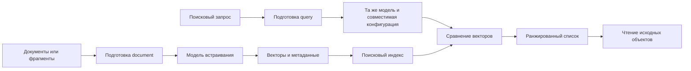
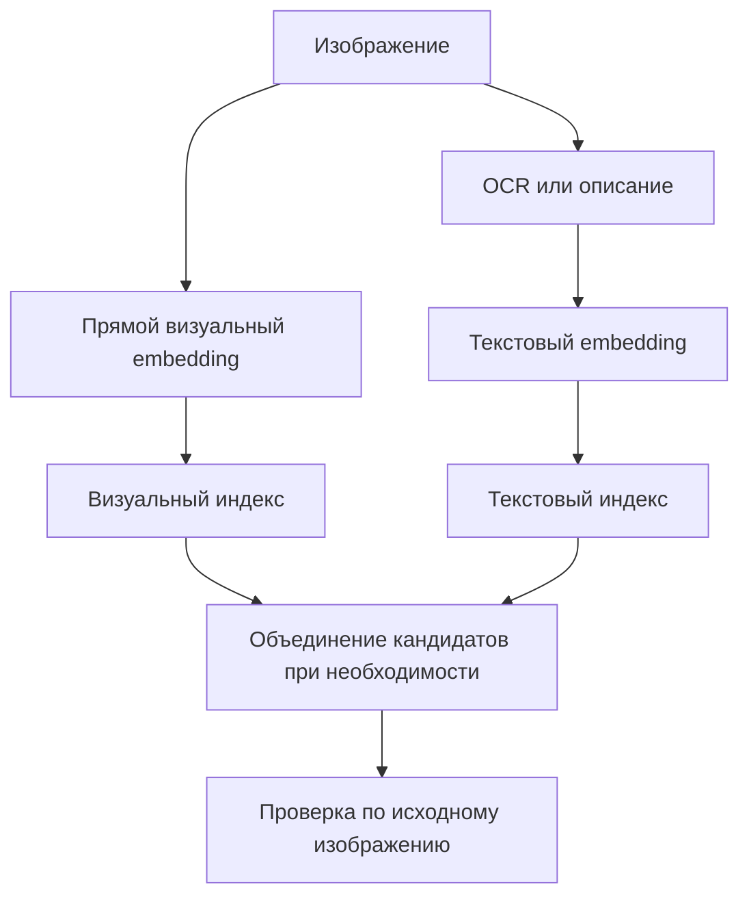
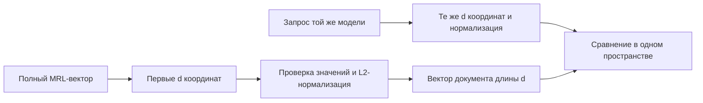
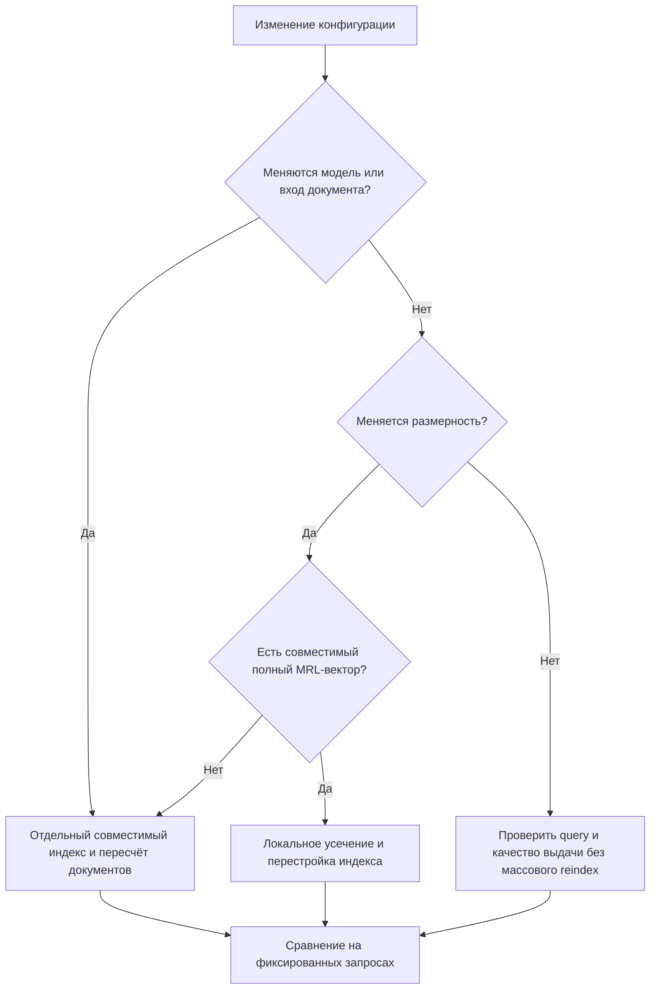

# Современные модели встраивания: текст, изображения, аудио и цена компактного вектора

*Исследовательский обзор по состоянию на 25 октября 2026 года.*

У модели встраивания нет эффектного диалога с пользователем. Она не пишет убедительный ответ, не рисует интерфейс и не демонстрирует длинное рассуждение. Её результат — несколько сотен или тысяч чисел. Но именно эти числа часто определяют, найдёт ли приложение нужное решение в архиве переписки, правильный фрагмент документа, похожую фотографию или запись с подходящим речевым содержанием.

В этой области особенно легко купить не то, что написано на упаковке. «Мультимодальная» модель может принимать изображения только на стороне документов. «Поддерживает русский» не означает, что опубликован отдельный русский бенчмарк. «Можно уменьшить размерность без потери смысла» не означает неизменную поисковую выдачу. Наконец, одинаковая длина двух векторов не делает их совместимыми.

Этот обзор рассматривает десять основных моделей и вариантов: OpenAI `text-embedding-3-small` и `text-embedding-3-large`; Qwen3-Embedding 0.6B и 8B; NVIDIA Nemotron 3 Embed и Nemotron 3.5 Embed в размерах 1B и 8B; облачную Gemini Embedding 2 и локальную EmbeddingGemma 2. Qwen3-VL упоминается отдельно как соседнее, но не тождественное текстовому Qwen3 семейство.

> [!abstract] Главная мысль
> Практическая единица сравнения — не только название модели. Это **модель + ревизия + способ подготовки входа + размерность + нормализация + сервер + конкретная поисковая задача**. Изменение любого из этих условий способно сделать красивый результат из таблицы неприменимым к реальной системе.

> [!info] Происхождение результатов
> Числа ниже взяты из официальных карточек, технических отчётов и опубликованных результатов MTEB. Собственные прогоны нейросетей в рамках подготовки статьи не выполнялись. Расчёты размеров хранилища и разниц между опубликованными баллами — арифметические; проектные рекомендации — инженерные выводы. Отсутствующие сопоставимые измерения обозначаются прямо, а не заменяются оценками «на глаз».

## Навигация 🧭

| Раздел | Главный вопрос |
|---|---|
| [Что именно сравнивается](#что-именно-сравнивается-) | Чем поиск отличается от общего «понимания смысла»? |
| [Карта моделей](#карта-исследованных-моделей-) | Какие модели работают локально и какие модальности поддерживают? |
| [Текстовые бенчмарки](#текстовые-бенчмарки-без-смешивания-разных-экзаменов-) | Что известно про английский, русский, европейские языки и китайский? |
| [Поиск по изображениям](#изображения-три-разные-задачи-вместо-одного-рейтинга-) | Где действительно измеряется поиск картинкой, без текста? |
| [Поиск по аудио](#аудио-речь-окружающие-звуки-и-разные-направления-поиска-) | Что доказано для двух Google-моделей? |
| [Префиксы и роли](#префиксы-и-роли-маленькая-настройка-с-большими-последствиями-) | Как готовить документ и поисковый запрос? |
| [Matryoshka](#matryoshka-как-уменьшать-вектор-и-не-обманывать-себя-) | Сколько места экономится и насколько падает качество? |
| [Интеграция и проверка](#надёжная-интеграция-без-избыточной-архитектуры-) | Как не испортить сильную модель неправильным клиентом? |

## Что именно сравнивается 🧠

### Вектор — представление, а не готовый ответ 🧠

Embedding, или встраивание, — числовое представление входного объекта. Поисковая система вычисляет представления документов заранее, а представление запроса — при обращении. Затем сравнивает их и возвращает наиболее близкие объекты. Такой двухсторонний подход позволяет отделить дорогую обработку корпуса от относительно дешёвого поиска по готовым векторам.[^openai-guide]

Однако модель не хранит документ внутри вектора как архиватор. Из небольшого массива чисел нельзя ожидать точного восстановления каждой фразы, номера версии или временной отметки. Вектор нужен для выбора подходящего объекта; сам текст, изображение или аудиофрагмент остаётся отдельным источником истины.

Из этого следует важное проектное различие. Система может хорошо находить общую тему и одновременно путать две почти одинаковые инструкции, отличающиеся одним отрицанием. Для справочной статьи это терпимо; для команды удаления базы данных — уже нет. Поэтому окончательное чтение найденного источника не заменяется его близостью к запросу.



### Поиск часто асимметричен 🌓

Вопрос «почему соединение с базой зависает?» и ответ «соединение удерживалось незавершённой транзакцией» не обязаны быть похожими по словам. Их нужно связать как запрос и полезный документ, а не как две взаимозаменяемые фразы.

Поэтому многие модели обучены на разных форматах двух сторон. У Qwen3 задача описывается в запросе, а документы идут без такой инструкции. У Google для текстового поиска используются отдельные шаблоны запроса и документа. У NVIDIA различие может задаваться строкой или параметром API.[^qwen8][^gemini-guide][^nim3]

Это не декоративный промпт. Формат определяет, в какой роли модель интерпретирует вход.

### Мультимодальность не отменяет направления поиска ↔️

«Модель понимает изображения» — слишком расплывчатое описание. Для системы важнее, какая пара входов поддерживается:

| Направление | Пример | Что требуется доказать |
|---|---|---|
| Текст → текст | Вопрос → фрагмент инструкции | Релевантность ответа, а не только сходство формулировок |
| Текст → изображение | «Красный велосипед у стены» → фотография | Соответствие описанию |
| Изображение → изображение | Фото товара → такой же или похожий товар | Визуальная или предметная близость |
| Текст → изображение документа | Вопрос → страница с таблицей | Поиск информации в структуре страницы |
| Аудио → текст | Произнесённый вопрос → документ | Сопоставление речи и текстового смысла |
| Текст → аудио | Описание → речевой или звуковой фрагмент | Соответствие содержанию записи |
| Аудио → аудио | Звуковой образец → похожий звук | Отдельная проверка акустического сходства |

Последние три задачи особенно легко смешать. Хорошая работа с речевыми запросами ещё не доказывает качество поиска музыки, шумов оборудования или похожих голосов.

## Карта исследованных моделей 🗺️

### Основные характеристики 📋

Контекст указан для модели или документированного API, а не как гарантия любого сервера. Для локальных моделей число параметров округлено; параметры и память runtime — разные величины.

| Модель | Развёртывание | Входные модальности | Полный вектор | Контекст |
|---|---|---|---:|---:|
| OpenAI text-embedding-3-small | Облачный API | Текст | 1536 | 8192 токена |
| OpenAI text-embedding-3-large | Облачный API | Текст | 3072 | 8192 токена |
| Qwen3-Embedding-0.6B | Локально или через провайдера | Текст | 1024 | 32K |
| Qwen3-Embedding-8B | Локально или через провайдера | Текст | 4096 | 32K |
| Nemotron 3 Embed 1B | Локально или через провайдера | Текст | 2048 | 32 768 |
| Nemotron 3 Embed 8B | Локально или через провайдера | Текст | 4096 | 32 768 |
| Nemotron 3.5 Embed 1B | Локально или через провайдера | Текст; изображения на стороне документов | 2048 | 32 768 |
| Nemotron 3.5 Embed 8B | Локально или через провайдера | Текст; изображения на стороне документов | 4096 | 32 768 |
| EmbeddingGemma 2 | Локально | Текст, изображения, аудио, видео | 768 | 8192 |
| Gemini Embedding 2 | Облачный API | Текст, изображения, аудио, видео, PDF | 3072 | 8192 |

Источники характеристик: документация OpenAI, карточки Qwen и NVIDIA, документация Google.[^openai-small][^openai-large][^openai-create][^qwen06][^qwen8][^nv3-1][^nv3-8][^nv35-1][^nv35-8][^gemma-card][^gemini-model]

### Размер модели и её роль ⚙️

**OpenAI small/large** — две текстовые API-модели без опубликованных весов. Их эксплуатационная привлекательность связана с простым интерфейсом и отсутствием необходимости обслуживать локальный runtime. Это не аргумент об универсальном превосходстве качества.[^openai-small][^openai-large]

**Qwen3 0.6B/8B** — открытые текстовые модели с существенно разной вычислительной ценой. Обе поддерживают инструкции и сокращаемые представления. Их не следует путать с Qwen3-VL-Embedding: наличие «Qwen3» в имени не добавляет текстовой модели изображений.[^qwen06][^qwen8][^qwenvl]

**Nemotron 3 Embed 1B** фактически содержит около 1,14 млрд параметров; модель получена последовательным уменьшением и дистилляцией. Семейство использует двунаправленное внимание и усреднение токеновых представлений. **Nemotron 3.5** добавляет визуальный компонент: полные варианты имеют примерно 1,55B и 8,38B параметров.[^nv3-1][^nv35-nvfp4][^nv35-8]

**EmbeddingGemma 2** устроена модульно: около 270M приходится на текстовую часть, 170M — на зрительный модуль, 300M — на аудио. Неиспользуемые модули можно не загружать. Это делает её интересной не только как «маленькую нейросеть», но и как основу нескольких режимов одного приложения.[^gemma-multimodal]

**Gemini Embedding 2** объединяет модальности в облачном сервисе. Размер её весов не раскрыт в использованных источниках, поэтому приписывать ей конкретное число параметров некорректно.[^gemini-model]

### Идентификатор модели не универсален 🏷️

Для открытых весов канонические имена выглядят следующим образом:

| Семейство | Идентификаторы исходных весов |
|---|---|
| Qwen3 | `Qwen/Qwen3-Embedding-0.6B`, `Qwen/Qwen3-Embedding-8B` |
| Nemotron 3 | `nvidia/Nemotron-3-Embed-1B-BF16`, `nvidia/Nemotron-3-Embed-8B-BF16` |
| Nemotron 3.5 | `nvidia/Nemotron-3.5-Embed-1B-BF16`, `nvidia/Nemotron-3.5-Embed-8B-BF16` |
| EmbeddingGemma 2 | `google/embeddinggemma-2` |

У хостинга или локального сервера могут быть другие обслуживаемые имена. Например, hosted NVIDIA API использует `nvidia/nemotron-3-embed-1b`. Это идентификатор маршрута, а не название файла весов.[^nim3]

У Google отдельно существуют `gemini-embedding-2` и `gemini-embedding-2-preview`. В примере OpenAI-совместимого API указан preview-ID, тогда как нативная документация показывает стабильный. Клиент не должен молча заменять их друг другом.[^gemini-model][^gemini-preview][^google-openai]

## Как читать бенчмарки и не получить ложного победителя 📏

### Метрика важнее красивого числа 📏

| Метрика | Что измеряется | Частая ошибочная интерпретация |
|---|---|---|
| nDCG@10 | Насколько хорошо упорядочены релевантные результаты в первой десятке | «Модель правильно отвечает в таком проценте случаев» |
| MRR@10 | Насколько рано появляется первый релевантный результат | «Найдены все подходящие документы» |
| Hit@K | Есть ли хотя бы один подходящий объект среди первых K | «Вернулась такая доля всех релевантных объектов» |
| Recall@K | Какая доля релевантных объектов найдена | «То же самое, что Hit@K, при любой разметке» |
| MTEB Mean(Task) | Среднее по набору задач | «Чистое качество семантического поиска» |
| Mean(TaskType) | Среднее с группировкой по типам задач | «То же среднее, только другое название» |

При единственном правильном объекте Hit@K и Recall@K могут совпадать. Если правильных объектов несколько, эти показатели отвечают на разные вопросы. В обзоре они не заменяются друг другом.

Ниже результаты приводятся к шкале 0–100, но это не превращает все метрики в проценты точных ответов. Например, nDCG учитывает позиции и степени релевантности, а не только наличие одного попадания.

### Не один экзамен, а несколько 🔬

Английский MTEB разных поколений, многоязычный MTEB, RTEB, MIRACL и MLDR нельзя безоговорочно объединять в общий турнир. Даже одинаковое имя задачи не гарантирует одинаковый корпус: полная коллекция и версия с отобранными сложными отрицательными примерами — разные эксперименты.

Имеет значение и **что именно усредняется**. Большой набор классификационных задач способен изменить общий MTEB, почти ничего не сообщив о поиске нужной страницы. Аналогично мультимодальный средний показатель может скрывать слабость на чистом поиске изображением.

В статье используются три уровня доказательств: сравнительные таблицы одного исследования; результаты разработчиков на именованных наборах; отдельные опубликованные прогоны. Это полезные, но не равнозначные источники. Отдельные JSON-файлы результатов не становятся независимым аудитом только потому, что размещены в общем репозитории.

> [!warning] Нет результата — не значит ноль
> Обозначение «н/д» означает, что в изученных источниках не найдено подходящего сопоставимого числа. Оно не означает плохую модель, отсутствие языка или невозможность выполнить задачу. «Не поддерживается» используется только для документированного ограничения входа.

## Текстовые бенчмарки без смешивания разных экзаменов 🔎

### Многоязычный поиск: покрытие всех основных моделей 🌐

Следующая таблица — **каталог опубликованных поисковых измерений, а не единый рейтинг**. Столбец происхождения принципиален: разные строки нельзя считать результатом одного одновременного прогона.

| Модель | Retrieval: опубликованный балл | Другой поисковый показатель | Происхождение |
|---|---:|---:|---|
| OpenAI text-embedding-3-small | н/д для сопоставимого среза MMTEB | MIRACL **44,0** | Публикация OpenAI, январь 2024 |
| OpenAI text-embedding-3-large | **59,27** | MIRACL **54,9** | Таблица Qwen; отдельно публикация OpenAI |
| Qwen3-Embedding-0.6B | **64,64** | — | MTEB Multilingual, Retrieval; таблица Qwen |
| Qwen3-Embedding-8B | **70,88** | — | Тот же сравнительный срез Qwen |
| Nemotron 3 Embed 1B | **71,0** | RTEB **72,4** | Оценка NVIDIA, июль 2026 |
| Nemotron 3 Embed 8B | **75,5** | RTEB **78,5** | Та же публикация NVIDIA |
| Nemotron 3.5 Embed 1B | Отдельное число здесь не приписывается | — | Заявлено сохранение текстового пространства соответствующей Nemotron 3 |
| Nemotron 3.5 Embed 8B | Отдельное число здесь не приписывается | — | Та же оговорка |
| EmbeddingGemma 2 | н/д для сопоставимой поисковой категории | Общий MTEB Multilingual v2: **61,36** | Общий балл не подменяет Retrieval |
| Gemini Embedding 2 | **70,0** | Общий MTEB Multilingual: **69,9** | Технический отчёт Google, таблица 2 |

Источники: OpenAI, Qwen, NVIDIA, Google.[^openai-launch][^qwen06][^nv3-blog][^gemini-paper][^gemma-card][^nv35-8]

В сравнительном срезе Qwen значения Qwen3 0.6B, Qwen3 8B и OpenAI large относятся к одной таблице. Результаты NVIDIA опубликованы позднее и полезны как отдельное свидетельство сильного поиска, но не дают автоматического доказательства преимущества на любом локальном архиве.

Для Nemotron 3.5 сохранённая текстовая часть — важная архитектурная гарантия производителя. Тем не менее перенос числа из публикации о Nemotron 3 в отдельную строку 3.5 без пометки создавал бы видимость дополнительного измерения. Поэтому таблица этого не делает.

### Английский и китайский: одинаковый срез двух Qwen 🔎

| Поисковая категория | Qwen3 0.6B | Qwen3 8B | Разница, баллы |
|---|---:|---:|---:|
| Английский MTEB English v2, Retrieval | 61,83 | **69,44** | +7,61 |
| Китайский C-MTEB, Retrieval | 71,03 | **78,21** | +7,18 |
| MTEB Multilingual, Retrieval | 64,64 | **70,88** | +6,24 |

Значения взяты из таблиц разработчика; разницы рассчитаны вычитанием.[^qwen06]

Уменьшение модели здесь имеет измеримую цену. Маленькая Qwen остаётся полезным кандидатом, но её привлекательность связана с ресурсами и задержкой, а не с доказанной эквивалентностью большой модели.

У OpenAI опубликованы английские MTEB **62,3** для small и **64,6** для large. Это исторические **общие** результаты, поэтому они не добавлены в английский столбец Retrieval выше.[^openai-launch]

### Русский и европейские языки: MIRACL и длинные документы 🌍

В исследовании MILCO есть одинаково организованные результаты для Qwen3 0.6B и 8B. Они позволяют обсуждать языки без подмены реальных измерений общим списком поддерживаемых локалей. Метрика в обеих частях — **nDCG@10 × 100**.[^milco]

| Язык | MIRACL 0.6B | MIRACL 8B | MLDR 0.6B | MLDR 8B |
|---|---:|---:|---:|---:|
| **Русский** | 59,7 | **73,5** | 61,2 | **69,6** |
| Английский | 51,5 | **59,8** | 75,5 | **86,1** |
| Немецкий | 52,9 | **60,5** | 45,0 | **54,5** |
| Испанский | 54,2 | **59,6** | 48,4 | **56,1** |
| Французский | 54,4 | **61,0** | 69,7 | **79,5** |
| Итальянский | н/д | н/д | 62,6 | **72,7** |
| Португальский | н/д | н/д | 73,2 | **79,6** |
| Китайский | 58,3 | **63,3** | 26,9 | **30,8** |

«Европейская группа» в этой статье — практический географический набор, а не утверждение об одной лингвистической семье. Отдельное искусственное среднее по выбранным языкам не рассчитывается: оно зависело бы от произвольно выбранного состава.

Разрыв на русском составляет 13,8 балла MIRACL и 8,4 балла MLDR. Это делает большую Qwen обоснованным исходным вариантом для русскоязычного поиска, когда её вычислительная цена приемлема. Но даже такое преимущество относится к указанному протоколу, а не к любой подборке исходного кода.

Низкие китайские MLDR не противоречат высоким китайским C-MTEB: длинный документ предъявляет иные требования, чем другой набор поисковых задач. Вывод «модель плохо знает китайский» из одного столбца был бы слишком сильным.

### Что пока нельзя заключить про остальные модели ⚖️

Для всех десяти вариантов не найден единственный согласованный набор русских, китайских и европейских результатов. NVIDIA сообщает оценку текстового поиска на 34 языках, включая русский и китайский, но список языков не раскрывает качество каждого из них.[^nv3-8]

У Google и NVIDIA есть сильные агрегированные показатели. Они объясняют, почему модели стоит тестировать, но не закрывают вопрос «какая лучше ищет русские обсуждения ошибок Python». Для такой задачи нужен небольшой собственный контрольный набор с известными подходящими фрагментами и сложными похожими отрицательными примерами.

## Изображения: три разные задачи вместо одного рейтинга 🖼️

### Где запрос действительно является изображением 🖼️

| Модель или семейство | Изображение → изображение | Текст → изображение/страница | Аудио |
|---|---|---|---|
| OpenAI text-embedding-3 | Не принимает изображения | Только через отдельное преобразование в текст | Не принимает |
| Qwen3-Embedding 0.6B/8B | Не принимает изображения | Только через отдельное преобразование в текст | Не принимает |
| Nemotron 3 Embed | Не принимает изображения | Только через отдельное преобразование в текст | Не принимает |
| Nemotron 3.5 Embed | Изображение-запрос не заявлено; официальный query — текст | Да, документ может быть изображением | Не заявлено |
| EmbeddingGemma 2 | Да | Да | Да |
| Gemini Embedding 2 | Да | Да | Да |
| Qwen3-VL-Embedding, соседнее семейство | Поддерживает визуальные входы; отдельный набор доказательств | Да | Не заявлено в карточке |

Граница Nemotron 3.5 подтверждается карточкой: запросы текстовые, документы — изображение, текст или их сочетание. Поддержка визуальных входов Qwen3-VL не распространяется на обычные текстовые Qwen3-Embedding.[^nv35-8][^gemma-multimodal][^gemini-model][^qwenvl]

### Gemini Embedding 2: поиск картинкой 🔍

В техническом отчёте Google приведено прямое сравнение на **GUIEC** и **ImageNet**. Метрика — **Recall@1 × 100**. У GUIEC в данном эксперименте индекс содержит 200 тысяч изображений.[^gemini-paper]

| Модель | GUIEC | ImageNet |
|---|---:|---:|
| **Gemini Embedding 2** | **79,4** | **83,6** |
| Amazon Nova MME | 68,6 | н/д |
| Voyage-3.5-multimodal | 69,4 | н/д |
| Google multimodalembedding@001 | 69,5 | 71,8 |

Последние три модели приведены как контрольные участники этого исследования, а не как дополнительные основные герои обзора. Результаты получены авторами отчёта; это не независимая проверка всех доступных сегодня API.

### EmbeddingGemma 2: разные виды визуальной близости 🧩

В опубликованных результатах MTEB имеются три задачи с явным направлением **I2I**. Ниже указаны именно поля `hit_rate_at_1` и `hit_rate_at_10`, а не произвольный `main_score`.[^cub][^rp2k][^nights]

| Тест | Hit@1 | Hit@10 |
|---|---:|---:|
| CUB200I2IRetrieval | **78,74** | **96,31** |
| RP2kI2IRetrieval | **73,74** | **89,40** |
| NIGHTSI2IRetrieval | **8,26** | **51,60** |

Разброс не позволяет называть модель одинаково сильной во всех задачах сходства. В одном приложении требуется найти тот же объект, в другом — похожую сцену, в третьем — почти дубликат с изменённым кадрированием. Эти определения близости могут конфликтовать.

> [!warning] Ограничение доверия к отдельным прогонам
> Файлы относятся к ревизии `914f7f89142e33e77833254d9c9b90c3cef7303b`, MTEB 2.26.10. Сопутствующий `model_meta.json` содержит устаревшие описательные поля: текстовую модальность, около 271M параметров и старое обозначение лицензии, хотя файлы включают мультимодальные задачи. Числа выше действительно опубликованы, но здесь они считаются **предварительным свидетельством конкретного прогона**, а не полностью воспроизведённым независимым тестом. Для строгого сравнения необходим аудит wrapper и параметров запуска.[^gemma-meta]

Эта оговорка не означает, что результаты обязательно неверны. Она означает, что причина слабого NIGHTSI2I не установлена: по одному файлу невозможно уверенно разделить ограничение модели, особенности задачи и особенности запуска.

### Nemotron 3.5: поиск информации в визуальных документах 📑

На **ViDoRe v3.1, nDCG@10**, NVIDIA публикует следующие значения:[^nv35-blog]

| Модель | ViDoRe v3.1 |
|---|---:|
| Nemotron 3.5 Embed 1B BF16 | **58,38** |
| Nemotron 3.5 Embed 8B BF16 | **61,17** |

Это другой экзамен: текстовый вопрос должен привести к подходящей странице, содержащей текст, таблицу или схему. Число 61,17 нельзя сравнивать с 79,4 GUIEC так, будто NVIDIA проиграла Google 18 баллов в одном поиске.

Для Gemini 2 в отчёте есть **ViDoRe V2 — 64,9**, но V2 и v3.1 тоже нельзя ставить в один числовой рейтинг.[^gemini-paper]

У EmbeddingGemma 2 опубликован **MMEB v2 VisDoc — 67,84, nDCG@5**. Это ещё один набор и другая глубина метрики. Корректный обзор сохраняет эти различия, даже если из-за этого таблица выглядит менее эффектно.[^gemma-card]

### Почему OCR и подписи не заменяют прямой визуальный поиск 🔀

Преобразование страницы в текст может потерять расположение столбцов, связь подписи и диаграммы, цветовые обозначения и пространственные отношения. С другой стороны, непосредственный embedding изображения не гарантирует точного сохранения мелкого номера договора.

Возможный инженерный компромисс — хранить два представления: визуальное для структуры и текстовое для буквальных обозначений. Они могут объединяться на этапе выбора кандидатов, но не обязаны жить в одном числовом пространстве. Главное — не сравнивать вектор текстовой модели напрямую с вектором другой визуальной модели только потому, что оба имеют 1024 координаты.



## Аудио: речь, окружающие звуки и разные направления поиска 🎧

### Что поддерживают основные участники 🎧

В рассматриваемой десятке нативное аудио документировано у **Gemini Embedding 2** и **EmbeddingGemma 2**. Остальные перечисленные текстовые и визуально-документные варианты не становятся аудиомоделями после передачи имени файла в строковом поле.[^gemini-model][^gemma-multimodal]

Это не запрещает строить поиск по аудио с текстовой моделью: сначала запись может пройти распознавание речи. Но тогда измеряется уже другая цепочка — качество распознавания плюс качество текстового поиска.

### Gemini: произнесённый вопрос → текстовый документ 🎙️

Google сравнила непосредственный embedding аудио с предварительным распознаванием речи. Задача — поиск текстового фрагмента по голосовому запросу, метрика — **MRR@10 × 100**.[^gemini-paper]

| Маршрут | Среднее | Внутри языка | Между языками |
|---|---:|---:|---:|
| Распознавание речи → embedding текста | 70,40 | 73,58 | 67,55 |
| **Нативное аудио → embedding** | **73,99** | **75,58** | **72,56** |
| Разница | **+3,59** | **+2,00** | **+5,01** |

Здесь нативный маршрут выигрывает. Из результата не следует, что распознавание речи всегда лишнее: расшифровка может понадобиться для цитирования, субтитров и проверки найденного материала. Но её наличие и её роль как единственного поискового представления — разные решения.

Также этот эксперимент ничего напрямую не сообщает о поиске похожей мелодии. Речь, музыка и бытовые звуки нельзя объединять словом «аудио» и считать одним измерением.

### EmbeddingGemma: текст → речевые и звуковые фрагменты 🔊

В опубликованных MTEB-результатах присутствуют следующие значения:[^gigaspeech][^clotho]

| Набор | Hit@1 | Hit@10 |
|---|---:|---:|
| GigaSpeechT2ARetrieval | **79,60** | **82,82** |
| ClothoT2ARetrieval | **3,56** | **16,71** |

Для этих файлов действуют оговорки о метаданных и невоспроизведённом запуске, приведённые выше. Нельзя использовать слабый Clotho как окончательный диагноз всей модели. Но нельзя и игнорировать его, объявляя модель проверенным универсальным поисковиком любых звуков.

В официальной сводке EmbeddingGemma 2 также указаны **MSEB Retrieval — 69,54** и **MAEB — 49,39**. У MAEB объединяются разные задачи; это не «процент правильного распознавания аудио».[^gemma-card]

### Что нельзя сравнить напрямую ⚖️

| Вопрос | Состояние данных |
|---|---|
| Gemini 2 против Gemma 2 на одинаковом полном аудиопротоколе | Единого подтверждённого head-to-head в использованных источниках нет |
| Число 73,99 Gemini против 69,54 Gemma | Недостаточно доказательств идентичности состава и агрегации MSEB |
| Русские аудиозапросы против русских документов | Отдельная сопоставимая таблица для обеих моделей не подтверждена |
| Аудиофрагмент → похожий аудиофрагмент | Общей сравнительной таблицы для двух моделей не найдено |
| Поиск музыки и окружающих звуков | Не следует выводить из успешного поиска речевого содержания |

Такой результат исследования менее удобен для рекламного рейтинга, но гораздо полезнее для проектирования: он показывает, какую неопределённость должен закрыть локальный эксперимент.

### Длительность сегмента — часть качества ⏱️

У Gemini 2 документирован предел аудио **180 секунд**. Для видео — **120 секунд и максимум 32 кадра**, причём звуковая дорожка видео не обрабатывается. Если нужна речь из видеозаписи, её необходимо отправлять отдельно.[^gemini-guide]

Однако предельная длина — не рекомендованный размер поисковой единицы. В трёх минутах лекции могут встретиться определение, пример и отступление. Один embedding объединит их, а поисковому запросу нужен конкретный момент.

Для проектирования архива полезнее мыслить записью вида `файл + начало + конец + содержание + embedding`. Тогда выдача приводит не только к нужному видео, но и к нужному участку. Конкретный размер сегмента выбирается по поисковым результатам; фиксированное число секунд без проверки не является универсальным рецептом.

Слишком короткие отрезки теряют контекст, слишком длинные смешивают темы. Перекрытие соседних сегментов может уменьшить потери на границах, но увеличивает число векторов и дубли в выдаче. Это самостоятельный компромисс, а не бесплатное улучшение.

## Префиксы и роли: маленькая настройка с большими последствиями 🧩

### Два входа, а не один универсальный текст 🌓

У задачи поиска есть две стороны: корпус, который индексируется заранее, и вопрос, который появляется позже. Обе стороны могут обрабатываться одной нейросетью, но не обязательно одинаковой строкой. Именно здесь возникает много незаметных ошибок: сервер возвращает числовой массив правильной длины, приложение сохраняет его и объявляет интеграцию законченной.

Для текстового поиска базовые правила рассматриваемых семейств выглядят так. Запись `{text}` обозначает полезное содержимое, а не буквальную часть запроса.

| Семейство | Подготовка поискового запроса | Подготовка документа |
|---|---|---|
| OpenAI embedding-3 small / large | `{text}` | `{text}` |
| Qwen3-Embedding 0.6B / 8B | `Instruct: {instruction}\nQuery:{text}` | `{text}` |
| Nemotron 3 Embed 1B / 8B, сырой текстовый маршрут | `query: {text}` | `passage: {text}` |
| Nemotron 3.5 Embed, официальный адаптер | Роль query через адаптер / API | Роль document или passage согласно конкретному API |
| Gemini Embedding 2, текстовый поиск | `task: search result \| query: {text}` | `title: {title} \| text: {text}` |
| EmbeddingGemma 2, текстовый поиск | Такой же поисковый формат Google | Такой же формат документа Google |

Точные схемы определяются документацией соответствующей модели и транспорта.[^openai-guide][^qwen8][^nv3-1][^nv3-8][^nv35-1][^gemini-guide][^gemma-card]

**Пустой префикс — полноценное правило**, а не отсутствие настройки. Для OpenAI и документов Qwen он должен сохраняться явно. Так система отличает «эта модель не требует инструкции» от «разработчик забыл выяснить формат».

### Qwen: инструкция задаёт задачу 🔎

Для Qwen3 инструкция относится к поисковому запросу. Документ не следует автоматически оборачивать тем же текстом. Например, приложение для поиска технических решений может выбрать такую собственную формулировку:

```text
Instruct: Retrieve technical passages that are relevant to the search query.
Query: Почему соединение с базой остаётся занятым после исключения?
```

Это пример прикладной инструкции, а не единственная разрешённая фраза производителя. Полезнее зафиксировать её в конфигурации и оценить на наборе запросов, чем генерировать новую длинную инструкцию при каждом поиске. Официальные примеры Qwen используют короткое описание задачи и выделенный маркер запроса.[^qwen8]

Наличие слова `Query` в шаблоне также не означает, что все пользовательские вопросы надо переводить на английский. Язык служебной инструкции и язык полезного запроса — разные вещи. Для русской системы важнее сохранить смысл исходного вопроса и проверить соответствующий языковой срез.

### Google: поиск, сходство и мультимодальный вход — разные режимы 🎛️

Для обычного поиска текстовый документ без отдельного заголовка имеет форму:

```text
title: none | text: Соединение необходимо возвращать в пул после завершения транзакции.
```

Запрос имеет другую форму:

```text
task: search result | query: Как освободить соединение после транзакции?
```

Если название документа действительно существует, оно подставляется вместо `none`. Для EmbeddingGemma 2 встроенный `prompt_name="Document"` использует вариант без заголовка; при самостоятельном форматировании заголовка повторное применение этого prompt приведёт к дублированию.[^gemma-card]

У Google есть и другие задачи — например, поиск кода и оценка сходства предложений. Однако общий режим «похожесть» не является безусловной заменой retrieval. Два близких по теме текста могут не отвечать друг другу как вопрос и ответ.[^gemini-guide]

При работе с изображениями, аудио и видео нельзя механически приклеивать текстовый префикс к двоичным данным или имени файла. Для EmbeddingGemma 2 текстовые task-префиксы предназначены именно для текста; мультимодальный процессор отдельно кодирует медиа. Для смешанного входа Gemini 2 Google также не рекомендует по умолчанию добавлять task-инструкцию к его текстовой части.[^gemma-multimodal][^gemini-guide]

### NVIDIA: одна роль — разные способы передачи 🔌

Для NVIDIA особенно важно различать модель и сервер. Сопоставление «Nemotron → два строковых префикса» недостаточно для всех способов развёртывания.

| Маршрут | Что передаёт клиент | Кто применяет формат модели |
|---|---|---|
| Сырой текстовый inference Nemotron 3 | `query: ` либо `passage: ` перед текстом | Клиент или один явно выбранный адаптер |
| NVIDIA hosted NIM `/v1/embeddings` | `input_type: "query"` либо `"passage"` | Сервер |
| Официальный пример vLLM `/v2/embed` | `input_type: "query"` либо `"document"` | Сервер по шаблонам checkpoint |
| Официальный Sentence Transformers-путь Nemotron 3.5 | `encode_query()` и `encode_document()` | Модельный адаптер и процессор |

Это не взаимозаменяемые JSON-схемы. В частности, `document` из примера `/v2/embed` нельзя без проверки отправлять в NIM, где документация требует `passage`.[^nim3][^nv35-1][^nim35]

Следовательно, универсальный адаптер должен знать не только название семейства, но и **контракт конкретного маршрута**. Если сервер уже выбирает нужный prompt по `input_type`, клиент не должен одновременно вручную добавлять второй префикс.

> [!warning] Правило одного владельца
> Форматирование выполняется ровно в одном месте: в клиенте, библиотечном адаптере или сервере. «Для надёжности добавлено и там, и там» — не усиление инструкции, а другая входная последовательность, на которой качество не проверялось.

### Почему пакетная обработка не определяет роль 📦

Метод с именем `embedBatch()` не обязательно означает документы: в пакете могут быть и поисковые запросы. Обратное тоже верно: одиночная строка может быть документом. Определять роль по числу входов или внутреннему вызову метода — хрупкая эвристика.

Практически проще передавать роль явно и форматировать данные один раз перед вызовом нейтрального транспорта. Это сохраняет batching, отмену запросов и повторные попытки, не превращая их в скрытые переключатели поискового поведения.

Для теста достаточно перехватить фактический HTTP JSON на локальном сервере-заглушке. Проверяется не наличие красивого поля в настройках, а то, какая строка или какой `input_type` действительно ушли в запрос.

## Matryoshka: как уменьшать вектор и не обманывать себя 🪆

### Что именно обучается 📐

Matryoshka Representation Learning, или MRL, — метод обучения вложенных представлений. Модель учится размещать полезную информацию так, чтобы начальные части длинного вектора оставались пригодными для задачи. Это не просто архитектура слоя и не универсальное свойство любых embeddings.[^mrl-paper]

При поддерживаемом сокращении сохраняются **первые** координаты. Не выбираются случайные позиции, не усредняются соседние числа и не применяется произвольное сжатие массива. После этого обычно выполняется L2-нормализация.

Пусть исходный вектор имеет длину D, а требуется d координат:

$$
u = v[0:d], \qquad \hat{u} = \frac{u}{\lVert u\rVert_2}.
$$

Если система действительно считает полную косинусную близость с делением на обе нормы, явная нормализация математически избыточна. Но многие индексы используют скалярное произведение уже нормированных векторов как эквивалент cosine. **Для такого маршрута обрезать нормированный вектор и оставить его без повторной нормализации — ошибка.**

Это различие важно: проблема не в мистическом повреждении вектора, а в несоответствии представления выбранной функции сравнения.



### Какие размеры поддержаны 📏

| Модель | Полный вектор | Подтверждённый механизм уменьшения |
|---|---:|---|
| OpenAI text-embedding-3-small | 1536 | API-параметр `dimensions`; допустимое сокращение документировано |
| OpenAI text-embedding-3-large | 3072 | Тот же механизм; есть пример с 256 измерениями |
| Qwen3-Embedding-0.6B | 1024 | MRL, настраиваемая размерность в пределах 32–1024 |
| Qwen3-Embedding-8B | 4096 | MRL, настраиваемая размерность в пределах 32–4096 |
| Nemotron 3 / 3.5 Embed 1B | 2048 | Усечение начальных координат; в примерах 1024 и 512 |
| Nemotron 3 / 3.5 Embed 8B | 4096 | Поддержано сокращаемое представление |
| EmbeddingGemma 2 | 768 | Опубликованы размеры **512, 256, 128** |
| Gemini Embedding 2 | 3072 | Диапазон 128–3072; рекомендуемые **768, 1536, 3072** |

Источники: документы и карточки соответствующих моделей.[^openai-guide][^qwen06][^qwen8][^nv3-1][^nv3-8][^nv35-1][^nv35-8][^gemma-card][^gemini-model]

Модельная возможность не гарантирует, что любой хостинг принимает параметр `dimensions`. Некоторые серверы возвращают полный вектор, после чего клиент сокращает его локально. Это допустимый вариант при подтверждённой поддержке MRL, но фактическую длину результата нужно проверять, а не выводить из отправленного JSON.

### Измеренная цена сокращения EmbeddingGemma 2 📉

Для этой модели опубликована наиболее полезная в рассматриваемом наборе таблица: одинаковый checkpoint, одинаковые группы задач, несколько размерностей. Приведены полные численные значения без столбца code, в котором разные опубликованные редакции карточки имеют небольшое расхождение.[^gemma-card][^gemma-hf]

| Измерения | Сокращение объёма векторов | MTEB multilingual, общий | MTEB English, общий | MIEB Lite, общий | MMEB v2, общий | MSEB Retrieval | MAEB, общий |
|---|---:|---:|---:|---:|---:|---:|---:|
| **768** | 1× | **61,36** | **68,46** | **64,64** | **59,01** | **69,54** | **49,39** |
| **512** | 1,5× | 61,17 | 68,41 | 64,32 | 58,38 | 69,18 | 49,21 |
| **256** | 3× | 60,41 | 67,78 | 63,13 | 56,24 | 66,76 | 48,91 |
| **128** | 6× | 57,89 | 65,68 | 59,06 | 45,65 | 56,71 | 46,92 |

Сами столбцы измеряют разные вещи. Но **изменение внутри столбца** позволяет оценить цену уменьшения размерности.

При 512 измерениях многоязычный общий показатель снижается на **0,19 балла**, а речевой retrieval — на **0,36**. Это осторожный кандидат для универсального компактного индекса.

При 256 измерениях экономия уже трёхкратная. Цена по многоязычному MTEB — **0,95 балла**, по MIEB — **1,51**, по MSEB Retrieval — **2,78**. Такой вариант выглядит разумной отправной точкой для проверки, но слово «без потерь» уже скрывало бы измеренное изменение.

При 128 измерениях картина заметно другая: MTEB multilingual теряет **3,47 балла**, MMEB — **13,36**, MSEB Retrieval — **12,83**. Это не одинаковая деградация всех задач. Именно поэтому хороший компактный текстовый индекс нельзя автоматически объявлять хорошим компактным аудиоиндексом.

> [!important] Экономия не равна универсальной гарантии
> «Три раза меньше при небольшом падении среднего» и «ни один нужный документ не исчезает из top10» — разные утверждения. Таблица подтверждает первое для конкретных наборов, но не второе для любого приложения.

### Что известно об остальных семействах 🔬

Для OpenAI опубликован показательный результат: сокращённый до **256 координат** `text-embedding-3-large` превосходит прежний `text-embedding-ada-002` с **1536 координатами** на MTEB. Это демонстрирует эффективность нового представления, но **не доказывает равенство сокращённого large его собственной полной версии**.[^openai-launch]

У Qwen и NVIDIA документирована возможность сокращения. Однако в использованных источниках не найден единый сопоставимый набор кривых «размерность × язык × модальность» для всех моделей. Приписывать каждой из них одинаковую потерю вроде «не больше одного процента» оснований нет.

У Google существует отдельная ловушка документации: таблица MTEB при размерностях 2048, 1536, 768 и ниже в общем руководстве подписана **Gemini Embedding 001**. Эти числа нельзя переносить на Gemini Embedding 2. Для второй модели подтверждены механизм и рекомендуемые размеры, но это не создаёт отсутствующую детальную кривую качества.[^gemini-guide]

### Безопасное локальное сокращение: пример 🧪

Следующая функция демонстрирует обработку уже полученного вектора. Она не определяет сама, поддерживает ли выбранная нейросеть MRL: это должно быть проверено в конфигурации модели заранее.

```python
from numbers import Integral

import numpy as np
from numpy.typing import ArrayLike, NDArray


def truncate_mrl(vector: ArrayLike, dimensions: int) -> NDArray[np.float32]:
    """Сохранить начало совместимого MRL-вектора и нормализовать его."""
    if isinstance(dimensions, bool) or not isinstance(dimensions, Integral):
        raise TypeError("dimensions must be an integer")

    values = np.asarray(vector, dtype=np.float32)
    if values.ndim != 1 or values.size == 0:
        raise ValueError("Expected a non-empty one-dimensional vector")
    if not np.isfinite(values).all():
        raise ValueError("Embedding contains NaN or infinity")
    if not 1 <= dimensions <= values.size:
        raise ValueError("Target dimension is outside the source vector")

    shortened = values[:dimensions].copy()
    # Float64 нужен здесь только для устойчивого расчёта нормы.
    norm = float(np.linalg.norm(shortened.astype(np.float64)))
    if norm == 0.0:
        raise ValueError("Cannot normalize a zero-length vector")

    return (shortened.astype(np.float64) / norm).astype(np.float32)
```

Если сервер уже вернул нормированный результат нужной размерности, дополнительных преобразований не требуется. Для Gemini 2 при запросе уменьшенной `output_dimensionality` нормализация выполняется сервисом.[^gemini-guide]

### Сохранить полный вектор или только компактный? 🗃️

У системы есть два разумных режима. В первом сохраняется только выбранное компактное представление. Это максимальная экономия, но восстановление удалённых координат потребует повторного вычисления embeddings.

Во втором полные векторы остаются в холодном хранилище, а поисковый индекс использует компактные. Такой подход экономит оперативную память и размер рабочего индекса, но не весь объём хранения. Его преимущество — возможность пересобрать 512-мерный индекс в 1024-мерный без повторного обращения к модели, если полный исходный вектор достаточно длинный и совместимый.

Оба варианта честнее универсального обещания «сейчас обрежем, а потом при необходимости вернём». Вернуть хвост можно только из сохранённого полного представления либо повторным запуском модели.

## Место в базе: сколько действительно экономится 💾

### Чистая арифметика Float32 🧮

Для N объектов, d координат и Float32 объём числовых данных равен `N × d × 4 байта`.

| Размерность | Один вектор | Миллион векторов, десятичные ГБ |
|---|---:|---:|
| 4096 | 16 КиБ | **16,384** |
| 3072 | 12 КиБ | **12,288** |
| 2048 | 8 КиБ | **8,192** |
| 1536 | 6 КиБ | **6,144** |
| 1024 | 4 КиБ | **4,096** |
| 768 | 3 КиБ | **3,072** |
| 512 | 2 КиБ | **2,048** |
| 256 | 1 КиБ | **1,024** |
| 128 | 0,5 КиБ | **0,512** |

Это расчёт только для массива чисел. Тексты, изображения, аудио, идентификаторы, метаданные, резервные копии и структура ANN-индекса добавляются отдельно.

Для десяти тысяч объектов при 1024 координатах числовая часть составляет **40,96 МБ**. На таком масштабе агрессивное уменьшение размерности может экономить меньше, чем кажется по фразе «в восемь раз компактнее». Для миллионов фрагментов та же оптимизация уже влияет на стоимость инфраструктуры.

### Размерность, тип чисел и веса модели — три разных ручки 🎚️

| Изменение | Что уменьшается | Что требуется проверить отдельно |
|---|---|---|
| MRL: 1024 → 256 координат | Длина каждого выходного вектора | Качество поиска при усечении |
| Float32 → Float16 или int8 для векторов | Число байтов на координату | Ошибка округления, схема масштабирования, поддержка индекса |
| Квантование весов нейросети | Память и иногда стоимость inference | Изменение самих получаемых embeddings |
| Более крупные фрагменты | Число объектов в индексе | Потеря точности поиска внутри длинного объекта |

Эти оптимизации можно сочетать, но нельзя считать их потери независимыми и автоматически безопасными. Проверка сокращения BF16-эмбеддера в 256d не доказывает качество того же поиска после дополнительного квантования весов и сохранения координат в int8.

Также JSON-массив чисел и бинарный массив Float32 — разные способы хранения. У текстового JSON есть представление знаков, десятичных дробей и разделителей; у Base64 поверх бинарных данных — собственная надбавка. Поэтому расчёт из таблицы нельзя напрямую приравнивать к размеру любого файла на диске.

### Короткий вектор не делает модель в четыре раза легче ⚡

В стандартной MRL-схеме сокращается готовое представление. Основной проход через модель всё равно выполняется. Поэтому переход с 4096 на 1024 координаты уменьшает объём базы и работу со сходством, но не означает четырёхкратного снижения VRAM или времени кодирования длинного документа.[^st-mrl]

Для ускорения первичной индексации отдельное значение имеют размер модели, длина фрагмента, batching, dtype и реализация attention. Именно их надо измерять при сравнении локального развёртывания с API.

## Локальный запуск и облако: одинаковый API не означает одинаковую систему ☁️

### Что даёт локальная модель 🖥️

Локальное развёртывание позволяет контролировать ревизию весов, отправляемые данные и режим обработки. Цена этого контроля — обслуживание runtime, памяти, зависимостей и воспроизводимости. Подмена одного GGUF другим файлом с похожим именем может изменить результат, даже когда HTTP-интерфейс остаётся прежним.

Важнее всего проверить, что сервер корректно реализует именно embedding-модель: нужное внимание, pooling, обработку padding и task-инструкций. Например, официальный код Qwen3 использует представление последнего токена, тогда как EmbeddingGemma 2 документирует mean pooling с проекцией. Применить ко всем моделям одно «усреднение hidden states» — не универсальная реализация, а другой эксперимент.[^qwen8][^gemma-card]

Для LM Studio предусмотрен список локальных embedding-моделей:

```sh
lms ls --embedding
```

А OpenAI-совместимый сервер предоставляет embeddings endpoint.[^lmstudio-ls][^lmstudio-embed]

Однако наличие весов в каталоге или успешная загрузка файла не доказывают поддержку всех его модальностей. Особенно это касается мультимодальных checkpoint: текстовый запрос к `/v1/embeddings` не подтверждает, что сервер действительно кодирует изображения или аудио через правильные энкодеры.

### Точность вычислений: особый случай Gemma ⚠️

Для EmbeddingGemma 2 разработчик рекомендует **BF16 или FP32** и прямо предупреждает о несовместимости FP16-вычислений с диапазоном активаций. Возможны `NaN` либо незаметно ухудшенные embeddings. Поэтому «модель загрузилась и вернула массив» — недостаточная проверка.[^gemma-inference]

Это предупреждение касается вычисления нейросети. Оно не означает, что любое сохранение уже полученного нормированного вектора в Float16 всегда невозможно. Снижение точности хранения — отдельная операция со своей проверкой качества.

Для небольшой мультимодальной модели также имеет значение выбор модулей. Текстовый режим EmbeddingGemma 2 не обязан загружать зрительный и аудиомодули. Такая экономия затрагивает сам inference, в отличие от простого удаления координат готового вектора.[^gemma-multimodal]

### У облака свои границы 🔐

Облачный API снимает часть эксплуатационной нагрузки, но добавляет зависимость от сетевой задержки, квот, маршрутизации и жизненного цикла модели. Одинаковый публичный ID за шлюзом не следует считать достаточным доказательством побитовой стабильности результата.

Для системы с закрытыми документами проверяется не только тариф. Важны условия обработки запросов, логирование, допустимость передачи исходных материалов и то, кто фактически исполняет модель. Бесплатный endpoint не означает автоматически пригодный маршрут для конфиденциального архива.

Embeddings тоже следует считать производными данными исходного корпуса, а не безусловно анонимным мусором из чисел. Практическая архитектура должна ограничивать доступ и к оригиналам, и к их поисковым представлениям.

### Транспорт проверяется отдельно от модели 🚦

| Интерфейс | Что требует отдельной проверки |
|---|---|
| OpenAI `/v1/embeddings` | Модель, размерность, количество выходов и порядок `index` |
| LM Studio / другой совместимый сервер | Фактический served-model ID, загрузка embedding-head, форматирование и модальности |
| NVIDIA NIM | Обязательная роль `input_type`, limits именно hosted endpoint |
| Google native API | Отдельные объекты `Content` против одного объединённого входа |
| Google OpenAI-compatible | Полный endpoint и допустимый ID модели для этого маршрута |
| OpenRouter / другой шлюз | Какие параметры реально поддерживаются выбранным провайдером и как передаются роли |

Контракты приведены в официальной документации сервисов.[^openai-create][^lmstudio-embed][^nim3][^gemini-guide][^google-openai][^openrouter-api]

Например, у Google OpenAI-совместимый адрес имеет вид `https://generativelanguage.googleapis.com/v1beta/openai/embeddings`. Универсальный клиент, безусловно дописывающий `/v1/embeddings` к любому `baseUrl`, может построить неправильный URL.[^google-openai]

Ещё один пример: локальная Nemotron 3 описывает окно 32 768 токенов, но использованная документация hosted endpoint 1B ограничивает текст 4096 токенами. Ограничение выбранного сервера необходимо учитывать независимо от возможностей весов.[^nv3-1][^nim3]

## Надёжная интеграция без избыточной архитектуры 🛠️

### Модель обязана иметь явное правило ✅

Для приложения с управляемым набором embedding-моделей полезен небольшой декларативный реестр. Следующий JSON — **предлагаемый формат прикладной конфигурации**, а не существующий универсальный стандарт SDK:

```json
{
  "models": {
    "text-embedding-3-small": {
      "queryPrefix": "",
      "documentPrefix": ""
    },
    "Qwen/Qwen3-Embedding-8B": {
      "queryPrefix": "Instruct: Retrieve technical passages relevant to the search query.\nQuery:",
      "documentPrefix": ""
    },
    "google/embeddinggemma-2": {
      "queryPrefix": "task: search result | query: ",
      "documentPrefix": "title: none | text: "
    }
  }
}
```

В таком приложении неизвестная модель без записи — ошибка конфигурации. Пустые строки допускаются только явно. Завершающий пробел и перенос строки являются частью формата и не должны автоматически удаляться «для чистоты».

Этот реестр рассчитан на сырой текстовый маршрут. Для сервера, который сам форматирует запрос по роли, запись выбирает режим `server-role`, а адаптер переводит логические query/document в конкретные API-значения. Важен не размер конфигурационного фреймворка, а невозможность случайно одновременно применить оба способа.

Ключ можно составить из `маршрут + точный model ID`, если одинаковая модель обслуживается несколькими несовместимыми транспортами. Эвристика «в имени встречается gemma, значит подходит такой prompt» хуже явного алиаса: родственные модели могут иметь разные инструкции и возможности.

### Минимальная проверка ответных векторов 🧯

Перед записью в индекс проверяются число результатов, их соответствие входам, одинаковая ожидаемая размерность и конечность всех координат. Пустые, нулевые или содержащие `NaN` векторы не должны молча становиться обычными документами.

У OpenAI-совместимых ответов важно учитывать возвращаемые индексы элементов, а не полагаться только на порядок JSON-массива. У мультимодального API отдельно проверяется, что несколько документов не были объединены в один embedding.[^openai-create][^gemini-guide]

Небольшой тест может намеренно вернуть от сервера переставленные записи, неправильную размерность и неполный пакет. Хорошая интеграция отклонит такой результат раньше, чем индекс наполнится правдоподобными, но несовместимыми числами.

### Сохраняется не только вектор, но и его происхождение 🪪

Достаточно компактного паспорта поискового пространства:

| Поле | Зачем нужно |
|---|---|
| Модель и доступная ревизия | Не смешивать результаты разных весов |
| Семейство preprocessing / его версия | Отследить изменение текста и медиаподготовки |
| Формат document и версия query-формата | Разделять изменения корпуса и поисковой стороны |
| Размерность и нормализация | Проверять совместимость функции сходства |
| Версия нарезки и границы фрагмента | Понимать, какой именно объект представлен |
| Идентификатор исходного объекта | Читать оригинал после поиска |

В паспорте не нужны API-ключи или полный приватный prompt. Несекретной версии правил или их контрольного отпечатка достаточно для обнаружения несовместимой конфигурации.

## Семантика, FTS и переранжирование: разные инструменты 🔀

### FTS5 не сломан на кириллице 🇷🇺

SQLite FTS5 умеет работать с Unicode. Но часто используемая комбинация `porter unicode61` не даёт русской морфологии: Porter ориентирован на английское словообразование. Поэтому отсутствие совпадения разных русских словоформ не означает отсутствия поддержки кириллицы.[^sqlite-fts]

Для естественно сформулированных русских запросов чистый векторный поиск может давать более предсказуемый результат, чем неудачно настроенная смесь с полнотекстовым. Но точные имена функций, коды ошибок и артикулы остаются задачами, где лексический сигнал потенциально полезен.

Отсюда следует не универсальный запрет гибрида, а инженерная последовательность: сначала измеряется качественный семантический baseline, затем проверяется, действительно ли текстовый канал что-либо улучшает.

### Fusion — не нейросетевая модель переранжирования 🧮

RRF, Reciprocal Rank Fusion, объединяет ранги из нескольких выдач. Упрощённая формула выглядит так:

$$
\operatorname{RRF}(d)=\sum_i \frac{1}{k+r_i(d)}.
$$

Она не читает заново документ и запрос как cross-encoder.[^rrf] Документ, который поднялся в RRF, не обязательно получил более высокую косинусную близость: изменилась схема объединения сигналов.

Поэтому выражение «отключено ранжирование» обычно неточно. При чистом семантическом поиске результаты всё равно сортируются по сходству. Отключаются дополнительное смешивание каналов и, если он был, отдельный reranker.

Прозрачный режим `semantic-only` не должен вызывать полнотекстовый поиск, дописывать его результаты или молча переходить на FTS при ошибке embedding API. Альтернативный режим можно сохранить, но его включение должно быть явным и проверяемым.

## Контекст, фрагменты и обновление индекса 🧱

### Большое окно не превращает одну запись в хороший поисковой объект 📚

Сессия на тысячи сообщений может включать несколько независимых проблем. Даже если весь текст помещается в контекст embedding-модели, один вектор должен представлять их одновременно. Если перед моделью приложение ещё и обрезает начало или конец, часть обсуждения вообще не участвует в представлении.

Поэтому качество системы определяется не только моделью. Важны единица индексации, правила отбора текста, обработка заголовков и сохранение локального контекста.

Для текста полезно сохранять связанные фрагменты с указанием исходного документа. Для кода — границы функций или логических участков. Для аудио — временные диапазоны. Для визуальных документов — страницы или понятные группы страниц. Это проектные варианты, а не утверждение, что один размер chunk оптимален во всех случаях.

При выдаче соседние фрагменты можно объединять, а повторы — удалять. Однако оценка должна различать попадание нужного фрагмента и попадание любого участка большого документа: вторая задача существенно легче.

### Какие изменения требуют пересчёта 🔄

| Что изменено | Новые embeddings документов | Перестройка поискового индекса |
|---|---|---|
| Query-префикс при неизменном document-маршруте | Обычно не нужны; нужна проверка качества | Обычно нет |
| Semantic-only вместо RRF | Не нужны | Обычно нет |
| Сокращение сохранённых совместимых MRL-векторов | Не нужен повторный inference | Да, если меняется размерность индексируемых данных |
| Рост размерности при наличии полных master-векторов | Можно получить локально | Да |
| Рост размерности после удаления полного хвоста | Нужен повторный inference | Да |
| Новый document-префикс или preprocessing | Да | Да |
| Другая модель, даже той же размерности | Да, если совместимость явно не доказана | Да |
| Другая нарезка документов | Для изменившихся фрагментов | Обновление соответствующих записей |

Это вывод из того, какие входы определяют вектор документа. Сам по себе перезапуск сервера не является причиной переиндексации, а совпадение числа координат не является доказательством совместимости моделей.

У Nemotron 3.5 есть специальное заявление производителя о сохранённом текстовом пространстве соответствующей Nemotron 3. Оно относится к конкретным парам и согласованному способу вычисления, а не к любым моделям с названием Nemotron.[^nv35-8]



## Как выбрать модель и размерность без гадания 🧪

### Сначала фиксируется настоящий вопрос исследования 🎯

«Какая модель лучше?» почти всегда слишком широко. Более полезный вопрос: «Какая конфигурация чаще находит нужный русский технический фрагмент среди первых пяти результатов при заданном бюджете задержки и памяти?»

Для визуального поиска отдельно определяется, что считать похожим: тот же объект, тот же класс, похожая композиция или почти точная копия. Для аудио — содержание речи, акустическое событие или музыкальное сходство. Без этого один и тот же результат может быть одновременно успехом и ошибкой.

### Небольшой, но честный эксперимент 📋

Практическая проверка начинается с фиксированного набора запросов и размеченных подходящих объектов. В него включаются разные формулировки, короткие вопросы, длинные описания, отрицания и близкие, но неправильные ответы. Для многоязычной системы отдельно размечаются поиск внутри языка и переход между языками.

Сначала сравниваются модели на полной размерности и точном поиске по векторам. Затем уменьшается размерность одной модели. После этого отдельно включаются квантование, ANN и гибрид. Такой порядок не позволяет приписать одной оптимизации ошибку, вызванную другой.

| Этап | Что меняется | Что остаётся постоянным |
|---|---|---|
| Базовая корректность | Проверяется формат и транспорт | Одинаковые исходные примеры |
| Выбор модели | Семейство / размер модели | Корпус, запросы, критерии релевантности |
| MRL | Размерность одной модели | Её веса, preprocessing, документы |
| Числовое хранение | Float32 / другой формат | Размерность и embeddings до преобразования |
| Приближённый индекс | Параметры ANN | Те же документы и исходные векторы |
| Гибрид / reranker | Алгоритм выдачи | Зафиксированные предыдущие решения |

Статистическая неопределённость тоже важна. Разница в одно попадание на двадцати вопросах не доказывает устойчивое превосходство. Для отчёта полезны парные сравнения на одних запросах и интервалы неопределённости, а не только средний балл с двумя знаками после запятой.

### «Без потери качества» лучше превратить в критерий 🧷

Вместо абсолютного обещания команда задаёт допустимый бюджет ухудшения. Например: средний nDCG@10 не должен снизиться более чем на заранее выбранную величину, критические вопросы не должны выпадать из top5, а задержка должна укладываться в установленный предел.

Конкретные числа являются требованиями приложения, а не свойством Matryoshka. Для справочного архива и аварийных инструкций допустимые ошибки могут существенно различаться.

Ещё один полезный показатель — устойчивость состава выдачи. Две размерности могут иметь почти одинаковый средний nDCG, но менять разные документы местами. Проверка проблемных примеров объясняет, насколько это изменение важно для пользователя системы.

### Не только точность, но и стоимость полного жизненного цикла ⏱️

Сравнение должно учитывать первичную индексацию, обновления, задержку запросов, память модели, размер индекса и стоимость последующей миграции. Дешёвый запрос не компенсирует архитектуру, которая без необходимости пересчитывает весь архив при каждом запуске.

Для локального inference измеряются реальные документы нужной длины, а не одна короткая английская фраза. Для мультимодальности учитываются загрузка, декодирование, изменение разрешения и подготовка аудио. Иначе сравнивается только удобная часть конвейера.

## Практическая карта выбора 🧭

Следующая таблица не объявляет универсального победителя. Она связывает найденные свидетельства с подходящими направлениями проверки.

| Задача | Обоснованные кандидаты | Основная неопределённость |
|---|---|---|
| Русский технический текст и длинные документы | Qwen3 8B; Nemotron 3 1B/8B как конкуренты | Нет общего полного русского head-to-head всех семейств |
| Компактный локальный текстовый поиск | Qwen3 0.6B, Nemotron 3 1B, текстовая часть EmbeddingGemma 2 | Баланс качества на конкретном корпусе и ресурсов |
| Простой облачный текстовый маршрут | OpenAI embedding-3, Gemini Embedding 2 | Цена, язык, ограничения сервиса и реальные запросы |
| Изображение → изображение в облаке | Gemini Embedding 2 | Качество на целевом виде визуального сходства |
| Изображение → изображение локально | EmbeddingGemma 2 | Неоднородные отдельные I2I-результаты требуют повторения |
| Текст → визуальные документы | Nemotron 3.5 1B/8B; Google-модели | Нельзя смешивать ViDoRe разных версий |
| Голосовой вопрос → текст | Gemini Embedding 2; EmbeddingGemma 2 как локальный кандидат | Нет сопоставимой русской таблицы обеих моделей |
| Текст → речевой фрагмент локально | EmbeddingGemma 2 | Нужно подтвердить результат на целевом языке и длинах |
| Поиск окружающих звуков и музыки | Отдельная оценка аудиомаршрута | Речевые бенчмарки не закрывают этот сценарий |

Для EmbeddingGemma 2 опубликованная кривая делает **512 измерений** осторожной отправной точкой, **256** — вариантом более выраженной экономии, а **128** — режимом, особенно нуждающимся в проверке мультимодальных задач. Для остальных семейств эти же численные предпочтения автоматически не переносятся.

Для небольшой коллекции разумно сначала удержать качество и измерить реальный объём данных. Для миллионного корпуса выбор размерности становится самостоятельным инфраструктурным решением. Но и там экономия хранилища не должна маскировать исчезновение нужных источников из выдачи.

## Итог: сильный embedding начинается не с рейтинга 🧠

Исследованные модели представляют разные компромиссы. OpenAI предлагает текстовый API без необходимости обслуживать веса. Qwen3 даёт хорошо документированный открытый текстовый маршрут и заметную разницу качества между 0.6B и 8B. Nemotron 3 имеет сильные опубликованные поисковые результаты; Nemotron 3.5 расширяет сценарий визуальными документами, не превращаясь автоматически в универсальный поиск картинкой. Две Google-модели предлагают наиболее широкий набор модальностей среди рассматриваемых участников, но их размер и способ развёртывания существенно различаются.

Главный инженерный вывод состоит в другом. **Название модели — только одна часть поискового контракта.** Неверная роль входа, двойной префикс, неподходящий pooling, неявная агрегация нескольких объектов и несовместимый старый индекс способны испортить результат задолго до того, как проявится разница между двумя лидерами бенчмарка.

Matryoshka делает компактный индекс реальной возможностью, а не маркетинговой абстракцией. Но она не отменяет цену сжатия: у одной и той же EmbeddingGemma 2 сокращение до 128 координат по-разному влияет на текст, изображения и речь. Поэтому корректная формулировка — не «обрезать без потерь», а **«выбрать минимальную размерность, сохраняющую согласованное качество на нужных задачах»**.

Хорошая система начинается с явного формата query/document, совместимого пространства и небольшого честного набора проверок. Только после этого таблица моделей становится инструментом выбора, а не украшением документации.


## Источники и границы воспроизводимости 📚

Ссылки ниже ведут к первичным документам разработчиков, исследовательским работам и файлам результатов. Проверка относится к состоянию материалов на **25 октября 2026 года**. Страницы документации и ветка `main` репозитория результатов могут изменяться; путь с ревизией модели не следует путать с фиксацией коммита всего репозитория.

Для отдельных результатов EmbeddingGemma 2 сохранён идентификатор ревизии `914f7f89142e33e77833254d9c9b90c3cef7303b`, имена задач и версия MTEB. Метаданные этого набора имеют описанные выше несоответствия, поэтому числа рассматриваются как опубликованные результаты конкретных запусков, а не как полностью независимо воспроизведённый рейтинг.

Все сравнительные выводы ограничены соответствующими задачами и протоколами. Неполнота общей языковой или модальной матрицы не восполнялась вымышленными результатами.

[^openai-guide]: **OpenAI — Vector embeddings.** [Источник](https://developers.openai.com/api/docs/guides/embeddings). Формат API, сокращение векторов и нормализация.

[^qwen8]: **Qwen — Qwen3-Embedding-8B.** [Источник](https://huggingface.co/Qwen/Qwen3-Embedding-8B). Формат инструкции, подготовка документов, pooling и возможности старшей модели.

[^gemini-guide]: **Google — Embeddings, Gemini API.** [Источник](https://ai.google.dev/gemini-api/docs/embeddings). Префиксы для текстовых задач, агрегация Content, API limits, нормализация и различия с Gemini Embedding 001.

[^nim3]: **NVIDIA NIM — Nemotron 3 Embed 1B API.** [Источник](https://docs.api.nvidia.com/nim/reference/nvidia-nemotron-3-embed-1b-infer). Hosted endpoint: input_type query/passage и ограничение входа данного сервиса.

[^openai-small]: **OpenAI — text-embedding-3-small.** [Источник](https://developers.openai.com/api/docs/models/text-embedding-3-small). Карточка облачной текстовой модели.

[^openai-large]: **OpenAI — text-embedding-3-large.** [Источник](https://developers.openai.com/api/docs/models/text-embedding-3-large). Карточка старшей текстовой модели.

[^openai-create]: **OpenAI — Create embeddings.** [Источник](https://developers.openai.com/api/reference/resources/embeddings/methods/create). Официальный контракт запроса и ответа.

[^qwen06]: **Qwen — Qwen3-Embedding-0.6B.** [Источник](https://huggingface.co/Qwen/Qwen3-Embedding-0.6B). Карточка модели, размерности и сравнительные таблицы по категориям MTEB.

[^nv3-1]: **NVIDIA — Nemotron-3-Embed-1B-BF16.** [Источник](https://huggingface.co/nvidia/Nemotron-3-Embed-1B-BF16). Архитектура, контекст, префиксы и сокращение выходного вектора.

[^nv3-8]: **NVIDIA — Nemotron-3-Embed-8B-BF16.** [Источник](https://huggingface.co/nvidia/Nemotron-3-Embed-8B-BF16). Характеристики и примеры использования 8B-модели.

[^nv35-1]: **NVIDIA — Nemotron-3.5-Embed-1B-BF16.** [Источник](https://huggingface.co/nvidia/Nemotron-3.5-Embed-1B-BF16). Поддержанные роли и модальности, официальные encode_query/encode_document и пример vLLM /v2/embed.

[^nv35-8]: **NVIDIA — Nemotron-3.5-Embed-8B-BF16.** [Источник](https://huggingface.co/nvidia/Nemotron-3.5-Embed-8B-BF16). Характеристики старшего варианта и заявление о сохранении текстового пространства Nemotron 3.

[^gemma-card]: **Google DeepMind — EmbeddingGemma 2 model card.** [Источник](https://ai.google.dev/gemma/docs/embeddinggemma/model_card_2). Официальные характеристики, task-префиксы, MRL-таблица и ограничения. Карточка указывает Apache 2.0.

[^gemini-model]: **Google — Gemini Embedding 2.** [Источник](https://ai.google.dev/gemini-api/docs/models/gemini-embedding-2). Стабильный идентификатор, модальности, контекст и размерности облачной модели.

[^qwenvl]: **Qwen — Qwen3-VL-Embedding-2B.** [Источник](https://huggingface.co/Qwen/Qwen3-VL-Embedding-2B). Отдельное визуально-языковое семейство; его свойства не приписываются текстовой Qwen3.

[^nv35-nvfp4]: **NVIDIA — Nemotron-3.5-Embed-1B-NVFP4.** [Источник](https://huggingface.co/nvidia/Nemotron-3.5-Embed-1B-NVFP4). Описание полного размера мультимодальной архитектуры; квантованный вариант не считается отдельным измерением качества BF16.

[^gemma-multimodal]: **Google — Multimodal Embeddings with EmbeddingGemma 2.** [Источник](https://ai.google.dev/gemma/docs/embeddinggemma/multimodal-embeddinggemma-with-sentence-transformers). Модульная загрузка и работа с изображениями, аудио и видео.

[^gemini-preview]: **Google — Gemini Embedding 2 Preview.** [Источник](https://ai.google.dev/gemini-api/docs/models/gemini-embedding-2-preview). Отдельный preview-идентификатор; не предполагается автоматическая взаимозаменяемость маршрутов.

[^google-openai]: **Google — OpenAI compatibility.** [Источник](https://ai.google.dev/gemini-api/docs/openai). OpenAI-совместимый endpoint и документированный идентификатор embedding-модели в примере.

[^openai-launch]: **OpenAI — New embedding models and API updates.** [Источник](https://openai.com/index/new-embedding-models-and-api-updates/). 25 января 2024 года. Исторические MIRACL/MTEB и пример сокращённого large против ada-002.

[^nv3-blog]: **NVIDIA — Nemotron 3 Embed wins RTEB.** [Источник](https://huggingface.co/blog/nvidia/nemotron-3-embed-wins-rteb). Публикация июля 2026 года: MMTEB Retrieval и RTEB. Это результаты производителя.

[^gemini-paper]: **Google — Gemini Embedding 2, технический отчёт.** [Источник](https://arxiv.org/html/2605.27295v1). Версия v1. Источник текстовой поисковой категории, I2I GUIEC/ImageNet и сравнения native audio с ASR.

[^milco]: **MILCO — исследование многоязычного поиска.** [Источник](https://arxiv.org/html/2510.00671v1). Версия v1. Таблицы MIRACL и MLDR по языкам для двух Qwen3-Embedding.

[^cub]: **MTEB results — EmbeddingGemma 2 / CUB200I2IRetrieval.** [Источник](https://github.com/embeddings-benchmark/results/blob/main/results/google__embeddinggemma-2/914f7f89142e33e77833254d9c9b90c3cef7303b/CUB200I2IRetrieval.json). Hit@1 0,78737; Hit@10 0,96307; MTEB 2.26.10.

[^rp2k]: **MTEB results — EmbeddingGemma 2 / RP2kI2IRetrieval.** [Источник](https://github.com/embeddings-benchmark/results/blob/main/results/google__embeddinggemma-2/914f7f89142e33e77833254d9c9b90c3cef7303b/RP2kI2IRetrieval.json). Hit@1 0,73744; Hit@10 0,89399; MTEB 2.26.10.

[^nights]: **MTEB results — EmbeddingGemma 2 / NIGHTSI2IRetrieval.** [Источник](https://github.com/embeddings-benchmark/results/blob/main/results/google__embeddinggemma-2/914f7f89142e33e77833254d9c9b90c3cef7303b/NIGHTSI2IRetrieval.json). Hit@1 0,08255; Hit@10 0,51604; MTEB 2.26.10.

[^gemma-meta]: **MTEB results — EmbeddingGemma 2 / model_meta.json.** [Источник](https://github.com/embeddings-benchmark/results/blob/main/results/google__embeddinggemma-2/914f7f89142e33e77833254d9c9b90c3cef7303b/model_meta.json). Метаданные с loader EmbeddingGemma2Wrapper; устаревшие поля modalities, параметров и лицензии требуют осторожности при трактовке прогонов.

[^nv35-blog]: **NVIDIA — Nemotron Retriever: world-class agentic retrieval.** [Источник](https://huggingface.co/blog/nvidia/nemotron-retriever-world-class-agentic-retrieval). Опубликованные результаты Nemotron 3.5 на ViDoRe v3.1.

[^gigaspeech]: **MTEB results — EmbeddingGemma 2 / GigaSpeechT2ARetrieval.** [Источник](https://github.com/embeddings-benchmark/results/blob/main/results/google__embeddinggemma-2/914f7f89142e33e77833254d9c9b90c3cef7303b/GigaSpeechT2ARetrieval.json). Hit@1 0,796; Hit@10 0,82815; MTEB 2.26.10.

[^clotho]: **MTEB results — EmbeddingGemma 2 / ClothoT2ARetrieval.** [Источник](https://github.com/embeddings-benchmark/results/blob/main/results/google__embeddinggemma-2/914f7f89142e33e77833254d9c9b90c3cef7303b/ClothoT2ARetrieval.json). Hit@1 0,03563; Hit@10 0,16705; MTEB 2.26.10.

[^nim35]: **NVIDIA NIM — Nemotron 3.5 Embed 1B.** [Источник](https://docs.api.nvidia.com/nim/reference/nvidia-nemotron-3_5-embed-1b). Текстовый query, визуальные документы и правила hosted-маршрута.

[^mrl-paper]: **Kusupati et al. — Matryoshka Representation Learning.** [Источник](https://arxiv.org/abs/2205.13147). Первичная исследовательская работа о вложенных представлениях.

[^gemma-hf]: **Google — EmbeddingGemma 2, фиксированная редакция README.** [Источник](https://huggingface.co/google/embeddinggemma-2/blob/914f7f89142e33e77833254d9c9b90c3cef7303b/README.md). Редакция карточки, связанная с рассматриваемой ревизией модели; для спорных различий общий code-столбец не используется.

[^st-mrl]: **Sentence Transformers — Matryoshka embeddings.** [Источник](https://sbert.net/examples/sentence_transformer/training/matryoshka/README.html). Документация обучения и применения сокращаемых представлений.

[^lmstudio-ls]: **LM Studio — lms ls.** [Источник](https://lmstudio.ai/docs/cli/local-models/ls). Официальный флаг --embedding для списка загруженных на диск моделей.

[^lmstudio-embed]: **LM Studio — OpenAI-compatible Embeddings.** [Источник](https://lmstudio.ai/docs/developer/openai-compat/embeddings). Текстовый embeddings endpoint; сам по себе не подтверждает мультимодальную совместимость любой модели.

[^gemma-inference]: **Google — Generating Embeddings with EmbeddingGemma 2 and Sentence Transformers.** [Источник](https://ai.google.dev/gemma/docs/embeddinggemma/inference-embeddinggemma-with-sentence-transformers). Вычисления BF16/FP32, предупреждение об FP16, task prompts и сокращение размерности.

[^openrouter-api]: **OpenRouter — Embeddings API.** [Источник](https://openrouter.ai/docs/api/api-reference/embeddings/submit-an-embedding-request). Контракт шлюза. Фактическая поддержка параметров выбранным провайдером требует отдельной проверки.

[^sqlite-fts]: **SQLite — FTS5 Extension.** [Источник](https://www.sqlite.org/fts5.html). Unicode-токенизация и английская область применения Porter stemmer.

[^rrf]: **Cormack, Clarke, Buettcher — Reciprocal rank fusion outperforms condorcet and individual rank learning methods.** [Источник](https://doi.org/10.1145/1571941.1572114). SIGIR 2009. Первичная работа о слиянии ранжированных списков.
